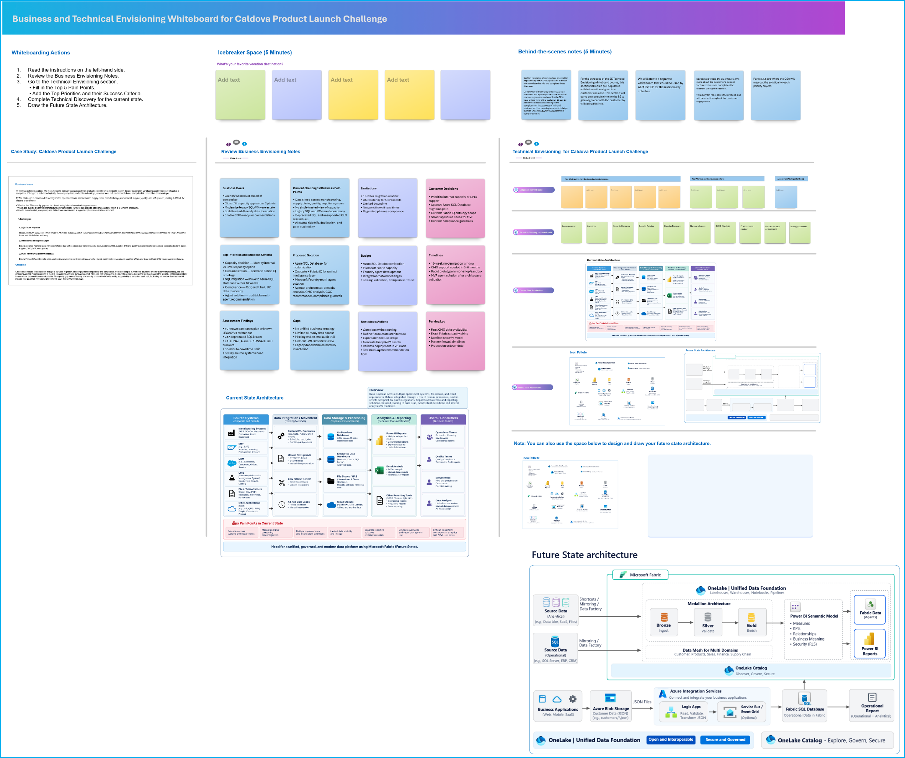

# 1. Envisioning Session Using Whiteboarding

### Whiteboarding

Whiteboarding helps technical teams to quickly align on business goals, current challenges, current-state and future-state architecture, and solution priorities. It turns abstract ideas into a shared visual plan and helps accelerate decisions for building a unified, governed data and AI estate.

Let's consider a common pharmaceutical manufacturing and distribution use case. **Caldova Pharmaceuticals** is expanding its product portfolio and entering new markets, each with its own pharmaceutical regulations. Customer, product, inventory, supply chain, sales, finance and operational data is spread across business applications, databases, files and cloud storage. Custom integrations, manual preparation, separate reporting datasets, duplicate copies and inconsistent definitions make it difficult to gain unified visibility, govern data, meet compliance requirements and analyze information across business domains.

You will start with **whiteboarding** to architect a future state of a **unified, open and governed data solution** which can:

- Connect operational and analytical data with minimal unnecessary data movement
- Unify data across customer, product, inventory, supply chain, sales, finance and operations
- Integrate application-generated and event-driven data into the data platform
- Establish centralized data discovery, governance, security and role-based access
- Create a trusted semantic foundation for consistent reporting and AI-driven insights
- Keep the architecture open and interoperable, so Caldova can evolve tools and processing engines and integrate third-party systems without creating new data silos
- Shorten the time from a business question to a trusted answer, for people and for AI, by running Fabric, OneLake, Azure Integration Services and Power BI as one platform

### How to copy the Whiteboard using an existing template URL

1. Open a new browser tab in the Edge browser.

1. Right click on the following Whiteboard template link -  ["Whiteboard Template"](https://sandboxailabs1002-my.sharepoint.com/:wb:/g/personal/amplify_user_sandboxailabs1002_onmicrosoft_com/IQA7_Vp5dZPvSYoIOfqsX2LGAZtnHUDp6xkGXX-vLwXer5Y?e=acU4JZ), then select **Copy link** and then paste it on the browser tab.

1. If prompted, sign in with your ODL user credentials.

1. Once you login, you will get a pop-up message to create the new Whiteboard. Read the message and click **Got it**.

   

1. Use the **Zoom out** option to view the Whiteboard template clearly.

   

1. Please follow along as the **Facilitator** guides you through the **Business** and **Technical** Envisioning session. During the session, you will identify key business challenges, define priorities, assess the current environment, and design a Future-state solution architecture.

### Activities

1. Review the **Business Envisioning Notes** to understand the organization's goals, challenges, and desired outcomes.

1. Go to the **Technical Envisioning** section and:
   - Capture the **Top 5 Pain Points**.
   - Define the **Top Priorities** and corresponding **Success Criteria**.

1. Where you can, attach a measure to each pain point and success criterion. For example: hours spent reconciling reports each month, days needed to bring a new market's data online, or the number of reports that define revenue differently.   

1. Complete the **Technical Discovery** by documenting:
   - Current-state architecture
   - Systems

1. Design the **Future State Architecture** to illustrate how the proposed solution addresses business needs and technical requirements.

1. Review the completed envisioning outputs and validate their alignment with the desired business outcomes.

### Next Step: Bringing the Unified Data and AI Solution to Life

Once the **Future State Architecture** has been defined during the Envisioning session, the next step is to turn the proposed solution into a working prototype. For Caldova Pharma, this involves bringing together analytical, operational, and business application data in Microsoft Fabric and making it available for reporting, business insights, and AI-driven interactions.

**Traditional Approach:**

1. Traditionally, after finalizing the architecture and identifying the required solution components, the next step would be to manually implement and configure the solution. This typically involves:
   - Creating the **Fabric workspace** and configuring the required capacity and access permissions.
   - Connecting to analytical data in **Azure Blob Storage** and operational data in Azure SQL Database.
   - Creating the Lakehouse, configuring **shortcuts** and **mirroring**, and making the required data available.
   - Integrating business application data into **Fabric SQL Database** using the required integration components.
   - Building the **semantic model**, establishing table relationships, and creating Power BI reports and a Data Agent.
   - Reviewing governance, security, and data assets through **OneLake Catalog**.

2. This traditional approach involves multiple configuration and integration activities across data sources, Microsoft Fabric, reporting, and AI capabilities. It can require considerable manual effort and technical expertise to ensure that all components are configured correctly and work together as intended.

3. In the next exercise, we will use a **rapid prototyping** approach to demonstrate how **GitHub Copilot** can help translate the Future State Architecture and implementation requirements into a unified data and AI solution. By providing structured prompts describing the desired outcomes and existing resources, you will work interactively with Copilot to build the prototype, review its progress, and validate the results. This allows you to spend less time manually configuring individual components and more time focusing on the solution's business value and capabilities. Caldova, a prototype means business and technical leaders can test the future-state design against real questions before they commit budget to a full implementation.

### Now, click on **`Next >>`** from the lower right corner to move on to **`Rapid Prototyping`**.
