# 2. Rapid Prototyping


Now that you have completed the envisioning **Whiteboard session** and identified key business opportunities, it is time to move from ideas to a working prototype.

By the end of this exercise, Caldova's operations, supply chain and customer data will sit in one governed platform. A business user will be able to ask a cross-functional question, such as which supplier has the best lead time and quality rating and get an answer in Microsoft 365 Copilot.

## Rapid Prototyping using ****GitHub Copilot****


You will use GitHub Copilot to build the Future State Architecture from the Whiteboarding exercise. You describe what you need in plain language, and Copilot creates and configures the Fabric and Azure components.

### Sign in to ****GitHub Copilot**** Chat

#### Step 1: Creation of Fabric Workspace

1. Click on the **Visual Studio Code** from the VM desktop.

   

1. Click on **Continue with GitHub** to sign in to ****GitHub Copilot****.

   

1. On the **Sign in to GitHub** tab, enter the provided **GitHub username** **(1)** in the input field, and click on **Sign in with your identity provider** to continue **(2)**.

    - **Username:** <inject key="GitHub User Name" enableCopy="true"/>

     

1. Click on **Continue** on the **Single sign-on to CloudLabs Organizations** page to proceed.

   

1. Click on **Accept**.

   

1. Select **Continue** to **Authorize Visual Studio Code**.

   

1. Select **Authorize Visual Studio Code**.

   

1. Select **Open**.

   

1. Once the Visual Studio code opens, choose any desired theme **(1)** and then click **Get Started (2)**.

   

   

   >**Note:** If you get any error pop up, please **Close.**

      

    - **Close** the pop up.  

     >**Note**: Please follow the steps sequentially as indicated by the numbered brackets (e.g., (1), (2), …) and execute them in the specified order.

1. Select **File (1)** and then **Open Folder (2)**.

   

1. Navigate to **`C:\`** path **(1)**, then select the **unifydata** folder **(2)** and then **Select folder (3)**.

   

1. From the ******GitHub Copilot**** Chat**, select **Models (1)** and then select **Trust Workspace (2)** to enable models.

   

1. Select **Trust Folder and Continue**.

   

1. Click **Auto (1)** and then **turn off (2)** the **Auto** toggle. 

   

1. Expand **Other Models**.

   

1. Set the model to **Claude Sonnet 5**.

   

    >**Note:** If you're unable to select the **Models**, please wait for `2-3 minutes` then check and make sure you're signed in properly.

1. Click on **Default permission (1)** and then set it to **Allow all (2)**.

   

1. Select **Enable**.

   


## Creation of Fabric Workspace using **GitHub Copilot**

The unified Caldova Pharma solution requires a **Microsoft Fabric workspace** to bring together analytical data, operational data, business application data, and AI capabilities. Before configuring these components, we need to establish the Fabric workspace and associate it with the existing Fabric capacity.

Traditionally, this would involve manually creating the workspace, selecting the appropriate capacity, and configuring the required access permissions. Instead, we will provide ****GitHub Copilot**** with the workspace requirements and details of the existing Azure resources.

#### What will this prompt do?

- Reuse the existing Azure Resource Group, storage account, and Fabric capacity.
- Create the Caldova-Pharma Fabric workspace and attach the existing capacity.
- Configure the requested Fabric workspace access for the specified user.

This allows us to establish the foundation for the unified data solution through a natural-language prompt rather than manually configuring each item.


> [!TIP]

> **Business value:** Caldova starts with the Azure resources it already has: the same storage account, database, and Fabric capacity. Nothing is replaced. Access is set when the workspace is created, so governance starts on day one rather than being added later.  

1. Select the **Future-State-Architecture.png** image.

   

1. From the ********GitHub Copilot****** Chat**, click on **+ (1)** and then select the **Future-State-Architecture.png (2)**.

   

1. Please copy the below prompt and paste it in the copilot chat window.

   ```
   You are my Agent supporting Caldova Pharma. I am planning to build a unified solution to improve business operations and decision-making.
 
   Please follow the instructions below to build Fabric Workspace:
   
   Instructions:
   
   Use existing Resource Group (rg-unified) and proceed further.
   
   Use existing storage account(storage<inject key="Deployment-ID" enableCopy="false"/>) and container inside this.
   
   Use existing Fabric Capacity (fabriccapacity<inject key="Deployment-ID" enableCopy="false"/>).
   
   Create a new Fabric Workspace (Caldova-Pharma) and attach capacity.
   
   Please provide Fabric admin access to the UPN <inject key="AzureAdUserEmail"></inject> to see the fabric workspace (Caldova-Pharma)

   ```

   - Then **Send (3)**.

    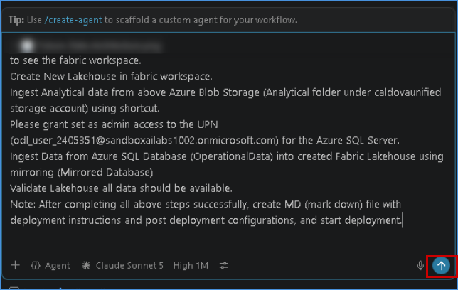
   
1. Once Copilot starts generating the response, monitor the process closely. Do not take any action; simply watch the progress.

1. If Copilot Asks to authenticate like below, please click on provided link and provide the code which was given by copilot 

   

1. Click on Yes, completed and then click on **Submit** button
    
    

1. After some time, Copilot may ask you a few questions. Review each question carefully and select the appropriate response. 

1. Monitor the process to understand how it generates the response and handles or resolves errors.  

1. If prompted for the SQL database password, please provide the existing password **<inject key="sqlAdminPassword" enableCopy="false"/>**.

   >**Note:** In between, if it asks you to **Continue to iterate**, please click **Continue**.
   
   >Wait for the deployment to complete.

1. Once the deployment is complete, you can verify the deployed resources by navigating to the resource group.

1. Navigate back to the Azure portal and Click on the **App launcher (1)** and select **Microsoft fabric** icon.

   

1. Navigate to **Workspaces**, there should be workspace created with the name similar to **Caldova-Pharma**. 

   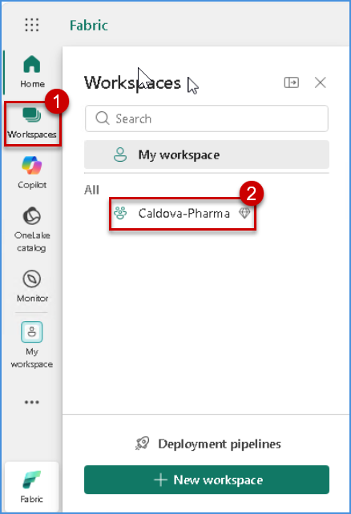

---

### Step 2: Loading Required Data into the Lakehouse

#### Bringing Analytical and Operational Data into OneLake

With the Fabric workspace created, the next step is to bring together Caldova's analytical and operational data so that it can be used for reporting, analysis, and AI-driven insights.

Traditionally, this would require manually creating a Lakehouse, configuring connections to the relevant data sources, setting up shortcuts or mirroring, and validating that the data is accessible. We will instead use ****GitHub Copilot**** to help configure these components based on the required data sources and ingestion approach.

### What will this prompt do?

- Create the Caldova-Lakehouse in the existing Fabric workspace.
- Access analytical CSV files in Azure Blob Storage and use shortcuts to make them available in the Lakehouse.
- Connect to the existing Azure SQL Database containing operational data.
- Configure the mirrored database and the required shortcuts to make operational data available.
- Validate that the required tables are accessible in the Lakehouse.

This approach demonstrates how different data sources can be brought together in OneLake while reducing the manual effort required to configure individual data integration components.


> [!TIP]
> **Business value:** Analytical files stay in Blob Storage, and operational data stays in Azure SQL Database where the business applications still use it. Shortcuts and mirroring make both available in OneLake without building pipelines or keeping extra copies. When Caldova enters a new market or acquires a company, its data can be connected the same way. The data is stored in the open Delta Parquet format, so Caldova can use other engines and tools later without migrating it.

**Verify Analytical Source Data in Azure Blob Storage**

Before loading analytical data into Microsoft Fabric, verify that the source CSV files are available in **Azure Blob Storage**.

1. Navigate to the [Azure portal](https://portal.azure.com/)

1. Search and select the **Storage account**.

1. Navigate to the existing storage account storage named **storage<inject key="Deployment-ID" enableCopy="false"/>**.

   

1. Under Data storage, select **Containers (1)** amd then select **Data (2)** container.

   

1. Select the **Analytical folder**.

    

1. Review the available CSV files.   

   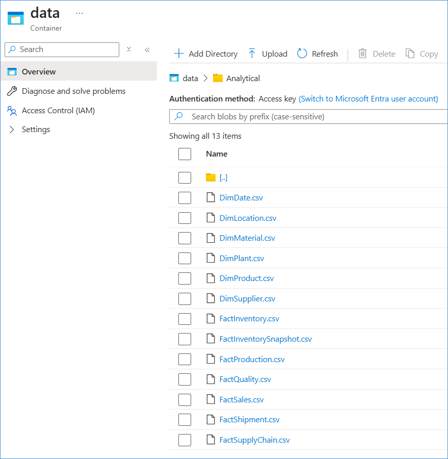 

1. Navigate back to ****GitHub Copilot**** 

1. Copy the below prompt and paste it in the chat window 

   ``` 
   Great. You have created Fabric Workspace (Caldova-Pharma). Now follow below instructions to create Lakehouse and delta table for Analytical data.
 
   Instructions:  
   
   Use above Resource Group, Azure Blob storage account, Fabric capacity, and Fabric Workspace.
   
   Create New Lakehouse (Caldova-Lakehouse) in the above Fabric workspace.  
   
   After Lakehouse is created, ingest data from Azure Blob and follow the steps below.
   
   Connect storage account(storage<inject key="Deployment-ID" enableCopy="false"/>) and Container (data)  
   
          a. Extract/Read analytical data from the Analytical folder exist under above container. 

          b. Load data (csv files) into the above created (Caldova-Lakehouse) using Shortcut technique.
   
   After completing above steps, please validate Lakehouse and all delta tables are created successfully.
   ```

1. Monitor the process to understand how it generates the response and handles or resolves errors.  

   >**Note:** In between, if it asks you to **Continue to iterate**, please click **Continue**.
   
   >Wait for the deployment to complete.

1. Here We are creating **external shortcuts** in the **Caldova-Lakehouse** to access these files directly from **Azure Blob Storage**. This makes the source data accessible through OneLake without manually copying the files into the Lakehouse.

1. Once the deployment is complete, you can verify the created Lakehouse in fabric workspace.

1. Navigate to the **Microsoft Fabric** portal and Open the **Caldova-Lakehouse** lakehouse from the workspace.

1. In the **Explorer** pane, expand **Tables**.

1. Verify that the required tables are available in the lakehouse.

1. Select the **DimDate** table to open and review the table data. 

   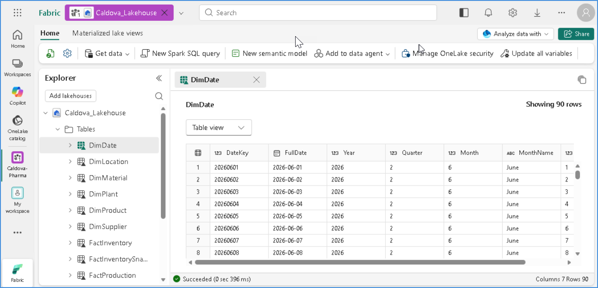 


**Verify Operational Source Data in Azure SQL Database**

Before integrating operational data into Microsoft Fabric, verify that the source database is available in **Azure SQL Database**.

1. Navigate to the [Azure portal](https://portal.azure.com/)

1. Navigate to the existing SQL server.

1. Open the OperationalData database.

1. Select Query editor and review the available tables.

   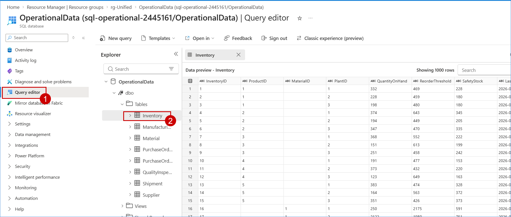

1. Navigate back to ****GitHub Copilot**** 

1. Copy the below prompt and paste it in the chat window 

   ```
   Great. Now you have created Fabric Lakehouse in the Workspace (Caldova-Pharma) and ingested data from Azure Blob storage. Now follow the instructions below to ingest operational data from Azure SQL Database.
 
   Instructions:  
   
   Use the above Resource Group, Azure Blob storage account, Fabric capacity, Fabric Workspace, and Lakehouse (Caldova-Lakehouse).  
   
   Connect to Azure SQL Server (sql-operational-<inject key="Deployment-ID" enableCopy="false"/>.database.windows.net)    and its Database (OperationalData)  
   
   Use UPN: <inject key="AzureAdUserEmail"></inject> to connect  above SQL Server and Database to read/ingest Operational data into    Lakehouse  
   
   Create Fabric Mirrored Database and connect to Azure SQL Server for  Operational Data.
   
   Ingest data and create delta tables in the above created Lakehouse using   shortcut pointing to Mirrored database.
   
   After completing the above steps, please validate Lakehouse. All delta  tables are created successfully and data moved from Azure SQL Database.  

   ```

**Operational data** resides in the existing **Azure SQL Database**, Instead of creating external shortcuts directly to the SQL tables, we first configure **Mirroring** to replicate the supported source data into a **mirrored database** in Microsoft Fabric.

We then create **shortcuts** from the **mirrored database** to the **Caldova-Lakehouse**, making the operational tables accessible alongside the analytical data

1. Once the deployment is complete, you can verify the Created tables in the same Lakehouse.

   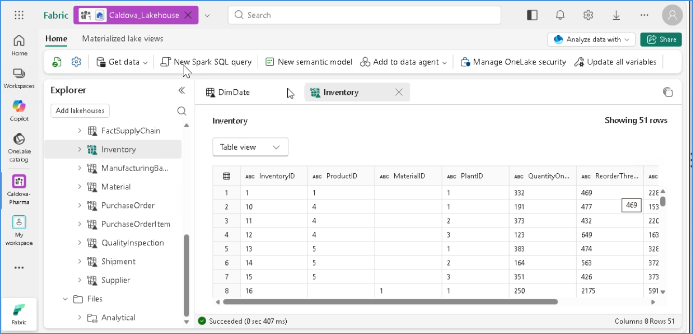

---
### Step 3: Loading Business Application Data into Fabric SQL Database:

#### Integrating Business Application Data

In addition to analytical and operational data, Caldova's solution requires business application data to be available for downstream reporting, analytics, and AI workloads. This data is stored separately in Azure Blob Storage and needs to be loaded into Fabric SQL Database.

Traditionally, this would involve manually configuring the integration components, creating the required connections, and developing a workflow to transfer data between the source and target systems.

With ****GitHub Copilot****, we can describe the required integration flow and allow it to help create the necessary resources and configuration.

### What will this prompt do?

- Create a Fabric SQL Database in the existing Fabric workspace.
- Configure the required Azure integration components.
- Create an Azure Logic App to read business application data from the designated storage location and load it into Fabric SQL Database.
- Make the business application tables available for downstream use.
- Enable validation of the created database and integration resources.

The objective is to demonstrate how a business requirement can be translated into an integration workflow with the help of ****GitHub Copilot****, instead of manually building each component separately.


> [!TIP]
> **Business value:** Customer data written by business applications now lands in the same estate as operational and analytical data, through a managed Logic Apps workflow instead of custom integration code. The same pattern can be reused for the next application, and Service Bus or Event Grid can be added when Caldova needs event-driven updates.

**Verify Business Application Source Data in Azure Blob Storage**

Next, verify that the business application files are available in Azure Blob Storage. These files will be used by the Logic App to load data into the Fabric SQL Database.

1. Navigate to the [Azure portal](https://portal.azure.com/)

1. Navigate to the existing storage account storage<Deployment-ID>.

1. Under Data storage, select Containers and Open the **data** container.

1. Open the **BusineesApplication** folder and review the available source files.

   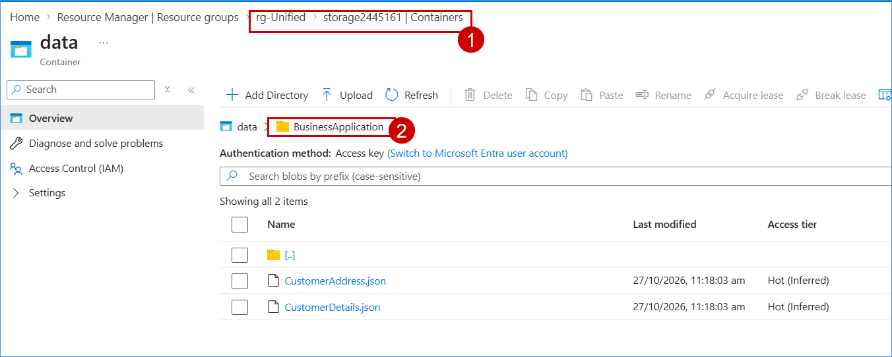

1. Navigate back to ****GitHub Copilot**** 

1. Copy the below prompt and paste it in the chat window 

   ```
   Great, you have brought all data. Please follow below instructions to bring Business application data to Fabric SQL Database.
 
   Instructions:
   
   1. Use existing Resource Group: rg-unified.
   
   2. Create a new Fabric SQL Database in the existing Fabric Workspace    (Caldova-Pharma).
   
   3. Create a new Azure Integration Service in the above resource group.
   
   4. Create an Azure Logic App to read Application data from:    storage<inject key="Deployment-ID" enableCopy="false"/>→ Application folder under data container and load it into  the Fabric SQL Database.

   ```

1. When the terminal prompts you to install the required extension, review the message displayed.

1. If you see the following prompt:
   
   > **Note:** The command requires the extension logic. Do you want to install it now? The command will continue to run after the extension is installed. (Y/n):
 
1. Enter `Y` and press Enter to allow the required Azure CLI extension to be installed.

   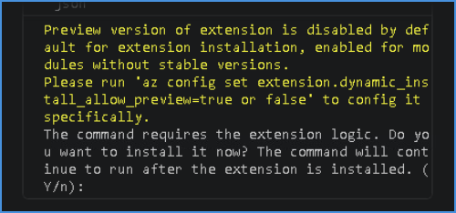

1. Once the deployment is complete, you can verify the Created tables in Fabric SQL Database

1. Open the **Caldova_BusinessApp_SQLDB** from the **Caldova-Pharma** workspace.

1. In the **Explorer** pane, expand **dbo** and then expand **Tables**.

1. Verify that the business application tables have been loaded successfully. For example:
   - **CustomerAddress**
   - **CustomerDetails**

   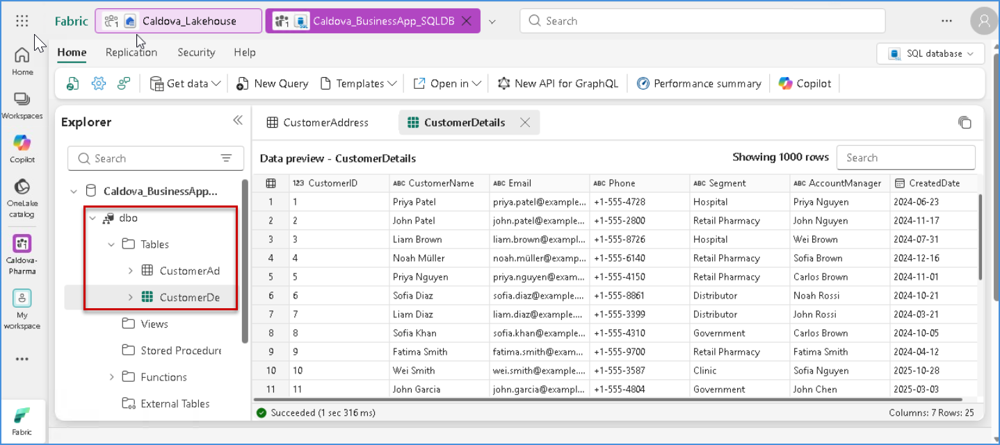

1. Next, navigate to the **Azure Portal** and open the **rg-Unified** resource group.

1. Under **Resources**, verify that the integration components created for the data-loading process are available:
   - **caldova-blob-connection** – API connection used to connect to the Azure Storage account.
   - **caldova-businessapp-ingest** – Logic App responsible for orchestrating the data ingestion.
   - **caldova-fabricsql-connection** – API connection used to connect to the Fabric SQL Database.
   - **caldova-integration-account** – Integration Account used as part of the integration workflow.

   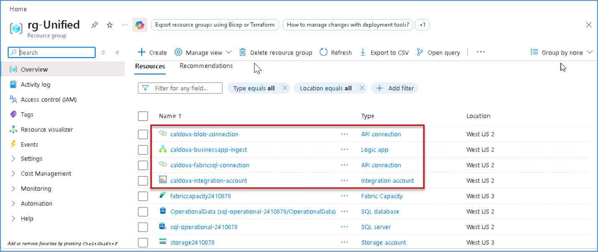
---

### Step 4: Building **Semantic Model** using Fabric Lakehouse and SQL Database to generate PowerBI report

#### Turning Unified Data into Business Insights

Once the **analytical, operational, and business application** data are available, the next step is to make the data meaningful and accessible to business users.

**Traditionally**, this would involve manually building a **Semantic Model**, defining relationships between tables, developing a Power BI report, and configuring a Data Agent to answer business questions.

In this exercise, we will use ****GitHub Copilot**** to accelerate the creation of these components and demonstrate how the unified data can be used for both visual analytics and natural-language interactions.

#### What will this prompt do?
- Create a Direct Lake **Semantic Model** using the available Lakehouse and Fabric SQL Database tables.
- Establish relationships between related tables.
- Create a Data Agent using the **Semantic Model** and provide instructions based on the available data.
- Help generate a Power BI operations report with relevant KPIs and visualizations.

After the components are created, you will review the **Semantic Model** relationships, inspect the generated report, and test the Data Agent with a business question.

This demonstrates how ****GitHub Copilot**** can help move from data integration to a usable analytics and AI experience.


> [!TIP]
> **Business value:** The semantic model holds one set of business definitions, such as what counts as revenue, an order or stock on hand. The Power BI report and the Data Agent both use it, so a dashboard and an AI answer return the same number. Direct Lake mode reads the data in OneLake directly, so reports don't depend on a separate imported copy.

1. Navigate back to ****GitHub Copilot**** 

1. Copy the below prompt and paste it in the chat window 

   ```
   Great, You have loaded all data, please follow below instructions to create **Semantic Model** and Data agent in fabric workspace
 
   1. Create ONE **Semantic Model** using Direct Lake mode.  
   
   Add ALL tables from the existing Fabric Lakehouse and Fabric SQL Database.
   
   Create and validate proper relationships between related tables.
   
   Ensure all tables and relationships are visible, connected, and usable in  the **Semantic Model**.
   
   2. Create one Data Agent using the **Semantic Model** and add concise instructions based on the available tables.

   ```
1. Navigate to Fabric Portal

1. Open the created ****Semantic Model**** and review the configured table relationships to ensure the data model is correctly connected.

   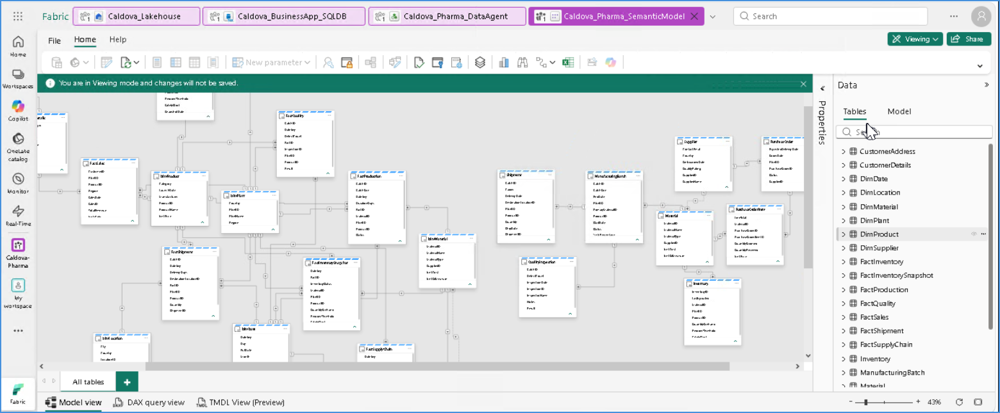

1. Locate the created ****Semantic Model**** and Select the **More options (...)** menu for the **Semantic Model** and Select **Create report**.

   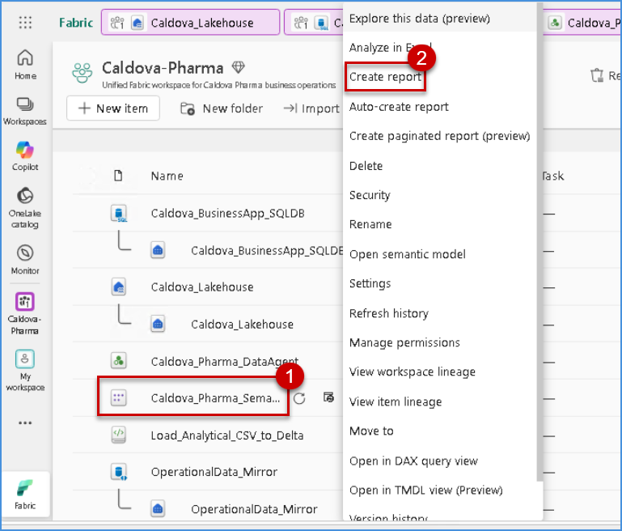

1. Click on **Copilot** icon on top and paste the below prompt and click send button to create Report 

   ```
   Create a Caldova Pharma Operations Report using only the attached **Semantic Model**. Build a clean single-page dashboard with 5 KPI cards at the top (Orders, Revenue/Sales, Products, Customers, Inventory/Stock), followed by 3–4 visuals including a donut chart, bar chart, line chart, and trend chart. Use relevant fields and measures from the model without inventing data, and apply a professional, consistent blue theme with clear titles, proper formatting, and an executive-friendly layout.

   ```

   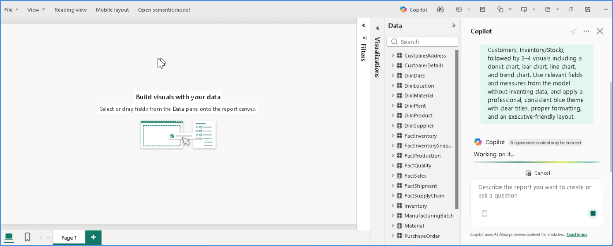

1. Once Copilot finishes creating the report, review the generated report.

   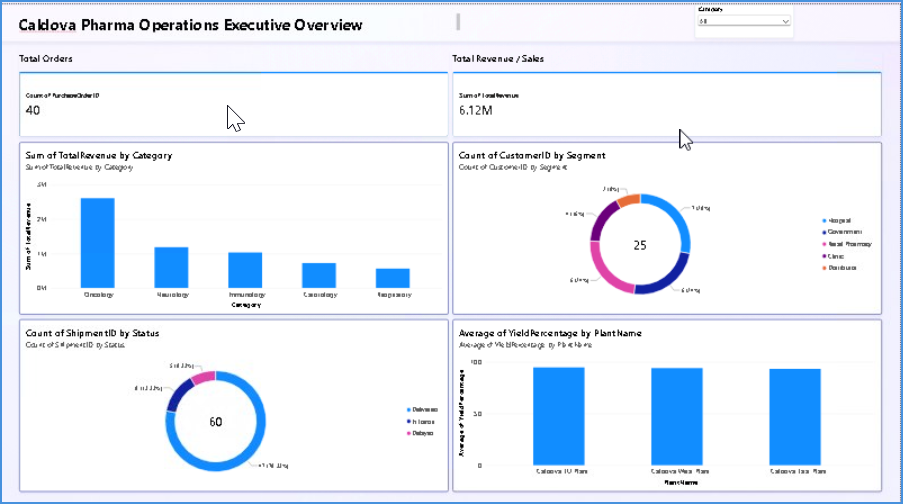

### Building Data Agent using Semantic Model.

1. Navigate to the created **Data Agent**.

1. Open the **Data** section and verify that the tables are selected and available to the Data Agent.

   - If the tables are not selected, select the tables.

   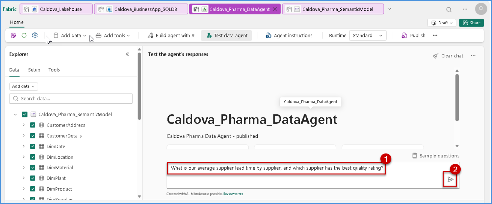

1. Open the **Test Agent** option.

1. Copy the following prompt and paste it into the test chat: 

   ```
   What is our average supplier lead time by supplier, and which supplier has the best quality rating?

   ```

1. Review the response provided by the **Data Agent**

   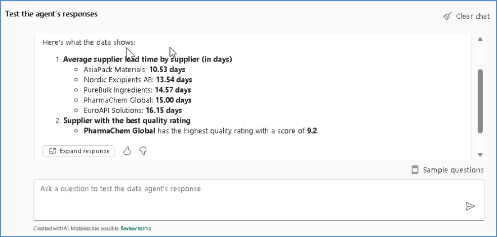


   > [!TIP]
   > **What this shows:** The question combines supplier performance and quality data. Before, answering it meant pulling extracts from separate systems and reconciling them by hand. Here, anyone with access can ask it in plain language and get an answer based on the governed model.

1. In the Data Agent editor, click **Publish** to publish the latest changes.

   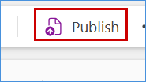

1. In the **Publish changes** window, enable **Also publish to Microsoft 365 Copilot** and click on **Publish**.

   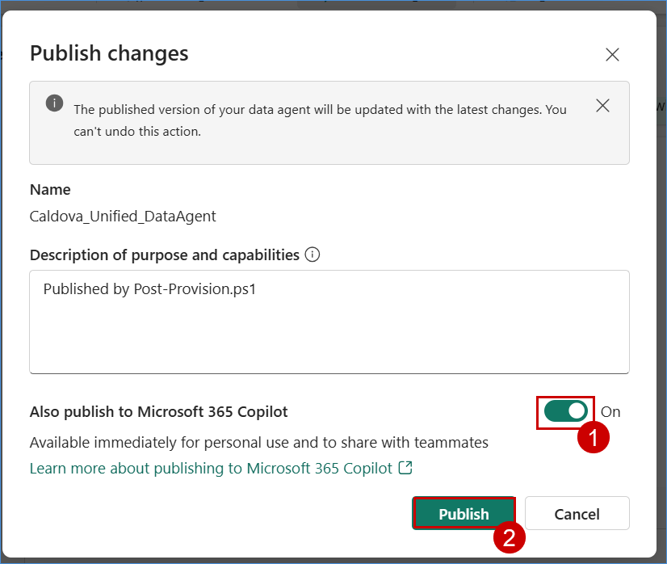

### Step 5: Govern & Secure - Caldova Operation

#### Establishing Governance and Security Across the Unified Data Estate
After creating the data and analytics components, the final step is to review how the resulting assets can be discovered, governed, and secured within Microsoft Fabric.

As the solution grows, it becomes important to understand which workspaces and data assets are available, review governance information, and manage access permissions appropriately.

In this step, we will use **OneLake Catalog** to explore the available data assets and the governance and security capabilities provided by Microsoft Fabric.

### What will you explore?
- Discover the workspaces and data assets available through **OneLake Catalog**.
- Review governance insights for the created Fabric content.
- Explore the available security and access-management capabilities.

This step completes the prototype by connecting data integration and analytics with the governance and security capabilities needed to manage the unified data estate.


> [!TIP]
> **Business value:** As Caldova adds markets, each with its own pharmaceutical regulations, the business needs to know what data it has, who owns it and who can access it. The OneLake catalog gives one place to find, govern and secure the lakehouse, databases, semantic model and agent built today, instead of managing controls system by system.

1. Click **OneLake Catalog** and navigate to catalog page.

   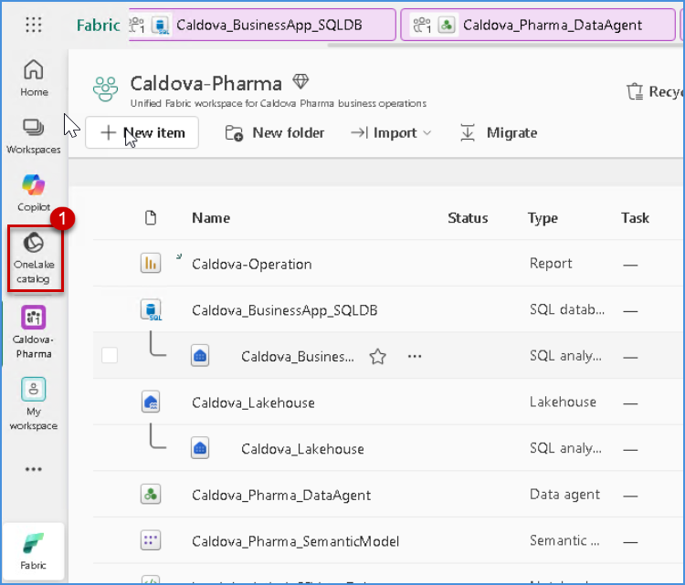

1. Landing page of OneLake Catalog with show items and sub-items for all the workspaces.

   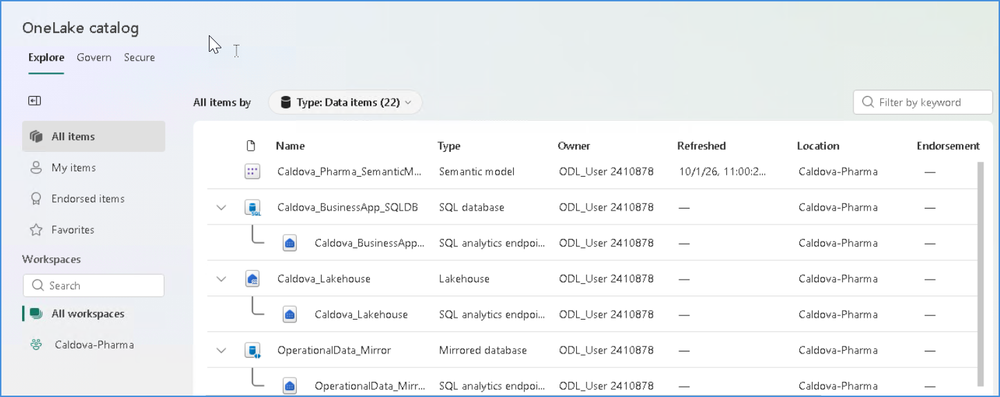

1. Click the **Govern** tab to view key insights about the content you've created in Microsoft Fabric.

   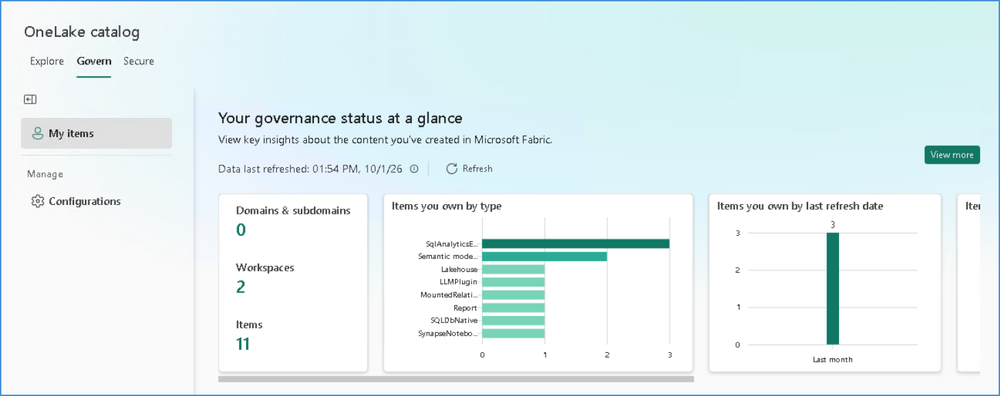

1. Click the **Secure** tab where all users will be managed under one space and add, remove, and manage access across all the domains and workspaces.


   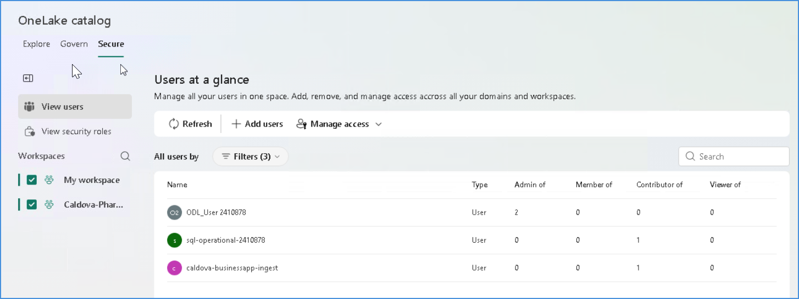

   > **Perform a wide range of operations:** including data discovery, governance, security, monitoring, and lineage tracking across the enterprise data landscape through the centralized OneLake Catalog.

### Step 6: Integrating the Fabric Data Agent with Microsoft 365 Copilot

#### Bringing Unified Business Insights into Microsoft 365

With the Fabric Data Agent created and validated against the semantic model, the next step is to make these insights accessible through Microsoft 365 Copilot. This allows business users to ask natural-language questions about Caldova Pharma's operational data from their Microsoft 365 experience without rebuilding the underlying data solution.

In this exercise, you will publish the existing Fabric Data Agent, access it through Microsoft 365 Copilot, and validate its responses using business questions about supplier performance, sales, and inventory.

#### What will you achieve?

- Publish the existing Fabric Data Agent for Microsoft 365 Copilot.
- Access the published agent from Microsoft 365 Copilot.
- Ask business questions and validate the answers against the unified data.

> **Business value:** Business users get answers in Microsoft 365 Copilot, where they already work, without learning a new tool. The agent answers from the same governed semantic model as the reports, so access controls and business definitions carry through to every answer.

1. Open **[Microsoft 365 Copilot](https://m365.cloud.microsoft/chat?omkt=en-001&source=post_page---------------------------)** and provide sign-in details

1. Navigate to **Agents**. and Under **Your agents**, select **Caldova_Unified_DataAgent**.

   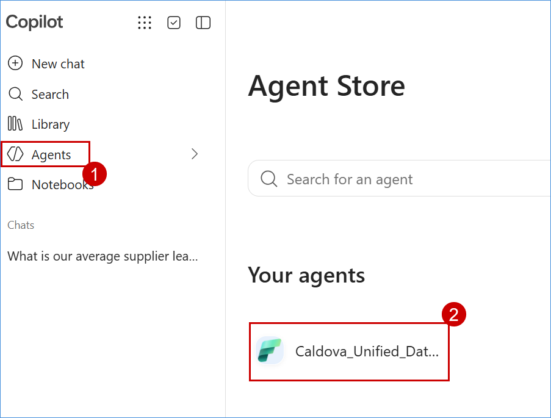

1. Enter the following prompt in the chat window:

   ```
   What is our average supplier lead time by supplier, and which supplier has the best quality rating?
   ```

   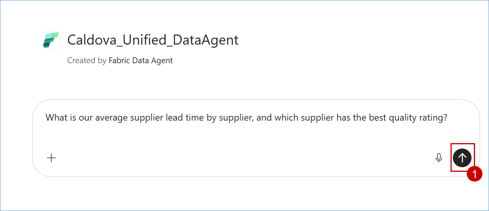

1. Review the response.


#### What you built and why it matters for Caldova
 
- One governed data estate across analytical, operational and application data, built on the resources Caldova already had
- New sources connected without new copies or custom pipelines, so new markets and acquisitions come online faster
- One set of business definitions shared by reports and AI
- A single place to discover, govern and secure data assets
- Answers to cross-functional questions in Microsoft 365 Copilot

#### Congratulations! You have successfully completed the `Rapid Prototyping using ****GitHub Copilot****` session and validated the Unified governed Data&AI estate.
