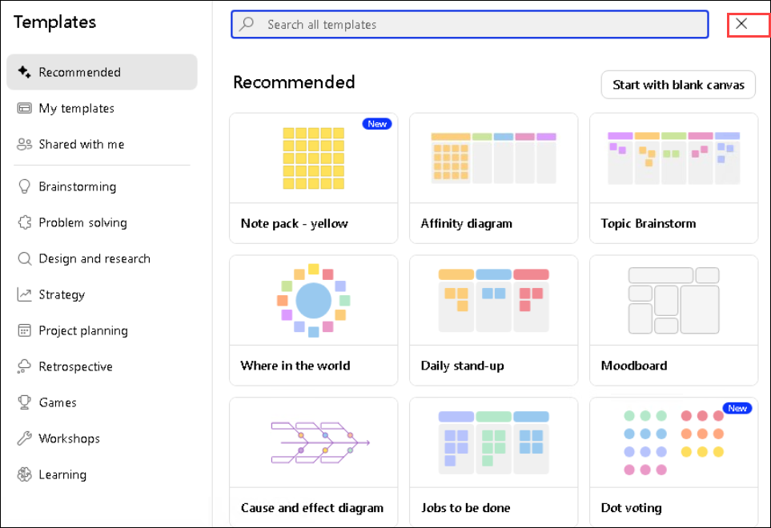
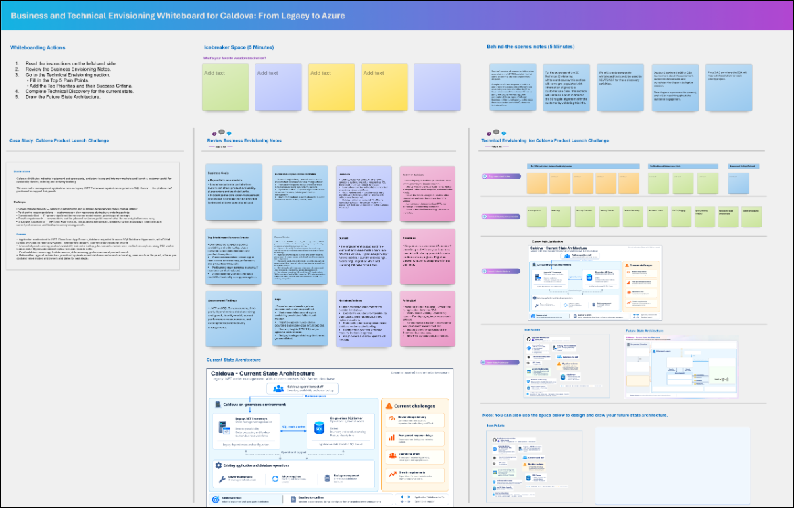

## 1. Envisioning Session Using Whiteboarding

### Whiteboarding
Whiteboarding helps technical teams align **Caldova’s business goals, current application and data challenges, modernization priorities, and future-state architecture**. It transforms modernization ideas into a shared visual plan and helps identify where Microsoft technologies and Solution Accelerators can accelerate the journey.

For the **Caldova scenario**, start by exploring the current environment and identifying applications, databases, dependencies, integration points, scalability concerns, and modernization opportunities.

Use whiteboarding to architect a future-state solution that helps Caldova:

- Assess the current application and database landscape
- Identify modernization priorities and dependencies
- Modernize applications and databases with confidence
- Introduce AI capabilities into modernized applications
- Improve scalability, reliability, security, and operational efficiency
- Create a connected future\-state architecture across applications, data, and AI
- Accelerate implementation using Microsoft technologies and Solution Accelerators

### Whiteboarding Outcome

By the end of the session, the team has a shared view of **Caldova’s current\-state challenges, modernization priorities, target business outcomes, and future\-state architecture**, providing a clear path from envisioning to rapid prototyping and implementation.

### How to copy the Whiteboard Using an Existing Template URL

1. Open a new browser tab in the Edge browser.

1. Right-click on the following Whiteboard template link -  ["Whiteboard Template"](https://sandboxailabs1005-my.sharepoint.com/:wb:/g/personal/caipuser_sandboxailabs1005_onmicrosoft_com/IQCalauE84MPR4q_CkSFPu55ATJzLZmr6FVo-o7FxrhbDHY?e=JOJqno), then select **"Copy link"** and then paste it on the browser tab.

1. If prompted, sign in with your ODL user credentials.

1. Once you log in, a pop-up message will appear prompting you to create a new Whiteboard. Read the message and click **Got it**.

   

1. Click on **X** to close the pop-up.

   

1. Use the **Zoom out** option to view the Whiteboard template clearly.

   

1. Please follow along as the **Facilitator** guides you through the **Business** and **Technical** Envisioning session. During the session, you will identify key business challenges, define priorities, assess the current environment, and design a future-state solution architecture.

### Activities

1. Review the **Business Envisioning Notes** to understand the organization's goals, challenges, and desired outcomes.

1. Go to the **Technical Envisioning** section and:
   - Capture the **Top 5 Pain Points**.
   - Define the **Top Priorities** and corresponding **Success Criteria**.

1. Complete the **Technical Discovery** by documenting:
   - Current-state architecture
   - Systems

1. Design the **Future-State Architecture** to illustrate how the proposed solution addresses business needs and technical requirements.

1. Review the completed envisioning outputs and validate their alignment with the desired business outcomes.

## Next Step: Bringing the Modernization Architecture to Life

Once the **Future State Architecture** has been defined during the Envisioning session, the next step is to transform the proposed solution into a working prototype. For Caldova, this involves modernizing the existing database and web application, followed by introducing **AI-powered semantic search capabilities.**

**Traditional Approach:**

1. Traditionally, after finalizing the architecture and identifying the required solution components, the next step would be to manually implement the modernization activities. This typically involves:
   - Assessing the existing on-premises SQL Server database and migrating its tables and data to Azure SQL Database Hyperscale.
   - Migrating the existing web application to Azure App Service and configuring it to connect to the migrated database.
   - Modernizing the application's user interface and ensuring that its functional pages work with the migrated data.
   - Implementing **Azure OpenAI embeddings and vector search capabilities** to support natural-language product searches.
   - Testing and validating the migrated database, application functionality, and semantic search experience.

2. This traditional approach requires multiple implementation steps, configuration changes, and validation activities across the database, application, and AI components. It can be time-consuming and requires specialized technical knowledge to ensure that all components work together as intended.

3. In the next exercise, we will introduce a **rapid prototyping** approach that demonstrates how **GitHub Copilot** can help translate the Future State Architecture and implementation requirements into a working solution. Instead of manually carrying out each activity, you will provide Copilot with structured prompts describing the desired outcomes, existing resources, and technical requirements. Copilot will help implement the solution interactively, allowing you to review its progress, respond to clarification requests, and refine the prototype as needed.

### Now, click on **`Next >>`** in the lower-right corner to move on to **`Rapid Prototyping`**.
