# 2. Rapid Prototyping

Now that you have completed the Envisioning **Whiteboard session** and identified key business opportunities, it is time to move from ideas to a working prototype. Explore how a Intelligent solution can bring the envisioned scenario to life, validate its potential, and demonstrate how it could work in practice.

## Rapid Prototyping using ******GitHub Copilot******

You will use ******GitHub Copilot****** to generate ARM or Bicep templates using the Future State Architecture arrived at from the previous Whiteboarding exercise.

- **ARM templates:** JSON-based Infrastructure-as-Code files used to define and deploy Azure resources.
- **Bicep templates:** Simplified, declarative Infrastructure-as-Code files used to define and deploy Azure resources with cleaner syntax.

### Sign in to ******GitHub Copilot****** Chat


1. Click on the **Visual Studio Code** from the VM desktop.

   

1. Click on **Continue with GitHub** to sign in to ******GitHub Copilot******.

   

1. On the **Sign in to GitHub** tab, enter the provided **GitHub username** **(1)** in the input field, and click on **Sign in with your identity provider** to continue **(2)**.

    - **Username:** <inject key="GitHub User Name" enableCopy="true"/>

     

1. Click on **Continue** on the **Single sign-on to CloudLabs Organizations** page to proceed.

   

1. Click on **Accept**.

   

1. Select **Continue** to **Authorize Visual Studio Code**.

   

1. Select **Authorize Visual Studio Code**.

   

1. Select **Open**.

   

1. Once the Visual Studio code opens, choose any desired theme **(1)** and then click **Get Started (2)**.

   

   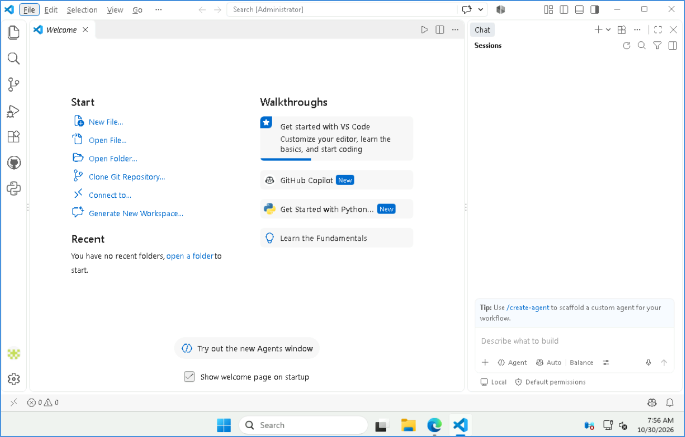

   >**Note:** If you get any error pop up, please **Close.**

      

    - **Close** the pop up.  

     >**Note**: Please follow the steps sequentially as indicated by the numbered brackets (e.g., (1), (2), …) and execute them in the specified order.

1. Select **File (1)** and then **Open Folder (2)**.

   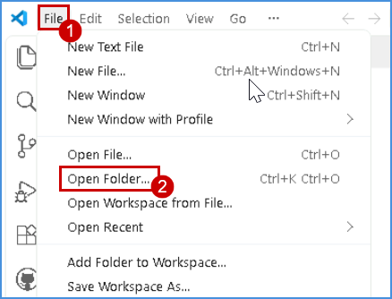

1. Navigate to **`C:\`** path **(1)**, then select the **mwc-project** folder **(2)** and then **Select folder (3)**.

   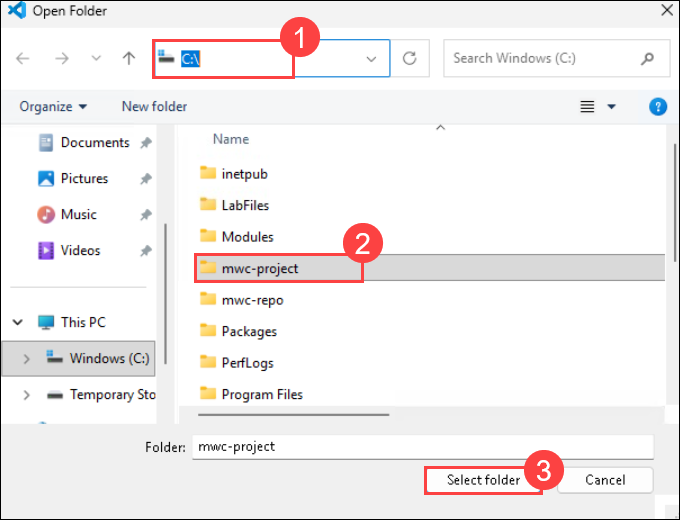

1. From the ********GitHub Copilot****** Chat**, select **Models (1)** and then select **Trust Workspace to enable models (2)**.

   

1. Select **Trust Folder and Continue**.

   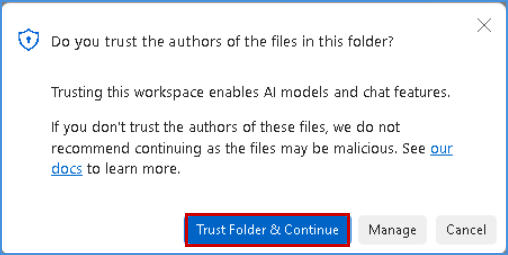

1. Click **Auto (1)** and then **turn off (2)** the **Auto** toggle. 

   

1. Expand **Other Models**.

   

1. Set the model to **Claude Sonnet 5**.

   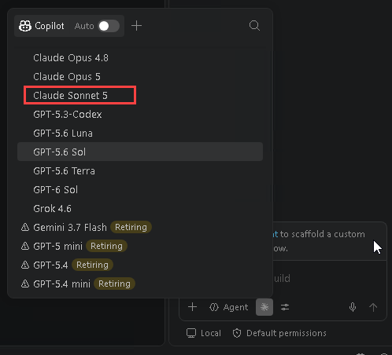

    >**Note:** If you're unable to select the **Models**, please wait for `2-3 minutes` then check and make sure you're signed in properly.

1. Click on **Default permission (1)** and then set it to **Allow all (2)**.

   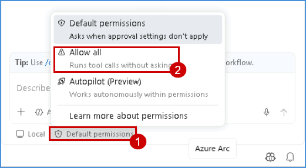

1. Select **Enable**.

   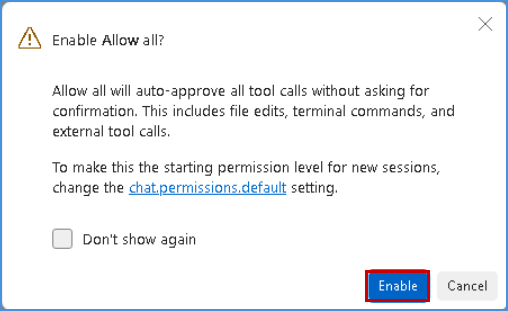

## Modernizing SQL Server to Azure SQL Database Hyperscale with ******GitHub Copilot******

### Why Caldova Should Modernize to Azure SQL Database Hyperscale

- **Scale for growing order data**  
   Support growing orders, inventory, and product data with highly scalable database storage.
- **Scale compute independently**  
   Scale compute resources as application demand changes without moving the underlying data.
- **Improve transactional performance**  
   Support high-throughput transactional reads and writes for the Order Management application.
- **Improve backup and recovery**  
   Use snapshot-based backups and fast restore capabilities to strengthen database recovery.
- **Build a scalable data foundation**  
   Provide a modern, scalable data platform that can grow with Caldova's application and database workloads.

The **solution architecture** defines how Caldova's existing on-premises database can be modernized by moving it to **Azure SQL Database Hyperscale**.
Traditionally, this migration would require manually connecting to the on-premises environment, identifying the database and its objects, configuring the target Azure SQL environment, migrating tables and data, and validating the migrated database.

Instead of performing each of these activities manually, we will provide ********GitHub Copilot******** with the solution architecture and the migration requirements.

## What Will This Prompt Do?

The prompt provides ********GitHub Copilot******** with the context and implementation steps required to perform the database migration. It instructs Copilot to:
1. Understand the proposed migration from the attached architecture.
2. Reuse the existing Azure resources.
3. Access the on-premises SQL Server environment.
4. Identify and access the CaldovaOrderManagement database.
5. Migrate the required tables and data to the Azure SQL Database Hyperscale environment.
6. Preserve the relationships between the migrated tables.
7. Prepare and deploy the required implementation.
8. Interact with you if additional authentication, clarification, or confirmation is required.

The objective is to move from manually executing individual migration tasks to describing the desired migration outcome and allowing ******GitHub Copilot****** to help implement it.

In this step, the prompt acts as the implementation plan that connects the existing on-premises database to the target Azure SQL Database environment.

1. Select the **Future-State-Architecture.png**.

   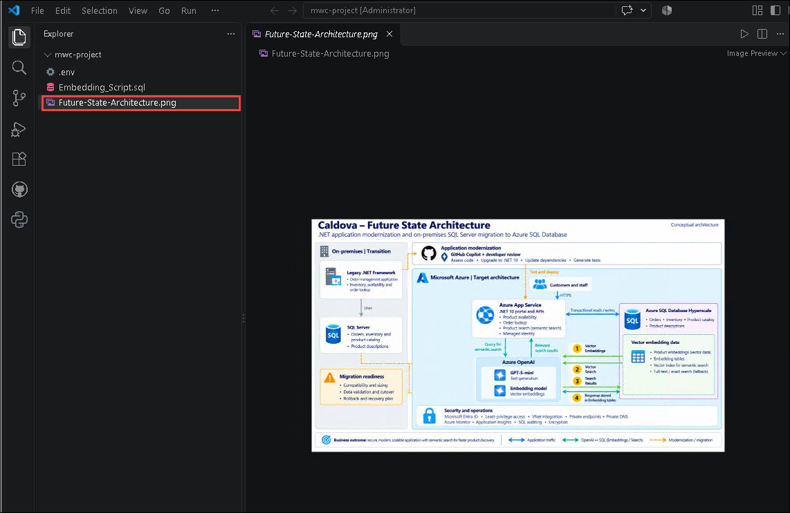

1. From the ********GitHub Copilot****** Chat**, click on **+ (1)** and then select the **Future-State-Architecture.png (2)**.

   

1. Along with the attached **Solution Architecture**, please paste the below prompt in the Chat.

   <!--   
   ```
   You are my smart agent to understand below are the problem statement and planned solution architecture design which will help Caldova to overcome from their problems. After that, please prepare bicep/ARM template and deploy the resources in the respective environment.

   Proposed Solution: The proposed solution is to migrate Caldova’s on-premises SQL Server database from the existing VM-based environment to Azure SQL Database Hyperscale. The migration will preserve the existing database objects. The migrated database will provide a scalable and secure foundation for the modernized .NET application on Azure App Service and future capabilities such as native SQL vector search over product descriptions, while reducing infrastructure-management overhead and supporting Caldova’s planned business growth.

   Planned Solution Architecture Design: Attached  Future-State-Architecture.png.

   First Migrate OnPrem SQL Database available in the VM to Azure SQL Server(Hyperscale) and modernize it with following below instructions:

   Instructions:
   1.Use existing Resource-Group (rg-caldova-modernize) in Azure and proceed further
   2.Use Existing Azure SQL Server and one Azure SQL Hyperscale Database (CaldovaOrderManagement) which is available in same Resource Group
   3.Make UPN - <inject key="AzureAdUserEmail"></inject> set as admin to the azure sql server and hyperscale database
   4.Connect VM: vm-onprem-sql (Public IP: 20.69.251.88) using credentials (User name: azureuser, passwrod: Password@123)
   5.Connect and Access the OnPrem SQL Server using credentials
      - User Name: caldova-admin
      - Password: B!Admin@123
   6.Access database CaldovaOrderManagement in this OnPrem server.
   7.Migrate Tables and data into the created Azure SQL Hyperscale Database
   8.Maintain a similar relationship among all tables.
   ```
   -->

   ```
   You are my smart agent to understand below are the problem statement and planned solution architecture design which will help Caldova to overcome from their problems. After that, please prepare bicep/ARM template and deploy the resources in the respective environment.
 
   Proposed Solution: The proposed solution is to migrate Caldova’s on-premises SQL Server database from the existing VM-based environment to Azure SQL Database Hyperscale. The migration will preserve the existing database objects. The migrated database will provide a scalable and secure foundation for the modernized .NET application on Azure App Service and future capabilities such as native SQL vector search over product descriptions, while reducing infrastructure-management overhead and supporting Caldova’s planned business growth.
   
   Planned Solution Architecture Design: Attached  Future-State-Architecture.png.
   
   First Migrate OnPrem SQL Database available in the VM to Azure SQL Server  (Hyperscale) and modernize it with following below instructions:
   
   Instructions:
   1.Use existing Resource-Group (rg-caldova-modernize) in Azure and proceed further
   2.Use Existing Azure SQL Server and one Azure SQL Hyperscale Database   (CaldovaOrderManagement) which is available in same Resource Group
   3.Make UPN -  set as admin to the Azure SQL server and hyperscale database
   4.Use the existing Caldova_DB_script (in the same project folder) which holds all our OnPrem SQL Server Database object along with data. 
   5.Use this above SQL script and deploy table in Azure SQL database then load data in the tables.
   6.Maintain the relationship among tables.
   ```

   - Then click **Send** button.

     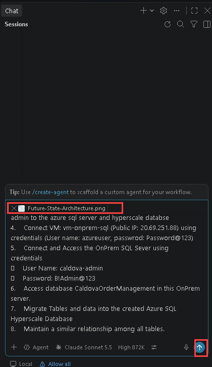

1. f prompted by GitHub Copilot, enter your Azure AD / Microsoft Entra ID User Principal Name (UPN) in the input field.
   UPN - <inject key="AzureAdUserEmail"></inject>
1. Click **Submit** or press Ctrl + Enter.
  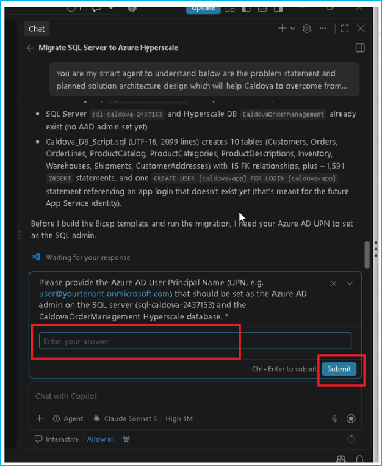
1. Continue with the migration steps after Copilot accepts the UPN.   
1. Once Copilot starts generating the response, monitor the process closely. Do not take any action; simply watch the progress.

1. If Copilot asks you to aunthenticate like below, please click the provided link and provide the code which was given by copilot 

   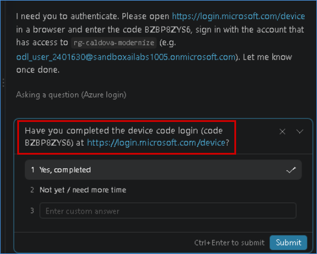

1. Click on **Yes, completed (1)** and then click on **Submit (2)** button.
    
    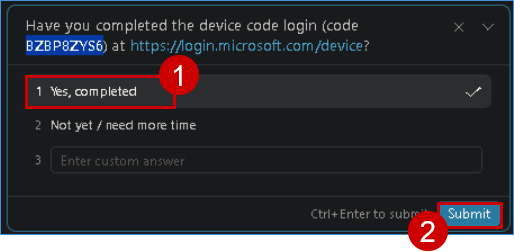

1. After some time, Copilot may ask you a few questions. Review each question carefully and select the appropriate response. 

1. If prompted for the SQL database password, please provide the existing password **<inject key="sqlAdminPassword" enableCopy="false"/>**.

1. Monitor the process to understand how it generates the response and handles or resolves errors.  

   >**Note:** In between, if it asks you to **Continue to iterate**, please click **Continue**.
   
   >Wait for the deployment to complete. This may take approximately `10–20` minutes. Select **Keep** to keep the created files.

### Validation - Azure SQL DB Hyperscale

1. Navigate back to [Azure portal](https://portal.azure.com/).  Go to **Resource groups**. and click on **rg-caldova-modernize** Resource Group.

   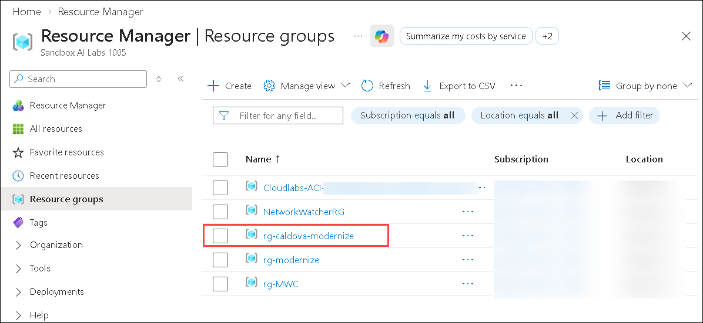

1. You can see all the resources and click on *Azure SQL Database Hyperscale* named **CaldovaOrderManagement**.

   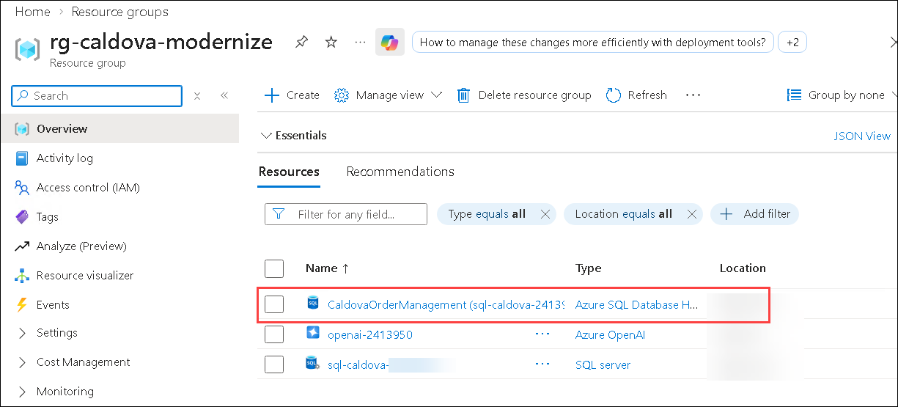

1. Click on **Query Editor** to connect SQL Database and Validate database objects.

   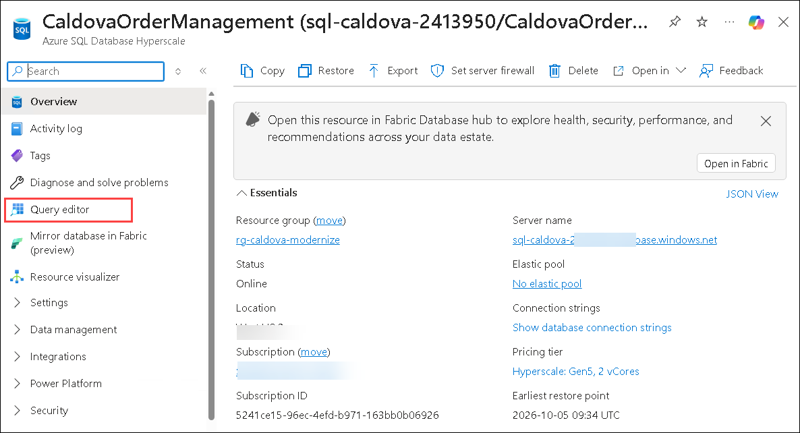

1. From **Microsoft Entra authentication (1)** tab. To authorize the user, click on **Connect as odl_user_<inject key="Deployment-ID" enableCopy="false"/> (2)**.

   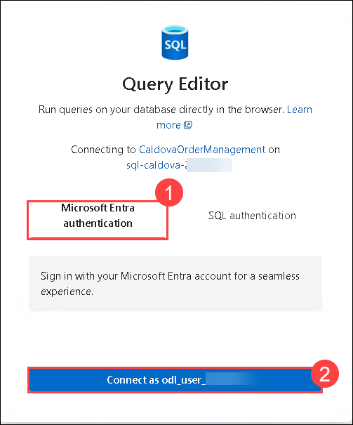

1. Expand **Schema(dbo) (1)** -> **Tables (2)** -> and click any table to see data **(3)**.

    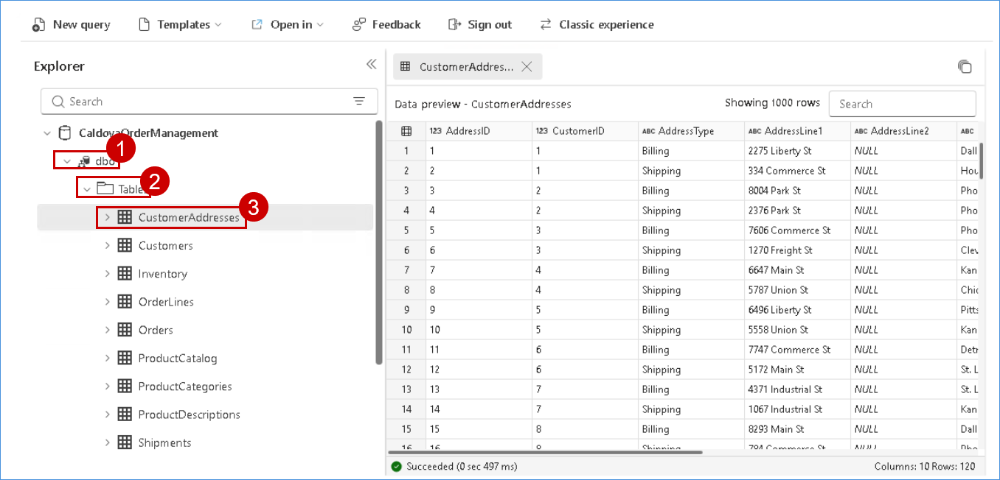   

   >**Note**: Similarly click other tables to compare and validate data.

## Modernizing SQL Server to Azure SQL Database Hyperscale with ******GitHub Copilot******

### Activity: Review the Caldova Legacy Order Management Application

As reviewed in the **Caldova Current-State Architecture during the Whiteboard Envisioning session**, Caldova currently uses a legacy web application for order management. In this activity, you will open and review the existing application running on the Virtual Machine (VM).

#### Step 1: Open Microsoft Edge

1. In the **Virtual Machine (VM)**, open **Microsoft Edge**.
2. Open a **new browser tab**.

#### Step 2: Open the Legacy Application

1. Copy the following URL:

   [Caldova Order Management Application](http://20.69.251.88/customer)

2. Paste the URL into the **Microsoft Edge address bar**.
3. Press **Enter** to open the application.
  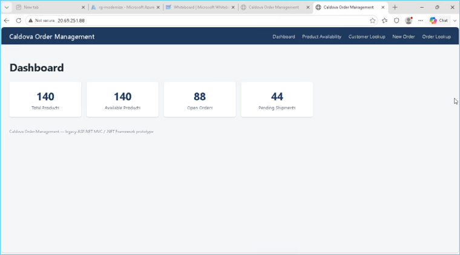

4. Select **Dashboard** from the top navigation to view the **Caldova Order Management** Portal.
   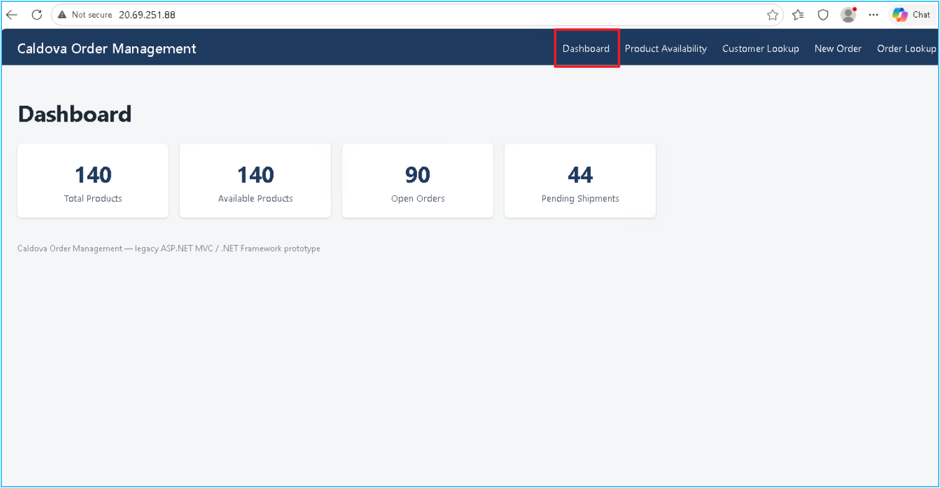

#### Step 3: Review the Current Application

Review the **Caldova Order Management** legacy web application and familiarize yourself with the current experience.
Take a moment to explore the application and understand its current functionality before proceeding to the **application modernization activities**.
1. **Look up a customer**
   - Select **Customer Lookup** from the top navigation.
   - Enter **3** as the **Customer ID**.
   - Select **Search** to view the customer details.
   
  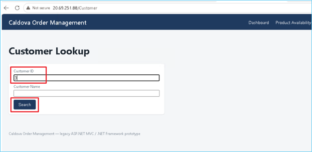
  
2. **Create a new order**
   - Select **New Order** from the top navigation.
   - Select a **Customer** from the dropdown.
   - Under **Order Lines**, select a **Product**.
   - Enter the required **Quantity**.
   - If needed, select **Add another product** to add additional products.
   - Select **Save Order** to create the order.

  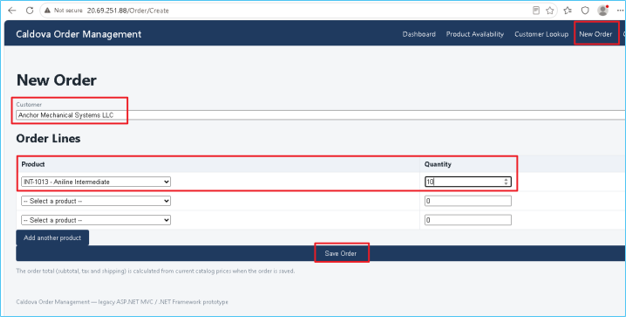
  
3. **Review the experience**
   - Explore the application and familiarize yourself with the current order-management experience before proceeding to the modernization activities.
 
  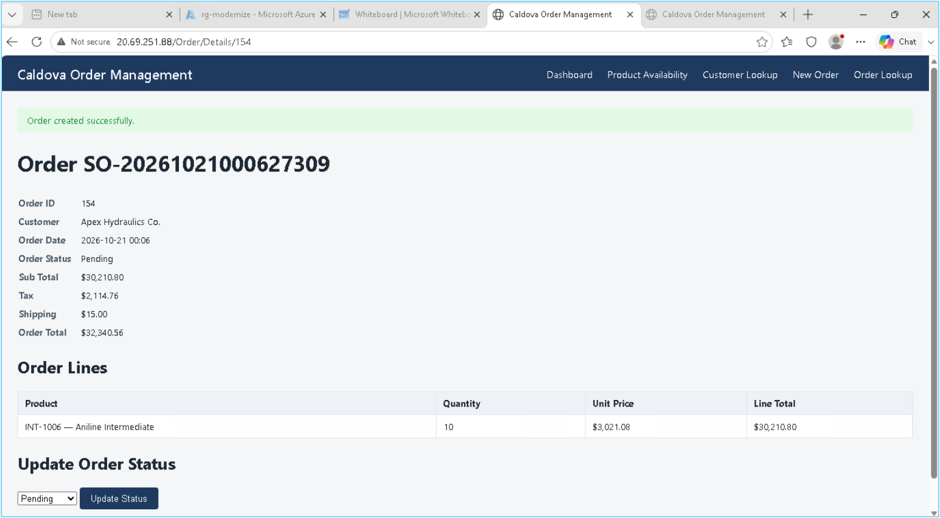

#### Why Caldova Wants to Modernize the Order Management Application

Caldova wants to modernize its legacy **Order Management application** to improve operational efficiency and provide a more scalable, secure, and intelligent platform.
1. **Reduce infrastructure management** by moving the legacy application from a VM to **Azure App Service**.
2. **Improve scalability and availability** to support growing customer and order volumes.
3. **Accelerate application delivery** through modern development and automated CI/CD.
4. **Strengthen security and reliability** using Azure-managed services, identity, monitoring, and configuration.
5. **Enable AI-powered experiences** by creating a modern foundation for intelligent customer, product, and order-management capabilities.

**Extend the Prototype to the Application Layer**
The database has now been migrated to Azure SQL Database Hyperscale. 
The next step is to modernize the application that currently runs in the on-premises environment and move it to Azure App Service.

Instead of manually analyzing the existing application, creating the App Service, migrating the application, updating its configuration, and implementing the requested UI changes separately, we will use ****GitHub Copilot**** to help perform these activities based on the existing solution requirements.

## What Will This Prompt Do?
The prompt provides Copilot with the application migration and modernization requirements. It instructs Copilot to:
- Access the existing CaldovaOrderManagement application in the VM.
- Migrate the application to Azure App Service.
- Modernize the application's user interface and responsiveness.
- Upgrade the application to the specified .NET version.
- Connect the application to the migrated Azure SQL Database.
- Ensure the existing functional pages continue to work with the corresponding database tables.
- Add a Traditional SQL Search page that will be used as the baseline for the next stage of the prototype.

This creates a clear progression from database **modernization to application modernization**, while allowing ******GitHub Copilot****** to handle much of the implementation work based on the requirements you provide.

The purpose of this prompt is to take the **migrated database** and **extend the prototype into a working, modernized application running on Azure.**
 
Follow the below instructions to migrate On-prem Web application to Azure app service.

1. Navigate back to **VS Code** and paste the below prompt in ******GitHub Copilot****** Chat**.

   <!--   
   ```
   Great, you have completed OnPrem SQL migration to Azure SQL Database Hyperscale. Now we need to migrate OnPrem Web Application to Azure App Service and modernize. 

   Follow the instructions below:

   Instructions:
   1.	Use existing Resource-Group (rg-caldova-modernize) in Azure and proceed further
   2.	Connect VM: vm-onprem-sql (Public IP: 20.69.251.88) using credentials (User name: azureuser, password: Password@123)
   3.	Access CaldovaOrderManagement(Caldova.OrderManagement) web application is already deployed in this above VM.
   4.	Migrate CaldovaOrderManagement web application to Azure Web App Service. 
   5.	Modernize the migrated web application and follow below modernization activities:
      a.	Use latest .NET Framework (.NET 10) 
      b.	Use CSS/Bootstrap etc. to make modernize look and feel
      c.	Can use some visuals in the Dashboard page to enhance the look and feel
      d.	Menu items should places at left side of the page. 
      e.	Top banner with company details with optimized details/views
      f.	Modernized Web App responsiveness
   6.	Migrated and Modernized web applications should integrate with Azure SQL Database (CaldovaOrderManagement) and integrate all functional pages to the respective tables. 
   7.	Please include one more page(in Web Application) for "Traditional SQL Search" where user will perform product based search.

   ```
   -->

   ```
   Great, you have completed OnPrem SQL migration to Azure SQL Database Hyperscale. Now we need to migrate OnPrem Web Application to Azure App Service and modernize.
 
   Follow the instructions below:
   
   Instructions:
   1.	Use existing Resource-Group (rg-caldova-modernize) in Azure and proceed further
   2.	Use the CaldovaOrderManagement folder(in the same project location) which  holds our OnPrem MVC Web Application artifacts and migrate CaldovaOrderManagement web application to Azure Web App Service. 
   3.	Modernize the migrated web application and follow below modernization   activities:
      a.Use latest .NET Framework (.NET 10) 
      b.Use CSS/Bootstrap etc. to make modernize look and feel
      c.Can use some visuals in the Dashboard page to enhance the look and feel
      d.Menu items should places at left side of the page. 
      e.Top banner with company details with optimized details/views
      f.Modernized Web App responsiveness
   4.	Migrated and Modernized web applications should integrate with Azure SQL   Database (CaldovaOrderManagement) and integrate all functional pages to the  respective tables. 
   5.	Please include one more page(in Web Application) for "Traditional SQL Search" where user will perform product based search.

   ````

   - Then click **Send** button.

     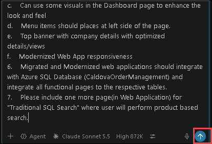    

1. Once Copilot starts generating the response, monitor the process closely. Do not take any action; simply watch the progress.

   >**Note:** In between, if it asks you to **Continue to iterate**, please click **Continue**.

1. Wait for the deployment to complete. This may take approximately `20–30` minutes. Select **Keep** to keep the created files.

### Validation - Azure App Service

1. Once the deployment is completed, navigate back to **Azure portal** to validate the migrated Web application.

1. Navigate to **rg-caldova-modernize** Resource Group. you can see `App service` resources along with `SQL Database Hyperscale`.

1. Click on App service named **app-caldova-<inject key="Deployment-ID" enableCopy="false"/>**.

   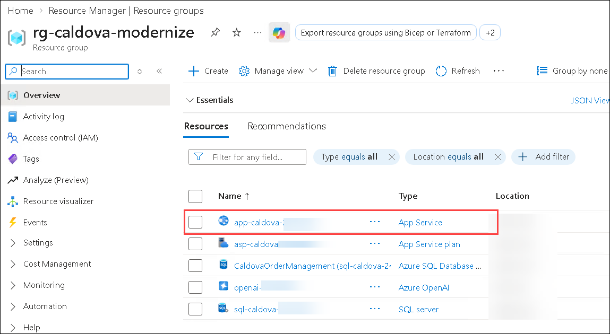 

1. You can see all app related information and click on **default domain**

   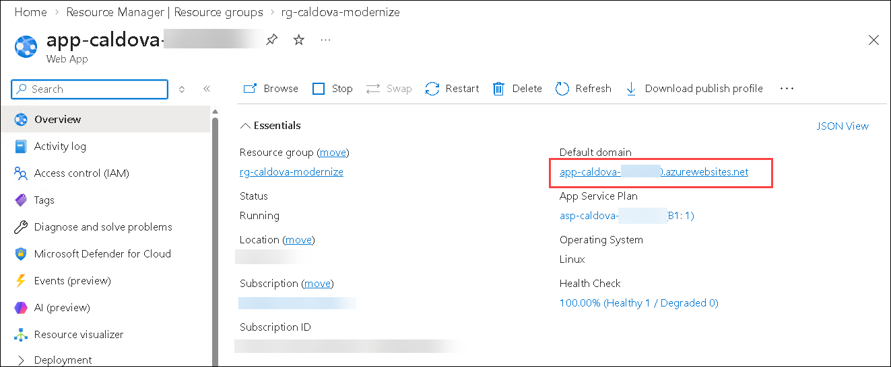 

1. It will open application in new tab and you can see migrated application. 

   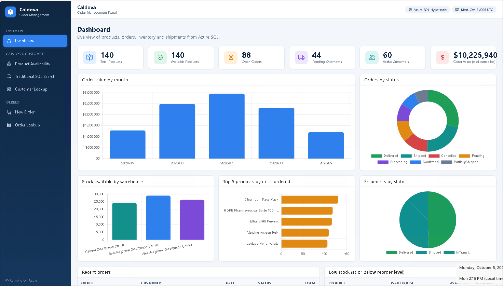 

1. In migrated application you can see **Traditional SQL Search** section got added.

1. Click on **Traditional Sql Search** section.

   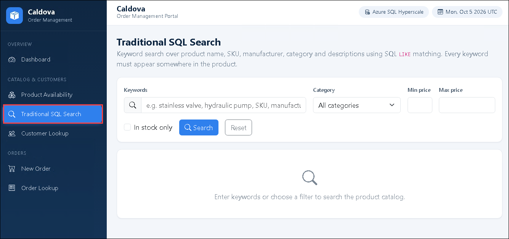 

1. Paste the below prompt in search area **(1)** and click on **Search (2)** button.

   ``` 
   medicine used to reduce fever
   ```

   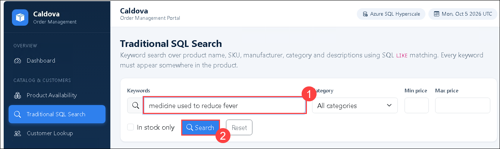 


1. `You can observe it will return no results.`

   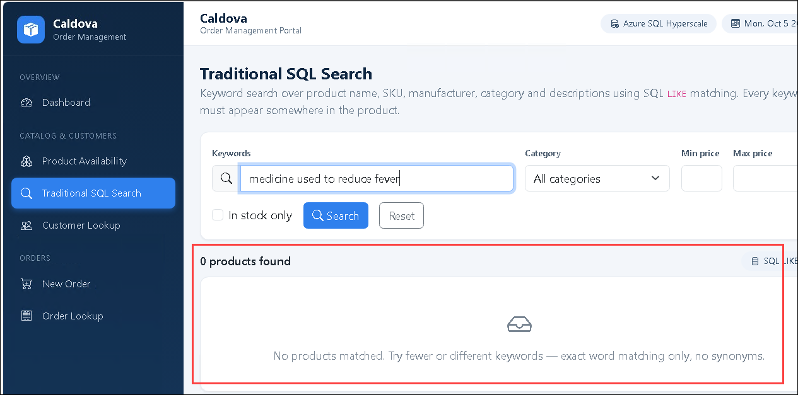 

   The migrated application currently uses traditional SQL search to find products based on exact text matches. Traditional SQL search typically relies on conditions such as LIKE, where the user's search terms need to closely match the words stored in the product description.

   For example, if a product description contains: `"Paracetamol is used to relieve mild pain."` and the user searches for: `"medicine used to reduce fever"`.

   - A traditional SQL `LIKE` search may not return the product because the exact phrase `"medicine used to reduce fever"` does not appear in the product description.

   - This creates a limitation for users because they often search using natural language, synonyms, or different words that express the same meaning.

1. To overcome this limitation, we will enhance the migrated application with **Vector Semantic search** using Azure SQL Database Hyperscale and Azure OpenAI embeddings.

   - `Vector search` converts product descriptions and user search queries into numerical **embeddings** that represent their meaning. The application can then compare the similarity between the user's query and product descriptions instead of relying only on exact keyword matches.

     >**Note:** Will do Semantic search validation once next deployment(Vector embedding) is done.

1. In the next Section, we will:

   - Generate embeddings for the existing product descriptions using **Azure OpenAI**.
   - Store the generated embeddings in **Azure SQL Database Hyperscale** using the native `VECTOR` data type.
   - Generate an embedding for the user's natural-language search query.
   - Compare the query embedding with product-description embeddings using vector similarity.
   - Add a **Semantic Vector Search** page to the migrated web application.
   - Display matching products along with their similarity/probability scores.
   - Add a visualization to demonstrate product search trends based on the vector-search results.

This allows us to demonstrate how the migrated application can move from **keyword-based search** to **meaning-based search** using Azure AI capabilities.

## Implementation of Vector/Semantic Search with ******GitHub Copilot******

**Move from Keyword Search to Meaning-Based Search**

The migrated application currently provides Traditional SQL Search, which relies on matching the user's search terms against the text stored in product descriptions.

The Product description may contain different words that express the same meaning. Because traditional keyword-based search depends on matching the text, the application may not return the expected product.

This demonstrates a limitation of the current search experience: the application can match words, but it does not understand the meaning behind the user's query. The existing guide demonstrates this limitation before introducing semantic/vector search

**Turn the Search Requirement into an AI-Powered Prototype**

To address this limitation, we will enhance the existing application with **Vector Semantic Search using Azure OpenAI embeddings and Azure SQL Database Hyperscale**.

Instead of manually implementing the embedding generation, database changes, vector storage, search logic, and application changes separately, we will provide ****GitHub Copilot**** with the business objective and implementation requirements.

## What Will This Prompt Do?

The prompt will guide ****GitHub Copilot**** to:
1. Generate embeddings for the existing product descriptions using Azure OpenAI.
2. Store the embeddings in Azure SQL Database Hyperscale using the native VECTOR data type.
3. Create the required embedding table and store the product information and embeddings.
4. Generate embeddings for natural-language search queries.
5. Compare the query meaning with product-description meanings using vector similarity.
6. Add a Semantic Vector Search experience alongside the existing Traditional SQL Search.
7. Return relevant products based on semantic similarity.
8. Display similarity/probability information and the requested visualization

**Traditional SQL Search → Matches words**
and
**Vector Semantic Search → Matches meaning**

The **goal** is to demonstrate how a natural-language business requirement can be translated into an AI-powered capability using **GitHub Copilot**, rather than manually implementing each component.

1. Navigate to **Visual Studio Code**.

1. In **Visual Studio Code**, open the `.env` file from the **Explorer**.

   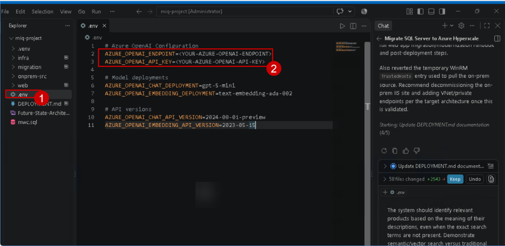

1. Under the **Azure OpenAI Configuration** section, update the following variables with corresponding values:

   - `AZURE_OPENAI_ENDPOINT` > <inject key="openaiEndpoint" enableCopy="false"/>
   - `AZURE_OPENAI_API_KEY` > <inject key="openaiPrimaryKey" enableCopy="false"/>

1. Save the file using **Ctrl+S**.   

1. Copy the below prompt and paste it in ********GitHub Copilot****** Chat**.

   ```
   Great, both SQL Database and Web application migration were completed successfully.
   BUSINESS OBJECTIVE: Enable semantic/vector search over product descriptions, so users can search using natural language rather than exact keywords.
   Two examples given below:
   "medicine used to reduce fever"
   "best medicine for hypertension"
   "tablet for controlling blood sugar"
 
   The system should identify relevant products based on the meaning of their descriptions, even when the exact search terms are not present. Demonstrate semantic/vector search versus traditional SQL LIKE search.

   IMPLEMENTATION REQUIREMENTS:
   1. Use existing resource-group(rg-caldova-modernize) and proceed further.

   2. Please execute the attached script file (Embedding_Script.sql) for the below activities:

       Read OpenAI Configuration details (API Endpoint, Key, Models etc.) from .env file and use it in this SQL script file
      . Use Azure SQL Database (CaldovaOrderManagement) Hyperscale and generate embedding for all existing Products and its Descriptions.
      . Create a table dbo.ProductDescriptionEmbeddings with below columns and  store all embedding details
         1.ProductDescriptionEmbeddingID
         2.ProductID
         3.ProductDescriptionID
         4.ContentText
         5.Embedding
         6.CreatedDate
         7.ModifiedDate
      . Make sure vector embedding should be created for all the products and its descriptions.
      . Store embeddings in the same Azure SQL DB using the SQL vector data type and the correct dimension for the selected embedding model.
   3. Create searchable text representations for each product description.
   4. Create a new Semantic/vector search" page besides the SQL Traditional search page to validate side by side.
   5. Existing Web Application will be used to do semantic search where natural-language query will accept and return matching products with probability score.
   6. Create graphical visualization to the existing web application/dashboard demonstrating the vector search on product trend

   ```
   - Then click **Send** button.

1. Once Copilot starts generating the response, monitor the process closely. Do not take any action; simply watch the progress.

   >**Note:** In between, if it asks you to **Continue to iterate**, please click **Continue**.

1. Wait for the deployment to complete. Select **Keep** to keep the created files.   

### Validation - Traditional SQL Search Vs Vector Semantic Search

1. Navigate **Azure Portal** and Open Migrated Application.

1. In the updated application, you can see the **Semantic Vector Search** section that has been added.

   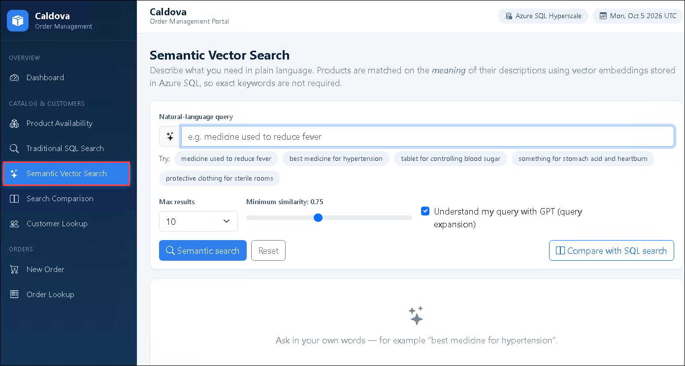 

1. Click on **Semantic Vector search** section.

1. Paste the below same prompt in search area **(1)** and click on **Semantic search (2)** button. 

   ``` 
   medicine used to reduce fever
   ```

   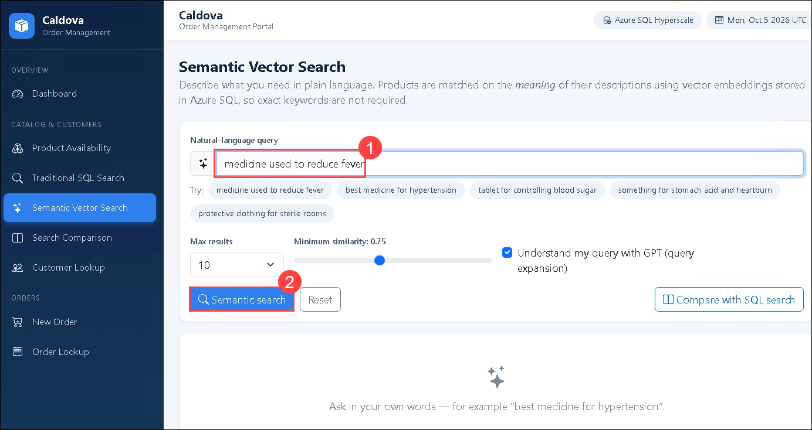 

1. The Semantic vector search can identify products based on the meaning and semantic similarity of the query and product descriptions, even when the exact keywords are not present.

   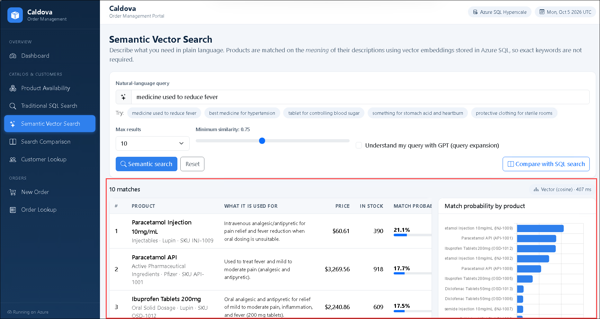 


### Congratulations! You have successfully completed the `Rapid Prototyping using ******GitHub Copilot******` session.

#### Click on `Next` to view the Pre-deployed `Modernize with Confidence Package`.
