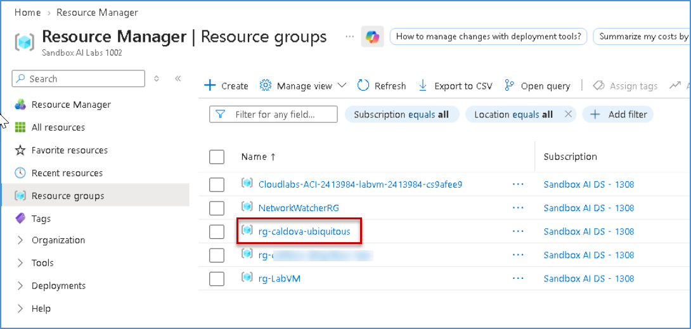
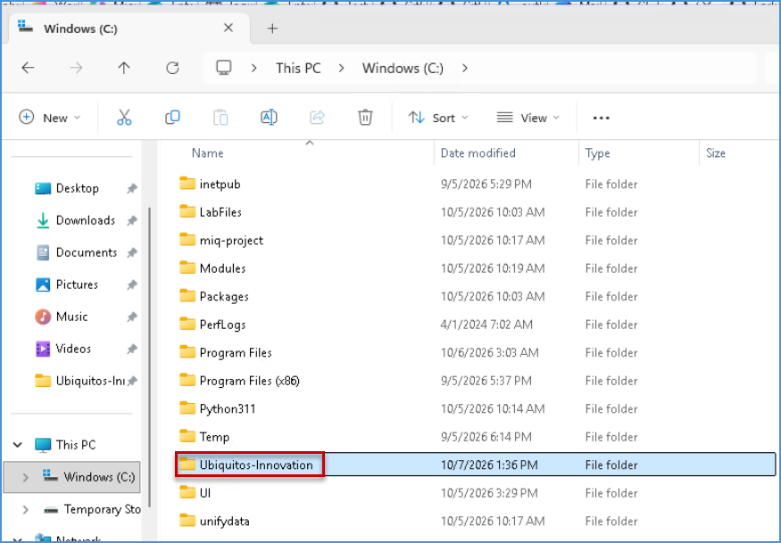
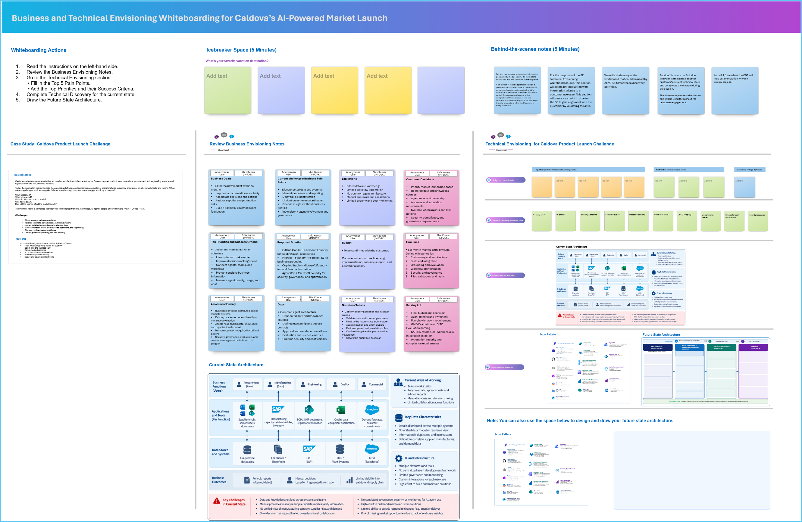
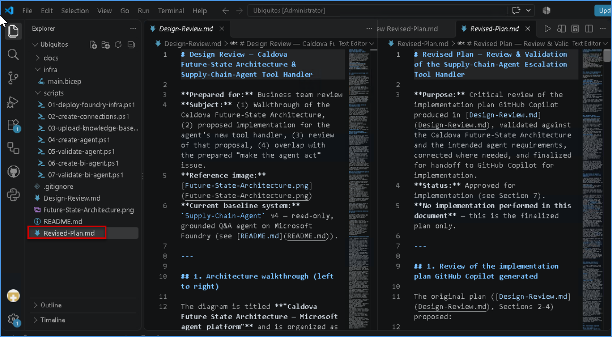

# 2. Rapid Prototyping


Now that you have completed the envisioning **Whiteboard session** and identified key business opportunities, it is time to move from ideas to a working prototype. Explore how a intelligent solution can bring the envisioned scenario to life, validate its potential, and demonstrate how it could work in practice.

## Rapid Prototyping using GitHub Copilot

You will use GitHub Copilot to generate ARM or Bicep templates using the Future State Architecture arrived at from the previous Whiteboarding exercise.

- **ARM templates:** JSON-based Infrastructure-as-Code files used to define and deploy Azure resources.
- **Bicep templates:** Simplified, declarative Infrastructure-as-Code files used to define and deploy Azure resources with cleaner syntax.

### Verify Resources in the Azure Resource Group

1. Navigate to the [Azure portal](https://portal.azure.com/). Search for **Resource groups**. and Click on **rg-unified** Resource Group.

   

1.  Confirm that the resource group contains the following resources:
      - **Fabric Capacity**
      - **Storage Account**

1. Verify that the resources are available in their respective Azure regions and that the migration environment has been provisioned successfully.

## Sign in to GitHub Copilot Chat

1. Click on the **Visual Studio Code** from the VM desktop.

   

1. Click on **Continue with GitHub** to sign in to GitHub Copilot.

   

1. On the **Sign in to GitHub** tab, enter the provided **GitHub username** **(1)** in the input field, and click on **Sign in with your identity provider** to continue **(2)**.

    - **Username:** <inject key="GitHub User Name" enableCopy="true"/>

     

1. Click on **Continue** on the **Single sign-on to CloudLabs Organizations** page to proceed.

   

1. Click on **Accept**.

   

1. Select **Continue** to **Authorize Visual Studio Code**.

   

1. Select **Authorize Visual Studio Code**.

   

1. Select **Open**.

   

1. Once the Visual Studio code opens, choose any desired theme **(1)** and then click **Get Started (2)**.

   

   

   >**Note:** If you get any error pop up, please **Close.**

      

    - **Close** the pop up.  

     >**Note**: Please follow the steps sequentially as indicated by the numbered brackets (e.g., (1), (2), …) and execute them in the specified order.

1. Select **File (1)** and then **Open Folder (2)**.

   

1. Navigate to **`C:\`** path **(1)**, then select the **Unifydata** folder **(2)** and then **Select folder (3)**.

   

1. From the **GitHub Copilot Chat**, select **Models (1)** and then select **Trust Workspace to enable models (2)**.

   

1. Select **Trust Folder and Continue**.

   

1. Click **Auto (1)** and then set the model to **Claude Sonnet 5 (2)**.

   

    >**Note:** If you're unable to select the **Models**, please wait for `2-3 minutes` then check and make sure you're signed in properly.

1. Click on **Default permission (1)** and then set it to **Allow all (2)**.

   

1. Select **Enable**.

   

## Topic 1 - Build agents and software at the speed of AI
Transform an existing agent design into a **production-ready, secure capability** using GitHub Copilot—from whiteboard and business decisions to implementation, testing, security remediation, review, and merge. Demonstrate how **AI-assisted planning, model choice, delegated coding, governance, and security** accelerate agent development while keeping humans in control.

### Activity 1.1: Start Whiteboarding
Review the prepared **Future-State-Architecture** design and walk through the four key areas: what the agent needs to know, the tools it can call and the production systems behind those tools, what actions it can perform autonomously versus where human approval is required, and where the agent will run once built. The starting point is that the agent already answers questions, but no code for the new action capability exists yet; the whiteboard represents the design for this new capability and serves as the foundation for the implementation activities that follow.

Whiteboard [Link](https://sandboxailabs1002-my.sharepoint.com/:wb:/g/personal/amplify_user_sandboxailabs1002_onmicrosoft_com/IQDTzUYleJUrSam4WftDPpZ2AX33HhN8Z7CFeGr_t79F1p0?e=PeZ7Jf)

Whiteboard Image
 

### Activity 1.2: Turn the Whiteboard into a Reviewed Plan
Turn the whiteboard into a reviewed implementation plan and issue set for extending the existing agent, without manually transcribing it.

1. Please copy the below prompt and paste it in the copilot chat win

   >- This activity is required to validate the future-state architecture before development begins and ensure the proposed solution aligns with the business requirement.
   >- Review the architecture to understand each component and determine how the new tool-handler capability should be implemented, documented, and reviewed by the business team.

   
   **Prompt**
   ```
   For my first activity, I have attached a whiteboard-generated future-state architecture design. Please review the architecture thoroughly and create a document based on your analysis. Follow the instructions below for this activity:
   
   Attached to future state architecture: Future-State-Architecture.png

   Instructions:
   1.	Read the attached design and list down all the sections starting form left to right and explain in detail.  Also generate one tabular format to understand each section and component wise activity.
   2.	Propose implementation of the new tool handler. 
   3.	Review what comes back: the proposed tool handler, the changes to the agent instructions, the test approach, and the issues it would open. 
   4.	Compare its proposed issues against the prepared “make the agent act” issue and point out the overlap. 
   5.	Once all the above steps are completed, generate one Design-Review.md file with proper design for business team to review
   Note: Please don’t create any other document or code at this moment apart from Design-Review.md. 
   ```

   - Then click **Send** button.

1. Once Copilot starts generating the response, monitor the process closely. 

#### Validation
Once GitHub Copilot completes the execution, validate the Project Explorer to confirm whether the review document has been successfully created and is available in the expected project location.

1. Navigate to the project explorer in VS code to validate review docuemnt.

   

### Activity 1.3: Ground Copilot in What the Business Already Decided
Turn the whiteboard into a reviewed implementation plan and issue set for extending the existing agent, without manually transcribing it.

1. Please copy the below prompt and paste it in the copilot chat window.


   ```
   Great. You have created above design review guide. Now review the same with below points and provide me with instructions and after confirmation include them in the same document.

   Instructions:
   1.	Review the implementation plan generated by GitHub Copilot.
   2.	Validate the plan against the intended agent requirements and architecture.
   3.	Verify that all required components, primitives, tools, and agent capabilities are correctly captured.
   4.	Identify and correct any missing, incorrect, or unnecessary items in the plan.
   5.	Finalize and approve the plan before handing it off to GitHub Copilot for implementation.
   ```

   - Then click **Send** button.

1. Once Copilot starts generating the response, monitor the process closely. 

#### Validation

   


### Activity 1.4: Choose the Model for the Job
Select the most appropriate model for the task while staying within the models and policies enabled by the organization. Review the available models using /model, switch between models to understand that model selection is task-specific, and use /model auto to allow GitHub Copilot to select an appropriate model based on the task, effort, and optimization settings such as Balanced versus Intelligence. Use /usage to review session usage and /context to understand the available context and session information. Finally, repeat the same task using a Frontier model and Auto mode to compare their output, performance, value, and cost, and understand when each approach is most appropriate.

Based on the context, the user can switch between the available models and validate their suitability for the task. Finally, select the **Auto** option to allow GitHub Copilot to automatically choose the most appropriate model based on the requirements and complexity of the work.

   

### Activity 1.5: Hand the Build to the Coding Agent
Validate the local changes from Activities 1.2 and 1.3, then use /delegate from the same GitHub Copilot session to hand off the implementation to the coding agent, accepting the checkpoint so the agent branch includes the existing scaffold and updated instructions. While the agent works, review the session log and reasoning, and demonstrate concurrent work by showing another active session before returning to the current task. 

Once complete, open the draft pull request in GitHub and verify that the diff includes the tool handler, updated agent instructions, and tests. Before human review, request a Copilot code review, evaluate its findings, and then add a follow-up comment beginning with @copilot requesting any necessary revisions so Copilot updates and commits the changes to the same branch.

1. Please copy the below prompt and paste it in the copilot chat win

   ```
   1. Run /delegate and accept the checkpoint to delegate the implementation.
   2. Update Review-Plan.md with the final agent instructions, tool-handler requirements, constraints, and test approach.
   Monitor the coding-agent execution and 
   3. Create a Draft Pull Request when complete.
   ```

   - Then click **Send** button.

1. After completing above step, validate the Pull Request with passing below prompt:

   ```
   1. @copilot Please address the valid review findings, update the implementation, Review-Plan.md, agent instructions, and tests as needed, and commit the revisions to the same PR branch. Do not merge.
   2. Confirm the revised changes are committed to the same PR branch and report any remaining issues requiring human review.
   ```

   - Then click **Send** button.
  
### Activity 1.6: Fix Security in the Same Pull Request
Review the capability to ensure it aligns with the agreed business requirements, governance standards, approval boundaries, and risk controls. Confirm that all identified business risks are addressed, required stakeholder approvals are obtained, and the capability is ready for release. 

**Objective:** Demonstrate a complete business journey from design and review through risk validation, approval, and final release, ensuring the capability is governed and business-ready before user adoption.

1. Navigate to Github.com and open the pull request
1. Select Approve and run workflows to allow the required checks to begin.
1. Review the code scanning results and identify the flagged vulnerability in the tool handler.
1. Review the Autofix recommendation and commit the fix directly to the same Pull Request branch.
1. Wait for all required checks and validations to complete successfully.
1. Obtain the required human or CODEOWNER approval.
1. Review the final changes and merge the Pull Request.

#### Validation
Pull request created for review and commit. 

1. Open the Pull request and validate the summary
   

1. After validation, merge pull request and commit.
   


## Topic 2: Agents That Know Your Business 

### Activity 2.1: Validate the Deployed Business Intelligence Agent

Before adding business context to the agent, we need to establish a baseline by validating the existing Business Intelligence agent deployed in Microsoft Foundry during Topic 1.

Traditionally, this would involve manually reviewing the agent configuration and testing its responses to understand its current capabilities and limitations. In this activity, we will use GitHub Copilot to locate and inspect the existing agent and run an initial Supply Chain assessment.

**What will this prompt do?**

- Locate and validate the existing `supply-chain-Bi-agent`.
- Review its model, role, instructions, and capabilities without changing the configuration.
- Run a baseline Supply Chain assessment and identify gaps in the available information.

This baseline will help us evaluate how the agent improves as we add live operational data, enterprise knowledge, and organizational context in the following activities.

1. Navigate back to **vs code**

1. Copy the below prompt and paste it in chat window

   ```
   Please follow below instructions
   1.	Open and validate the existing Caldova Pharma Business Intelligence agent(supply-chain-Bi-agent) deployed in Microsoft Foundry 
   2.	Review its model, role, instructions, and capabilities without modifying or recreating the agent.
   3.	Run the following baseline Supply Chain prompt and summarize the response, including any information gaps
   ```

1. Review the Response provided by agent

### Activity 2.2: Connect Live Manufacturing Context

The existing Business Intelligence agent needs access to live manufacturing data to answer questions about plant capacity, production schedules, and operational readiness. In this activity, we will connect the existing Fabric Data Agent from the `Caldova_UI` workspace to the Foundry agent using tool calling.

**What will this prompt do?**

- Locate the existing Fabric Data Agent in the `Caldova_UI` workspace.
- Configure the Data Agent as a tool for the existing `supply-chain-Bi-agent`.
- Validate that the Foundry agent can retrieve operational data by asking a question about November capacity utilization.

This enables the Business Intelligence agent to use live manufacturing context when answering relevant Supply Chain questions, without recreating the existing agents.

1. Navigate back to **vs code**

1. Copy the below prompt and paste it in chat window

   ```
   Follow the instructions below to connect the existing Data Agent from the Caldova_UI workspace as a tool in the existing Microsoft Foundry agent (supply-chain-Bi-agent).
   •	Locate the existing Data Agent in the Caldova_UI workspace.
   •	Configure and connect the Data Agent under the Tools section of the existing Foundry agent using tool calling.
   •	Ensure the Foundry agent can invoke the Data Agent to retrieve operational data when answering relevant questions.
   ```

1. Verify that the **Fabric Data Agent** is attached under the **Tools** section of the existing Foundry agent.

1. Confirm that the Data Agent is connected and configured correctly.

1. Copy the following prompt and paste it into the **Agent Playground**:

   ```
   What is the November capacity utilization of PL01?
   ```

1. Review the response provided by the Foundry agent and verify that it retrieves the expected manufacturing data through the Fabric Data Agent.


### Activity 2.3: Ground the Agent with Enterprise Knowledge

Operational data alone may not explain the procedures and constraints that influence manufacturing decisions. The agent also needs access to Caldova's manufacturing documents, including scheduling guidance and relevant procedures.

In this activity, we will create a Foundry IQ knowledge base from the existing documents stored in Azure Blob Storage and connect it to the Knowledge section of the existing Foundry agent.

**What will this prompt do?**

- Create a Foundry IQ knowledge base using documents from the specified Azure Blob Storage location.
- Configure the knowledge base to index and retrieve documents from the blobstorage
- Connect the knowledge base under the **Knowledge** section of `supply-chain-Bi-agent`.
- Validate the agent's ability to answer a production scheduling question using the available documents.

This allows the agent to combine operational data with documented manufacturing procedures and scheduling guidance when responding to business questions.

1. Navigate back to **vs code**

1. Copy the below prompt and paste it in chat window

   ```
   Follow the instructions below to create a Foundry IQ knowledge base from the  existing Caldova manufacturing documents in Azure Blob Storage and connect it under the Knowledge section of the existing Microsoft Foundry agent (supply-chain-Bi-agent)
   •	Create a Foundry IQ knowledge base using documents stored in Azure Blob    Storage under the rg-caldova-ubiquituos resource group.
   •	Access the testingsharepoint storage container and its data folder.
   •	Configure the knowledge base to index and retrieve the available  documents in above folder.
   •	Add the knowledge base under the Knowledge section of the existing   Caldova Business Intelligence Agent in Microsoft Foundry, not under Tools.
   •	Configure the agent to use this knowledge source when answering questions about the documents

   ```

1. Verify that the **Foundry IQ knowledge base** is configured under the **Knowledge** section of the existing Foundry agent.

1. Confirm that the knowledge base is connected properly and the relevant manufacturing documents are available for retrieval.

1. Copy the following prompt and paste it into the **Agent Playground**:

   ```
   According to Caldova's scheduling guidance, what should we consider when planning a production batch?
   ```

1. Review the response provided by the Foundry agent and verify that it uses the relevant manufacturing documents to provide a grounded answer.


### Activity 2.4: Add Organizational Context

To make better launch decisions, the Business Intelligence agent must understand not only manufacturing operations and procedures, but also Caldova's business priorities, commitments, and team responsibilities.

In this activity, we will connect the existing SharePoint source through ****Work IQ**** as a tool for the existing Microsoft Foundry agent.

**What will this prompt do?**

- Connect the specified SharePoint source through ****Work IQ****.
- Configure ****Work IQ**** under the **Tools** section of `supply-chain-Bi-agent`.
- Enable the agent to retrieve relevant organizational context, including launch priorities, business commitments, and team responsibilities.
- Validate the integration by asking about Caldova's main priorities for the November launch.

This adds organizational context to the agent's existing operational and enterprise knowledge, helping it provide more relevant answers to business questions.

1. Navigate back to **vs code**

1. Copy the below prompt and paste it in chat window

   ```
   Follow the instructions below to connect the existing SharePoint documents as a **Work IQ** tool in the existing Microsoft Foundry agent (supply-chain-Bi-agent).
   •	Use the following SharePoint URL to configure the **Work IQ** integration: https://sandboxailabs1002.sharepoint.com/sites/EnterpriseAIKnowledgeBase/Shared%20Documents/Forms/AllItems.aspx?id=%2Fsites%2FEnterpriseAIKnowledgeBase%2FShared%20Documents%2FAI%20Knowledge%20Base&viewid=2aae9886%2D5883%2D4e2a%2D8949%2D612beaeb50ac
   •	Connect the SharePoint source through **Work IQ** and add it under the Tools section of the existing Foundry agent.
   •	Ensure the agent can retrieve and use relevant business-context documents, including launch priorities, business commitments, and team responsibilities.
   •	Configure the agent to use **Work IQ** when answering questions about Caldova's business and organizational context.
   ```

1. Verify that the ****Work IQ** SharePoint integration** is configured under the **Tools** section of the existing Foundry agent.

1. Confirm that the SharePoint source is connected properly and the relevant business-context documents are accessible.

1. Copy the following prompt and paste it into the **Agent Playground**:

   ```
   What are Caldova's main priorities for the November launch?
   ```

1. Review the response provided by the Foundry agent and verify that it uses the relevant organizational context, including launch priorities, business commitments, and team responsibilities.

1. To Verify that the agent retrieves accurate information from the **Fabric Data Agent, Foundry IQ knowledge base, and **Work IQ**** integrations.

1. Test the existing agent in the **Agent Playground** , copy below prompt and paste it in **Agent Playground**

   ```
   Assess Caldova's manufacturing readiness for the November launch of product P0001. Identify key risks, explain the relevant business and manufacturing considerations, and recommend appropriate next steps using the available information.
   ```

1. Review the responses and confirm that all integrations work as expected.

### Activity 2.5: Enable the Agent to Act


### Activity 2.6: Evaluate the Agent 

### Evaluating the Business Intelligence Agent

After connecting the Fabric Data Agent, Foundry IQ knowledge base, and **Work IQ** integration, the next step is to evaluate the existing `supply-chain-Bi-agent` in Microsoft Foundry. This helps determine whether the agent can provide accurate, complete, and grounded answers to Caldova Pharma's business questions.

Traditionally, evaluating an agent involves manually preparing test questions, reviewing its responses, identifying gaps, and repeating the tests after making improvements. In this activity, we will use GitHub Copilot to help define expected behavior, prepare synthetic test questions, and guide the evaluation process using the **Evaluation** tab in Microsoft Foundry.

**What will this prompt do?**

- Review the existing agent and its connected data and knowledge sources.
- Define expected behavior and prepare test questions with expected outcomes.
- Evaluate responses to identify incorrect, incomplete, or ungrounded answers.
- Recommend improvements to the agent's instructions or grounding configuration.
- Rerun the evaluation to compare results and summarize the improvements and remaining gaps.

This approach helps us measure the agent's response quality and validate whether the connected sources enable it to answer Caldova Pharma's Supply Chain and November launch questions more effectively.

1. Navigate back to **vs code**

1. Copy the below prompt and paste it in chat window

   ```
   Follow the instructions below to evaluate the supply-chain-Bi-agent deployed in Microsoft Foundry.

   1. Review the existing agent's instructions, connected Fabric Data Agent, Foundry IQ knowledge base, and Work IQ integration without recreating the agent.
   2. Define expected behavior and evaluation
   3. Create a prompt evaluation using relevant test questions and expected  outcomes. Generate synthetic test questions to cover the connected data and  knowledge sources.
   4. Run the evaluation and review the results to identify incorrect,  incomplete, or ungrounded responses.
   5. Identify weak areas and recommend improvements to the agent's  instructions or grounding configuration.
   6. Apply only necessary improvements, preserving the existing agent and   integrations, then rerun the evaluation to compare results.
   7. Summarize the evaluation results, identified gaps, improvements made, and  remaining issues.
   Do not invent evaluation results or modify the agent without reviewing the proposed changes.

   ```


## Topic 3: From One Agent to a Coordinated System 

## Continue...

#### Congratulations! You have successfully completed the `Rapid Prototyping using GitHub Copilot` session.
