# 2. Rapid Prototyping


Now that you have completed the envisioning **Whiteboard session** and identified key business opportunities, it is time to move from ideas to a working prototype. Explore how a intelligent solution can bring the envisioned scenario to life, validate its potential, and demonstrate how it could work in practice.

## Rapid Prototyping using ****GitHub Copilot****

You will use ****GitHub Copilot**** to generate ARM or Bicep templates using the Future State Architecture arrived at from the previous Whiteboarding exercise.

- **ARM templates:** JSON-based Infrastructure-as-Code files used to define and deploy Azure resources.
- **Bicep templates:** Simplified, declarative Infrastructure-as-Code files used to define and deploy Azure resources with cleaner syntax.


## Sign in to ****GitHub Copilot**** Chat

1. Click on the **Visual Studio Code** from the VM desktop.

   

1. Click on **Continue with GitHub** to sign in to ****GitHub Copilot****.

   

1. On the **Sign in to GitHub** tab, enter the provided **GitHub username** **(1)** in the input field, and click on **Sign in with your identity provider** to continue **(2)**.

    - **Username:** <inject key="GitHub User Name" enableCopy="true"/>

     

1. Click on **Continue** on the **Single sign-on to CloudLabs Organizations** page to proceed.

   

1. Click on **Accept**.

   

1. Select **Continue** to **Authorize Visual Studio Code**.

   

1. Select **Authorize Visual Studio Code**.

   

1. Select **Open**.

   

1. Once the Visual Studio code opens, choose any desired theme **(1)** and then click **Get Started (2)**.

   

   

   >**Note:** If you get any error pop up, please **Close.**

      

    - **Close** the pop up.  

     >**Note**: Please follow the steps sequentially as indicated by the numbered brackets (e.g., (1), (2), …) and execute them in the specified order.

1. Select **File (1)** and then **Open Folder (2)**.

   

1. Navigate to **`C:\`** path **(1)**, then select the **Ubiquitous** folder **(2)** and then **Select folder (3)**.

   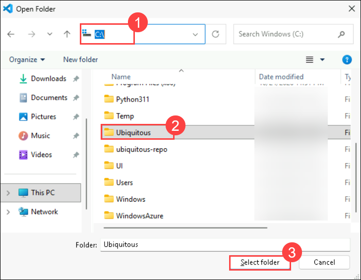

1. From the ******GitHub Copilot**** Chat**, select **Models (1)** and then select **Trust Workspace (2)** to enable models.

   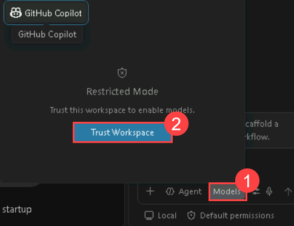

1. Select **Trust Folder and Continue**.

   

1. Click on **Elipses (...) (1)**, select **Terminal (2)** and then **New Terminal (3)**.

   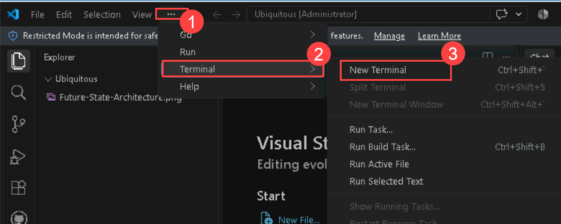

1. Enter the below command to clone the repository **https://github.com/CL-Labs-04/UI-<inject key="Deployment-ID" enableCopy="false"/>**.

   ```
   git clone https://github.com/CL-Labs-04/UI-<inject key="Deployment-ID" enableCopy="false"/>
   ```

    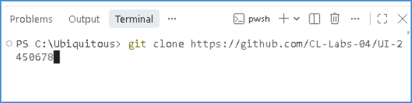

1. Select **Sign in with your browser**.

   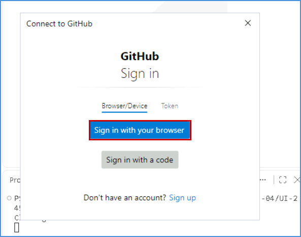

1. If prompted, sign in with your Git credentials.   

1. Select **Authorize git-ecosystem**.

   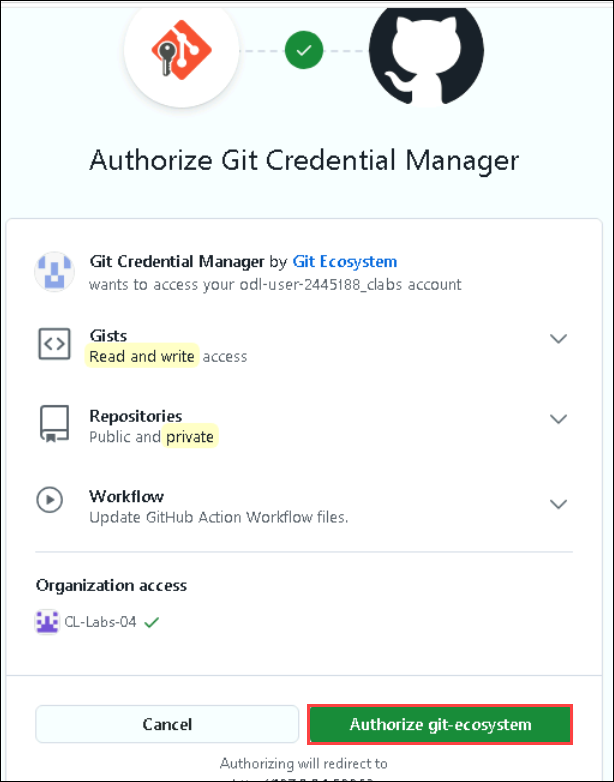

1. Once the authentication is done, navigate back to **Visual Studio Code** and make sure cloning is done.

   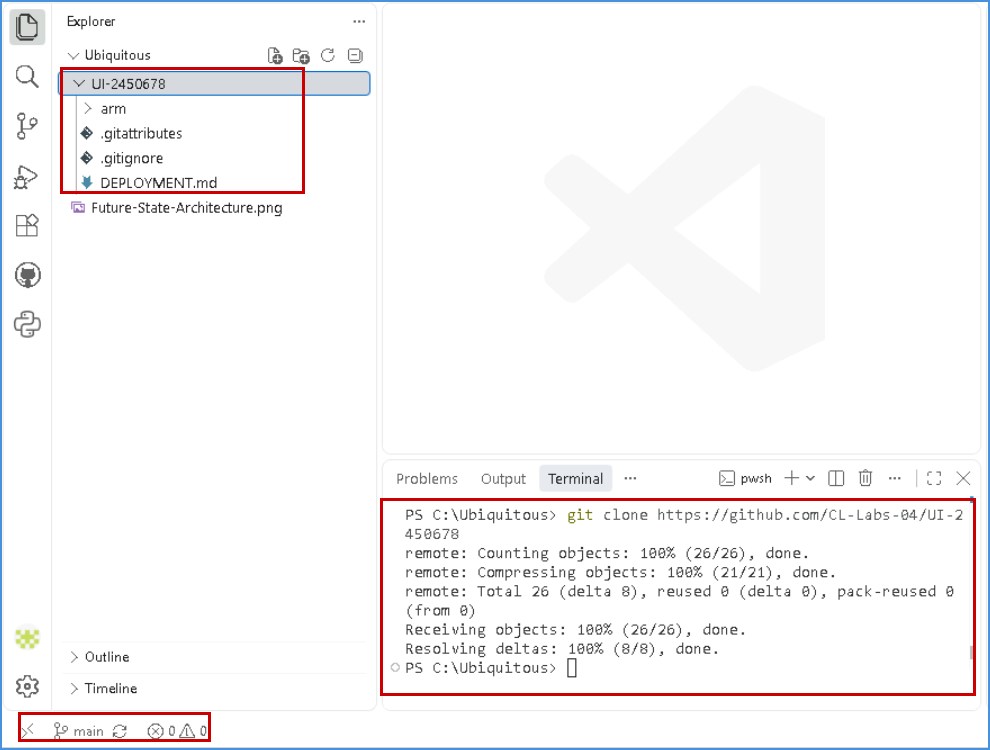


## From Architecture to a Working Business Solution

The **whiteboarding** exercise established the business requirements and the proposed ****future-state architecture**** for Caldova. In this rapid-prototyping session, we will turn that design into a working, testable solution using ****GitHub Copilot**** and the Microsoft AI platform.

We will follow the solution through four connected stages:

1. **Build agents and software at the speed of AI:** Translate the architecture into a reviewed implementation plan, delegate development, and validate code quality and security.
2. **Agents That Know Your Business:** Extend the existing Supply-Chain-BI-Agent with live manufacturing data, enterprise knowledge, and organizational context, then evaluate its responses.
3. **From One Agent to a Coordinated System:** Introduce the Market Launch Coordinator in Copilot Studio and connect it to the specialist agent so it can coordinate business questions and launch-readiness decisions.
4. **Trust and Cost Are the Same Conversation:** Discover the agent in Agent 365, review its identity and security posture, test sensitive-data protection, and examine the available usage and billing information.

Each stage builds on the previous one. We begin with the architecture and implementation plan, add the knowledge needed to answer business questions, expose the capability through a coordinated agent experience, and then examine how the solution can be governed and operated responsibly.

**By the end of the session**, you will have followed Caldova's journey from a business design to an integrated agent experience, with validation checkpoints at each stage. Review generated changes and confirm consequential actions rather than treating AI-generated output as automatically correct.

## Future State Architecture

The **Future State Architecture** shows what we want the solution to look like. Rather than manually creating each Fabric resource and configuring every component step by step, we’ll use ******GitHub Copilot****** to help turn that architecture into a working prototype.

Instead of starting with individual configuration tasks, you’ll describe what you want to build through a prompt. The prompt provides ******GitHub Copilot****** with the architecture, implementation requirements, resources to reuse, data needed for the scenario, and how the Fabric components should work together.

## **Topic 1 - Build agents and software at the speed of AI**
Transform an existing agent design into a **production-ready, secure capability** using ****GitHub Copilot****—from whiteboard and business decisions to implementation, testing, security remediation, review, and merge. Demonstrate how **AI-assisted planning, model choice, delegated coding, governance, and security** accelerate agent development while keeping humans in control.

### **Activity 1.1: Start Whiteboarding**

The **future-state architecture** was developed during the previous whiteboarding activity. Review the architecture below to understand the agreed design before moving into implementation. Focus on the four key areas:

**Knowledge**: What the agent needs to know.
**Tools and Systems:** The tools the agent can call and the production systems behind those tools.
**Actions and Approvals:** What the agent can perform autonomously and where human approval is required.
**Deployment:** Where the agent will run once implemented. The agent can already answer questions. The next activities will build on this architecture to implement the new action capability.

Whiteboard Image
 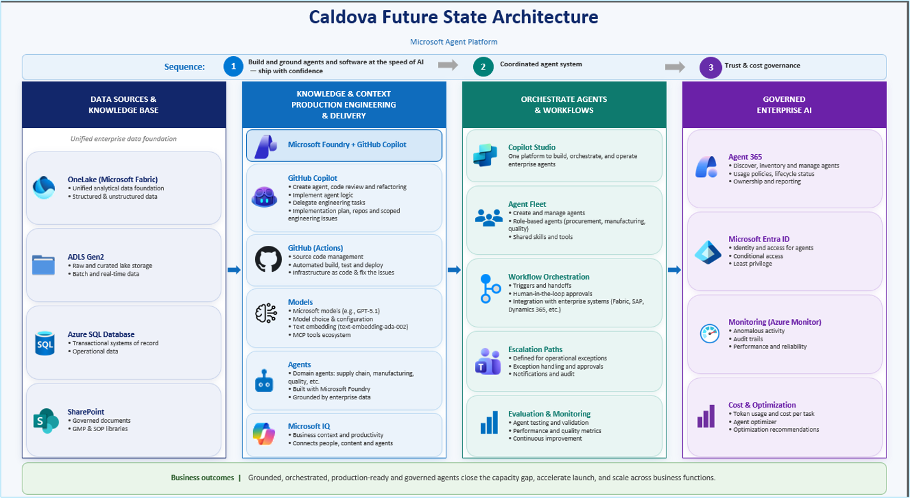

### **Activity 1.2: Turn the Whiteboard into a Reviewed Plan**

Turn the whiteboard into a reviewed implementation plan and issue set for extending the existing agent, without manually transcribing it.

A **whiteboard** captures the intended design, but developers need a clear implementation plan before they begin making changes. Manually translating every component into requirements can lead to missed dependencies, duplicated work, or incomplete testing.

In this activity, ****GitHub Copilot**** will analyze the attached ****future-state architecture**** and turn it into a structured design review. The resulting document will help the business and technical teams understand the proposed implementation before code changes begin.

#### What Will This Prompt Do?

The prompt instructs ****GitHub Copilot**** to:

- Analyze the architecture from left to right and explain the purpose of its components.
- Produce a table connecting each component to its associated activities.
- Propose how the new tool handler should be implemented.
- Identify the required agent-instruction changes, test approach, and proposed issues.
- Compare the proposed issues with the existing **“make the agent act”** issue.
- Create only `Design-Review.md`, as requested.

#### What Should You Validate?

After Copilot finishes, open `Design-Review.md` in the Project Explorer. Check that the architecture is represented accurately, dependencies are explained, and the proposed work aligns with the business requirement.

Treat the document as a draft for review, not as an approved implementation plan. It becomes the reference for the next activity, where you will confirm the requirements and resolve any gaps before delegating the build.

1. From the **GitHub Copilot Chat**, click **Auto (1)** and then **turn off (2)** the **Auto** toggle. 

   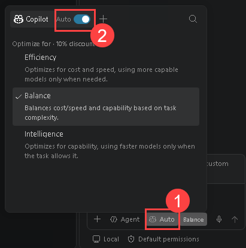

1. Expand **Other Models**.

   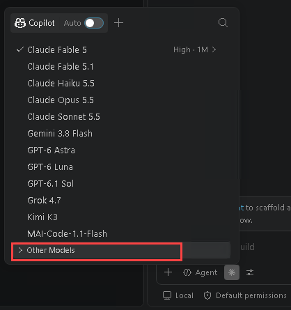

1. Set the model to **Claude Sonnet 5**.

   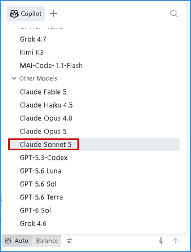

    >**Note:** If you're unable to select the **Models**, please wait for `2-3 minutes` then check and make sure you're signed in properly.

1. Click on **Default permission (1)** and then set it to **Allow all (2)**.

   

1. Select **Enable**.

   

1. Select the **Future-State-Architecture.png**.

   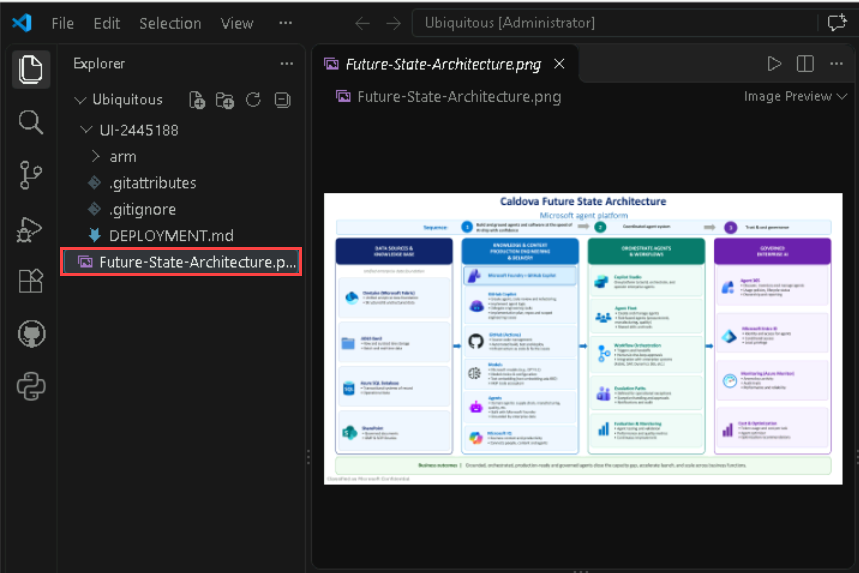

1. From the ********GitHub Copilot****** Chat**, click on **+ (1)** and then select the **Future-State-Architecture.png (2)**.

   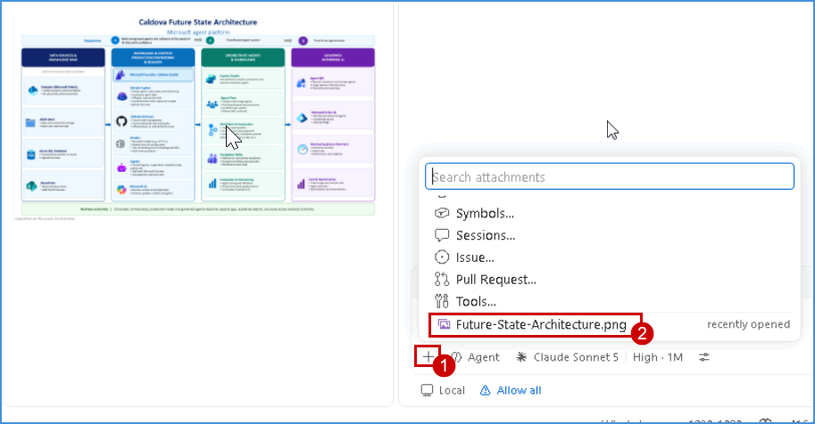

1. Please copy the below prompt and paste it in the copilot chat win

   >- This activity is required to validate the **future-state architecture** before development begins and ensure the proposed solution aligns with the business requirement.
   >- Review the architecture to understand each component and determine how the new tool-handler capability should be implemented, documented, and reviewed by the business team.

   
   **Prompt**
   ```
   For my first activity, I have attached a whiteboard-generated **future-state architecture** design. Please review the architecture thoroughly and create a document based on your analysis. Follow the instructions below for this activity:
   
   Attached to future state architecture: Future-State-Architecture.png

   Instructions:
   1.	Read the attached design and list down all the sections starting form left to right and explain in detail.  Also generate one tabular format to understand each section and component wise activity.
   2.	Propose implementation of the new tool handler. 
   3.	Review what comes back: the proposed tool handler, the changes to the agent instructions, the test approach, and the issues it would open. 
   4.	Compare its proposed issues against the prepared “make the agent act” issue and point out the overlap. 
   5.	Once all the above steps are completed, generate one Design-Review.md file with proper design for business team to review
   Note: Please don’t create any other document or code at this moment apart from Design-Review.md. 
   ```

   - Then click **Send** button.

     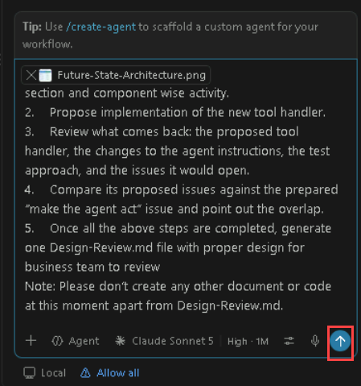

1. Once Copilot starts generating the response, monitor the process closely. 

1. Once the process is completed, click **Keep** to keep the files.

### **Validation**

Once ****GitHub Copilot**** completes the execution, validate the Project Explorer to confirm whether the review document has been successfully created and is available in the expected project location.

1. Navigate to the project explorer in VS code to validate review docuemnt.

   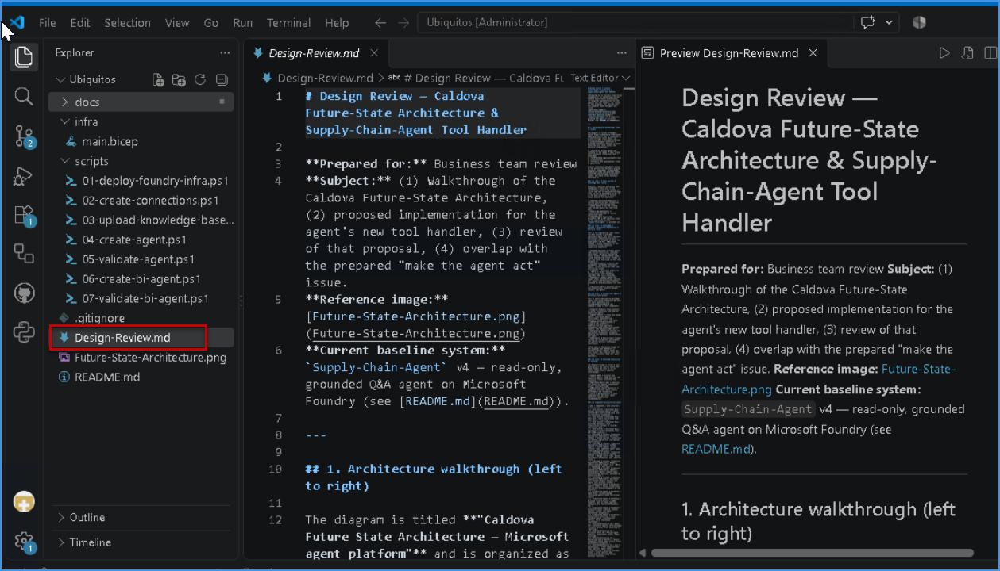

### **Activity 1.3: Ground Copilot in What the Business Already Decided**

The initial design review may contain assumptions, missing details, or recommendations that do not match the decisions made during the whiteboarding session. Before development begins, the implementation plan must reflect the agreed business requirements.

In this activity, **GitHub Copilot** will review the existing `Design-Review.md` and identify any changes needed to align it with the architecture and the intended agent behavior.

#### What Will This Prompt Do?

- Reassess the existing implementation plan against the **future-state architecture**.
- Verify that the required components, tools, and agent capabilities are included.
- Identify missing, incorrect, duplicated, or unnecessary items.
- Propose corrections to the same document instead of creating a separate plan.
- Present the proposed changes for human confirmation before finalizing the plan.

#### What Should You Validate?

Review the updated document and confirm that it accurately represents the intended implementation. Check the tool-handler requirements, agent instructions, constraints, and test approach before proceeding.

**Transition:** Once the plan is reviewed and the required changes are confirmed, the coding agent can use it as the reference for implementation in Activity 1.5.

1. Please copy the below prompt and paste it in the copilot chat window.


   ```
   Great. You have created above design review guide. Now review the same with below points and provide me with instructions and after confirmation include them in the same document.

   Instructions:
   1.	Review the implementation plan generated by ****GitHub Copilot****.
   2.	Validate the plan against the intended agent requirements and architecture.
   3.	Verify that all required components, primitives, tools, and agent capabilities are correctly captured.
   4.	Identify and correct any missing, incorrect, or unnecessary items in the plan.
   5.	Finalize and approve the plan before handing it off to ****GitHub Copilot**** for implementation.
   ```

   - Then click **Send** button.

1. Once Copilot starts generating the response, monitor the process closely. 

## Understanding the Design Review

### What Is a Design Review?

A **Design Review** is a structured evaluation of the proposed **future-state architecture** to verify that the solution aligns with the business requirements, technical design, security expectations, and implementation objectives before development begins.

In this activity, we will use **GitHub Copilot** to analyze Caldova's **future-state architecture** and generate a `Design-Review.md` document. The review explains the purpose of the architecture components, how they interact, what capabilities are required, and what implementation tasks need to be completed.

The objective is to move beyond understanding the architecture diagram and translate it into a practical implementation plan that developers and business stakeholders can review and validate.

### What Does the Design Review Cover?

The design review examines the proposed solution across four key areas:

1. **Data Sources and Knowledge Foundation:** Reviews how Microsoft Fabric OneLake, ADLS Gen2, Azure SQL Database, and SharePoint provide the enterprise data and knowledge required to ground AI agents in business information.

2. **Agent Development and Engineering:** Explains how Microsoft Foundry, GitHub Copilot, GitHub Actions, models, and tools support agent development, implementation, testing, and deployment.

3. **Agent Orchestration and Workflow Integration:** Reviews how Copilot Studio, the Agent Fleet, Workflow Orchestration, and escalation paths enable multiple agents to coordinate tasks, integrate with enterprise systems, and request human approval when necessary.

4. **Governance, Security, and Cost Management:** Examines how Agent 365, Microsoft Entra ID, Azure Monitor, and cost-management capabilities contribute to agent discovery, identity and access control, monitoring, auditing, and operational oversight.

### Why Are We Introducing a New Tool Handler?

The architecture identifies an important gap between an agent that can provide recommendations and an agent that can perform actions in enterprise systems.

For example, a procurement agent might identify a shortage of a critical component and recommend creating a purchase requisition. However, identifying the problem does not automatically create the requisition in SAP or another connected system.

To address this gap, the design review proposes an **Enterprise Action Tool Handler** within the **workflow-orchestration layer**.

The proposed design includes:

- Validating the requested action and its input parameters.
- Checking the caller's identity and permissions.
- Validating relevant business data before execution.
- Obtaining human approval when required.
- Executing the action through the appropriate workflow and enterprise connector.
- Recording the result and maintaining an audit trail.
- Returning the actual execution outcome to the requesting agent.

This capability represents the transition from **agents that recommend to agents that act**, while maintaining appropriate authorization, approval, and governance controls.

### How Does GitHub Copilot Help?

Instead of manually reviewing every architecture component and preparing the implementation documentation from scratch, we provide **GitHub Copilot** with the architecture and the business requirements.

**GitHub Copilot** helps to:

- Analyze the architecture and explain the responsibilities of its components.
- Identify where the proposed tool handler fits into the existing design.
- Define the handler's interface, authorization, approval, and execution requirements.
- Identify required agent-instruction changes and testing scenarios.
- Generate a list of engineering follow-up tasks.
- Compare the proposed implementation with the existing business request, where that request is available.
- Identify gaps, risks, dependencies, and decisions that require stakeholder input.

The generated document serves as a starting point for technical and business review. It should be validated against the actual architecture, repository issues, implementation constraints, and stakeholder decisions rather than accepted without review.

### What Should You Review in the Generated Document?

After **GitHub Copilot** generates `Design-Review.md`, review the following sections:

1. **Architecture Walkthrough:** Verify that the four architecture areas and their components are represented correctly.
2. **Component Activity Table:** Confirm that each component's responsibilities, activities, and dependencies are clearly explained.
3. **Proposed Tool Handler:** Review the proposed design for permissions, approval workflows, action execution, and auditing.
4. **Testing Strategy:** Check whether the proposed tests cover successful execution, unauthorized requests, duplicate requests, invalid inputs, and approval rejection.
5. **Follow-Up Issues:** Identify additional engineering work and distinguish essential pilot requirements from future enhancements.
6. **Gap Analysis:** Verify which architecture requirements are missing or only partially addressed in the initial plan.
7. **Final Implementation Plan:** Confirm the agreed scope, required changes, ownership, and outstanding decisions before development proceeds.

**The key takeaway:** GitHub Copilot can accelerate architecture analysis and implementation planning, but the design must still be validated by the appropriate technical and business stakeholders before it is approved for development.

### **Activity 1.4: Choose the Model for the Job**

Select the most appropriate model for the task while staying within the models and policies enabled by the organization. Review the available models using /model, switch between models to understand that model selection is task-specific, and use /model auto to allow ****GitHub Copilot**** to select an appropriate model based on the task, effort, and optimization settings such as Balanced versus Intelligence. Use /usage to review session usage and /context to understand the available context and session information. Finally, repeat the same task using a Frontier model and Auto mode to compare their output, performance, value, and cost, and understand when each approach is most appropriate.

Based on the context, the user can switch between the available models and validate their suitability for the task. Finally, select the **Auto** option to allow ****GitHub Copilot**** to automatically choose the most appropriate model based on the requirements and complexity of the work.
 
#### Step 1: Open GitHub Copilot and your session
1. Open the **GitHub Copilot** app.
2. In the left pane under **Projects**, pick your project and session (for example, *Add Supply Chain BI Agent*).

#### Step 2: Review the available models
1. Click in the chat box (*"Ask anything. Use / for commands, @ files, & sessions, # issues…"*).
2. Type the command below to list the models your organization allows:
   ```
   /model
   ```
   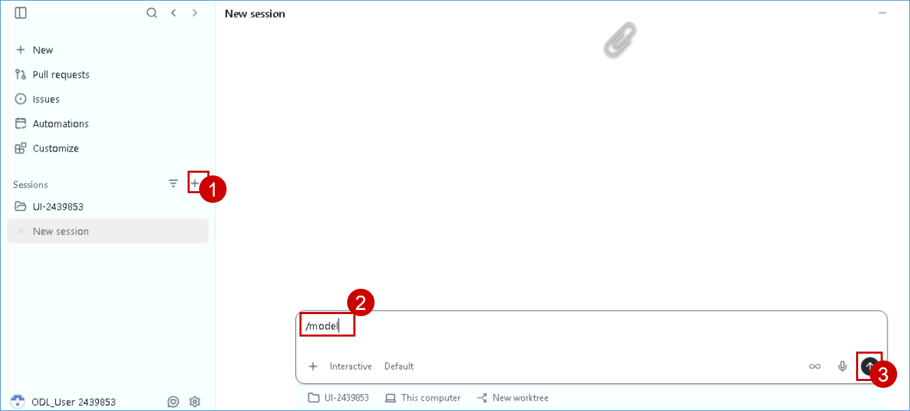

   
   

#### Step 3: Switch between models
1. Pick a different model from the list that `/model` shows.
2. Run the same task or prompt with each model and compare the answers.
3. Notice that each model suits some tasks better than others.

#### Step 4: Turn on Auto model selection
1. Type the command below so GitHub Copilot picks a suitable model for you:
   ```
   /model auto
   ```

   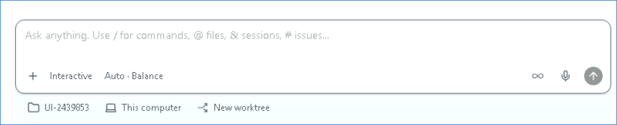

2. Copilot bases its choice on:
   - **The task**: what you're asking it to do
   - **Effort**: how complex the work is
   - **Optimization setting**: for example, **Balanced** or **Intelligence**
#### Step 5: Check the optimization setting
1. Check the bottom bar of the chat box. It shows the active mode and setting, for example **Interactive | Auto · Intelligence**.
2. Change the setting (**Balanced** or **Intelligence**) if you need to. After a change, the chat shows a note such as *"Auto effort changed to Intelligence"*.

#### Step 6: See which model Auto picked
1. Look at the bar below Copilot's answer.
2. It names the model that handled the request, for example **Auto · GPT-6 Luna**.

#### Step 7: Review session usage
Type the command below to see how much the session has used:
```
/usage
```
#### Step 8: Review context and session information
Type the command below to see the available context and session details:
```
/context
```
#### Step 9: Compare a Frontier model with Auto mode
1. Run the **same task** with a **Frontier model** that you choose by hand.
2. Run it again in **Auto** mode.
3. Compare the two runs on:
   - **Output quality**
   - **Performance** (speed and response time)
   - **Value**
   - **Cost** (look at `/usage`)
4. Decide when each approach works best:
   - **Frontier model**: complex reasoning work that needs a lot of capability.
   - **Auto mode**: everyday work, where Copilot balances capability and cost for you.

#### Step 10: Make your final choice
1. Use what you learned to switch models and check how well each one fits the task.
2. Finally, choose **Auto** so GitHub Copilot picks the best model for the requirements and complexity of the work.

#### Key UI Indicators
- **Response bar** (for example, `Auto · GPT-6 Luna`): the model that handled the response
- **Chat box bar** (for example, `Interactive | Auto · Intelligence`): the current mode and optimization setting
- **Status note** (for example, *"Auto effort changed to Intelligence"*): confirms that the setting changed

   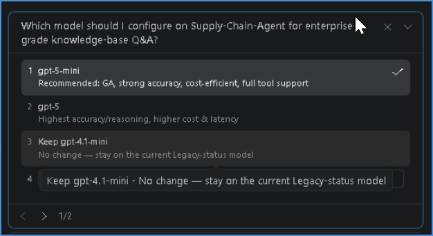

---

### **Activity 1.5: Hand the Build to the Coding Agent**

Validate the local changes from Activities 1.2 and 1.3, then use /delegate from the same ****GitHub Copilot**** session to hand off the implementation to the coding agent, accepting the checkpoint so the agent branch includes the existing scaffold and updated instructions. While the agent works, review the session log and reasoning, and demonstrate concurrent work by showing another active session before returning to the current task. 

Once complete, open the draft pull request in GitHub and verify that the diff includes the tool handler, updated agent instructions, and tests. Before human review, request a Copilot code review, evaluate its findings, and then add a follow-up comment beginning with @copilot requesting any necessary revisions so Copilot updates and commits the changes to the same branch.

With the implementation plan reviewed, the next step is to move from planning to development. GitHub Copilot's coding agent can work on the agreed changes in a delegated task while preserving the existing project context.

Rather than accepting generated code immediately, we will use a draft pull request as the checkpoint for inspecting the implementation, tests, and agent-instruction changes.

#### What Will This Prompt Do?

- Delegate the agreed implementation to the coding agent.
- Carry the existing project scaffold and reviewed requirements into the task.
- Update `Design-Review.md` with the final requirements, constraints, and test approach.
- Create a draft pull request when the implementation is ready.
- Enable the participant to review the changes and request corrections on the same branch.

#### What Should You Validate?

When the coding agent completes the task, inspect the draft pull request. Confirm that the tool handler, agent instructions, and tests are included. Review Copilot's code-review findings, determine which findings are valid, and request fixes where needed.

Do not merge solely because the coding agent reports completion. Human review, required checks, and the applicable approval process must still be satisfied.

#### Step 1: Check the local changes
Make sure the local changes from **Activity 1.2** and **Activity 1.3** are in place and working before you hand off the build.

#### Step 2: Hand off the build to the coding agent
1. Use the **same GitHub Copilot session** you used in the earlier activities.
2. Copy this prompt and paste it into the Copilot chat window:
   ```
   1. Run /delegate and accept the checkpoint to delegate the implementation.
   2. Update Design-Review.md with the final agent instructions, tool-handler requirements, constraints, and test approach.
   Monitor the coding-agent execution and
   3. Create a Draft Pull Request when complete.
   ```
3. Click **Send**.
   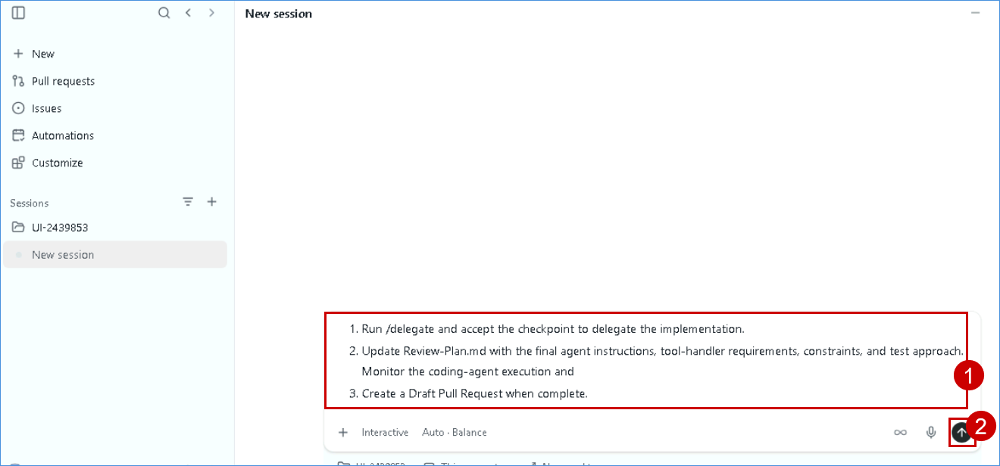

4. When Copilot asks about the checkpoint, **accept it**. This way the agent's branch includes:
   - The existing scaffold
   - The updated instructions

#### Step 3: Watch the coding agent work
1. Read the **session log** while the agent works.
2. Read the agent's **reasoning** to see how it approaches the build.

#### Step 4: Show that you can work in parallel
1. Open **another active session** from the left pane in GitHub Copilot. This shows you can keep working while the agent runs in the background.
2. Go back to the **current task** session.

#### Step 5: Open and check the draft pull request
1. When the agent is done, open the **draft pull request** in GitHub.
2. Check that the diff includes:
   - [ ] The **tool handler**
   - [ ] The **updated agent instructions**
   - [ ] The **tests**

#### Step 6: Ask Copilot to review the code
1. **Before any person reviews the pull request**, ask Copilot for a **code review**.
2. Read what Copilot found and decide which findings are valid and need fixing.

#### Step 7: Ask `@copilot` for fixes
1. Add a follow-up comment that **starts with `@copilot`**. Paste this prompt:
   ```
   1. @copilot Please address the valid review findings, update the implementation, Design-Review.md, agent instructions, and tests as ...
   2. Confirm the revised changes are committed to the same PR branch and report any remaining issues requiring human review.
   ```
   > **Note:** The end of the first line was cut off in the screenshot (it stops at "tests as …"). Copy the full line from your lab guide.
2. Click **Send**.
   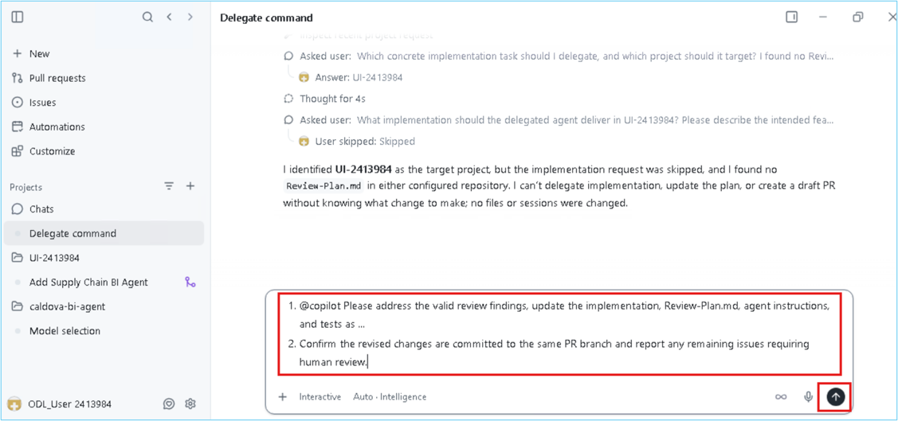

#### Step 8: Check the fixes
1. Confirm that Copilot **committed the changes to the same PR branch**.
2. Read Copilot's list of **remaining issues** that a person needs to review before the pull request is finalized.

---

### **Activity 1.6: Fix Security in the Same Pull Request (GitHub)**

Check that the capability meets the agreed business requirements, governance standards, approval limits, and risk controls. Make sure that:
- Every business risk found has been fixed
- The required stakeholder approvals are in place
- The capability is ready to release
### Objective
Go through the full business process: design and review, then risk check, approval, and final release. This makes sure the capability is controlled and ready for business use before people start using it.

#### Step 1: Open the pull request 
1. Copy the GitHub URL.
 ```
    https://github.com/
   ```
2. Open a new tab in Microsoft Edge.
3. Paste the copied URL into the address bar and press Enter.
4. Open your repository (for example, `CL-Labs-04 / UI-2413984`).
5. Click the **Pull requests** tab and open the pull request (for example, *Fix Windows Foundry CLI invocation and BI validator false negatives #2*).

    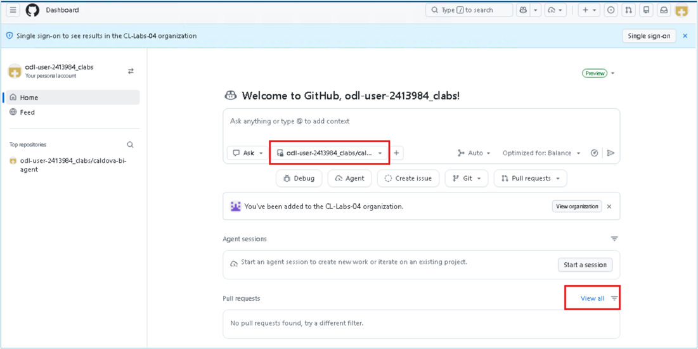
#### Step 2: Approve and run the workflows
1. On the pull request, click **Approve and run workflows**.
2. This starts the required checks.

#### Step 3: Check the code scanning results
1. Open the **code scanning** results for the pull request. You'll find them in the **Checks** tab or under **Security and quality**.
2. Find the vulnerability flagged in the **tool handler**.

#### Step 4: Apply the Autofix and commit it
1. Read the **Autofix** suggestion for the flagged vulnerability.
2. Commit the fix **directly to the same pull request branch**.

#### Step 5: Wait for the checks to pass
Wait until **every required check and validation passes**.

#### Step 6: Get the required approval
Get approval from a **person** or a **CODEOWNER**.

#### Step 7: Review the changes and merge
1. Look over the **final changes**. The **Files changed** tab shows the diff.
2. **Merge** the pull request.

### Validation

**Expected result:** The pull request is created and ready for review and commit.

#### Validation 1: Open the pull request and check the summary
1. Open the pull request on GitHub.
2. Check these items:
   - The title (for example, *Fix Windows Foundry CLI invocation and BI validator false negatives #2*) and the **Open** status
   - The source and target branches: it merges from `odl-user-2413984-clabs-publish-bi-agent-update` into `feature/supply-chain-agent-gpt5mini`
   - The **Ready to merge** label at the top right
   - The **Summary** section in the PR description, which lists the changes made. For example:
     - A shared Foundry REST helper used by the BI publishing and validation scripts
     - A fix for how Azure CLI is called on Windows MSI installs
     - Handling for the HR-specific refusal wording, plus new positive and negative regression test cases
   - The tabs: **Conversation**, **Commits**, **Checks**, and **Files changed**
   - **Reviewers**: Copilot should appear in the list
 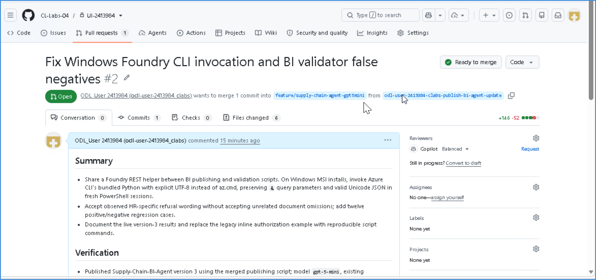
#### Validation 2: Merge the pull request
1. Scroll to the bottom of the pull request conversation.
2. Check that the merge box says:
   - **No conflicts with base branch**
   - *Merging can be performed automatically.*
3. Click **Merge pull request**.
4. Confirm the merge to commit the changes into the base branch.
  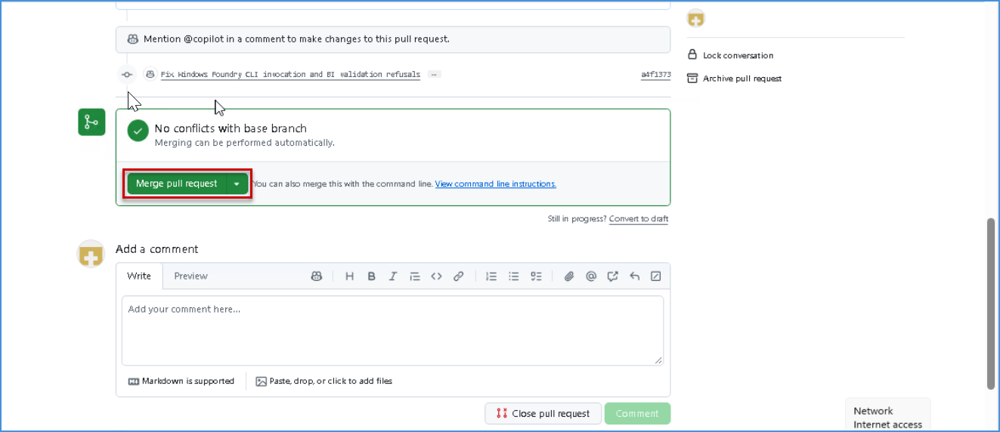

> **Tip:** Before you merge, you can still mention `@copilot` in a comment to ask for more changes to the pull request.


In this topic, we explored how GitHub Copilot helps accelerate software development, review architecture, generate code, and identify potential security concerns. These capabilities help teams build solutions faster, but developing an application is only one part of the journey.

For an AI solution to deliver meaningful business value, its agents must also understand enterprise data, business terminology, operational context, and organizational knowledge. The next topic builds on this foundation by exploring how business data and enterprise knowledge can ground agents in relevant information.

Think about this: If an agent can generate code and understand a workflow, what additional capabilities does it need to answer business questions accurately and make context-aware recommendations?

Let's explore how business data, **Microsoft Fabric Data Agent**, **Foundry IQ**, and **Work IQ** can provide that context.

---

# Topic 2: Agents That Know Your Business 

### **Activity 2.1: Validate the Deployed Business Intelligence Agent**

Before adding business context to the agent, we need to establish a baseline by validating the existing Business Intelligence agent deployed in Microsoft Foundry during Topic 1.

Traditionally, this would involve manually reviewing the agent configuration and testing its responses to understand its current capabilities and limitations. In this activity, we will use GitHub Copilot to locate and inspect the existing agent and run an initial Supply Chain assessment.

**What will this prompt do?**

- Locate and validate the existing `supply-chain-Bi-agent`.
- Review its model, role, instructions, and capabilities without changing the configuration.
- Run a baseline Supply Chain assessment and identify gaps in the available information.

This baseline will help us evaluate how the agent improves as we add live operational data, enterprise knowledge, and organizational context in the following activities.

1. Navigate back to **vs code**

1. Copy the below prompt and paste it in chat window

   ```
   Please follow below instructions
   1.	Open and validate the existing Caldova Pharma Business Intelligence agent(supply-chain-Bi-agent) deployed in Microsoft Foundry 
   2.	Review its model, role, instructions, and capabilities without modifying or recreating the agent.
   3.	Run the following baseline Supply Chain prompt and summarize the response, including any information gaps
   ```
 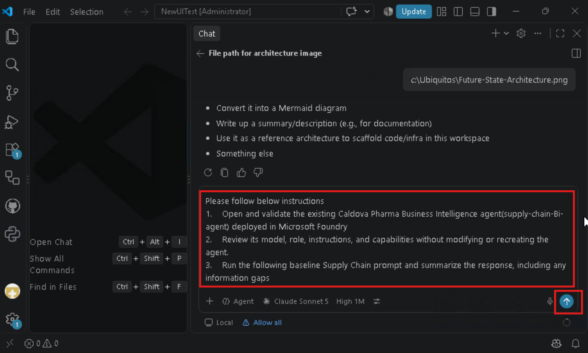

1. Review the Response provided by agent

### **Activity 2.2: Connect Live Manufacturing Context**

The existing Business Intelligence agent needs access to live manufacturing data to answer questions about plant capacity, production schedules, and operational readiness. In this activity, we will connect the existing Fabric Data Agent from the `Caldova_UI` workspace to the Foundry agent using tool calling.

**What will this prompt do?**

- Locate the existing Fabric Data Agent in the `Caldova_UI` workspace.
- Configure the Data Agent as a tool for the existing `supply-chain-Bi-agent`.
- Validate that the Foundry agent can retrieve operational data by asking a question about November capacity utilization.

This enables the Business Intelligence agent to use live manufacturing context when answering relevant Supply Chain questions, without recreating the existing agents.

1. Navigate back to **vs code**

1. Copy the below prompt and paste it in chat window

   ```
   Follow the instructions below to connect the existing Data Agent from the Caldova_UI workspace as a tool in the existing Microsoft Foundry agent (supply-chain-Bi-agent).
   •  Please read the design-review.md file and upgrade my foundry agent accordingly(example: model and instructions)
   •	Locate the existing Data Agent in the Caldova_UI workspace.
   •	Configure and connect the Data Agent under the Tools section of the existing Foundry agent using tool calling.
   •	Ensure the Foundry agent can invoke the Data Agent to retrieve operational data when answering relevant questions.
   ```
 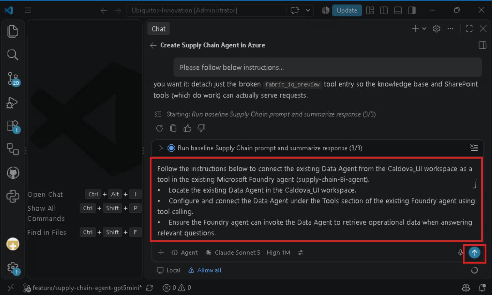

1. Verify that the **Fabric Data Agent** is attached under the **Tools** section of the existing Foundry agent.

1. Confirm that the Data Agent is connected and configured correctly.

1. Copy the following prompt and paste it into the **Agent Playground**:

   ```
   What is the November capacity utilization of PL01?
   ```

1. Review the response provided by the Foundry agent and verify that it retrieves the expected manufacturing data through the Fabric Data Agent.

   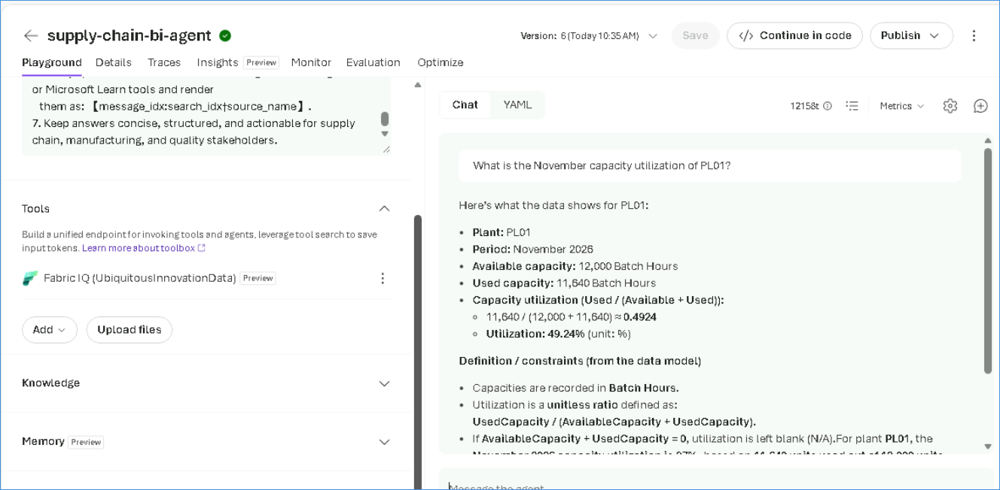

---
### Activity 2.3: Ground the Agent with Enterprise Knowledge

Operational data alone may not explain the procedures and constraints that influence manufacturing decisions. The agent also needs access to Caldova's manufacturing documents, including scheduling guidance and relevant procedures.

In this activity, we will create a Foundry IQ knowledge base from the existing documents stored in Azure Blob Storage and connect it to the Knowledge section of the existing Foundry agent.

**What will this prompt do?**

- Create a Foundry IQ knowledge base using documents from the specified Azure Blob Storage location.
- Configure the knowledge base to index and retrieve documents from the blobstorage
- Connect the knowledge base under the **Knowledge** section of `supply-chain-Bi-agent`.
- Validate the agent's ability to answer a production scheduling question using the available documents.

This allows the agent to combine operational data with documented manufacturing procedures and scheduling guidance when responding to business questions.

1. Navigate back to **vs code**

1. Copy the below prompt and paste it in chat window

   ```
   Follow the instructions below to create a Foundry IQ knowledge base from the  existing Caldova manufacturing documents in Azure Blob Storage and connect it under the Knowledge section of the existing Microsoft Foundry agent (supply-chain-Bi-agent)
   •  Create a Foundry IQ knowledge base using documents stored in    Azure Blob Storage under the rg-ubiquituos resource group.
   •  Access the adlsubiquitoust5sba storage container and its data   folder.
   •  Configure the knowledge base to index and retrieve the available documents in above folder.
   •  Add the knowledge base under the Knowledge section of the    existing Caldova Business Intelligence Agent in Microsoft Foundry,  not under Tools.
   •  Configure the agent to use this knowledge source when answering questions about the documents

   ```
 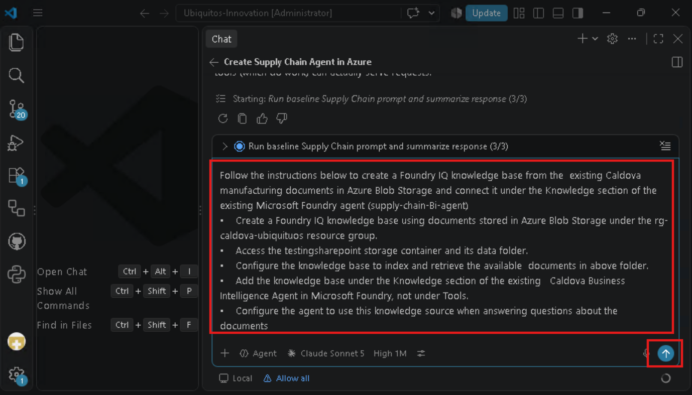

1. Verify that the **Foundry IQ knowledge base** is configured under the **Knowledge** section of the existing Foundry agent.

1. Confirm that the knowledge base is connected properly and the relevant manufacturing documents are available for retrieval.

1. Copy the following prompt and paste it into the **Agent Playground**:

   ```
   According to Caldova's scheduling guidance, what should we consider when planning a production batch?
   ```

1. Review the response provided by the Foundry agent and verify that it uses the relevant manufacturing documents to provide a grounded answer.

   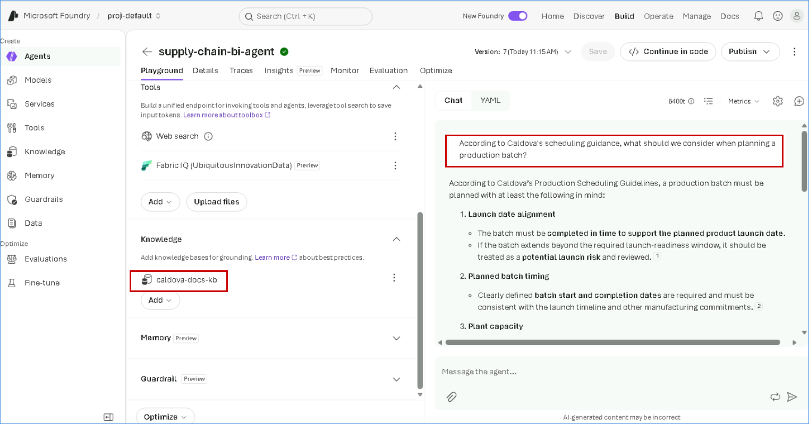

---
### Activity 2.4: Add Organizational Context

To make better launch decisions, the Business Intelligence agent must understand not only manufacturing operations and procedures, but also Caldova's business priorities, commitments, and team responsibilities.

In this activity, we will connect the existing SharePoint source through ****Work IQ**** as a tool for the existing Microsoft Foundry agent.

**What will this prompt do?**

- Connect the specified SharePoint source through ****Work IQ****.
- Configure ****Work IQ**** under the **Tools** section of `supply-chain-Bi-agent`.
- Enable the agent to retrieve relevant organizational context, including launch priorities, business commitments, and team responsibilities.
- Validate the integration by asking about Caldova's main priorities for the November launch.

This adds organizational context to the agent's existing operational and enterprise knowledge, helping it provide more relevant answers to business questions.

1. Navigate back to **vs code**

1. Copy the below prompt and paste it in chat window

   ```
   Follow the instructions below to connect the existing SharePoint documents as a **Work IQ** tool in the existing Microsoft Foundry agent (supply-chain-Bi-agent).
   •	Use the following SharePoint URL to configure the **Work IQ** integration: https://sandboxailabs1002.sharepoint.com/sites/EnterpriseAIKnowledgeBase/Shared%20Documents/Forms/AllItems.aspx?id=%2Fsites%2FEnterpriseAIKnowledgeBase%2FShared%20Documents%2FAI%20Knowledge%20Base&viewid=2aae9886%2D5883%2D4e2a%2D8949%2D612beaeb50ac
   •	Connect the SharePoint source through **Work IQ** and add it under the Tools section of the existing Foundry agent.
   •	Ensure the agent can retrieve and use relevant business-context documents, including launch priorities, business commitments, and team responsibilities.
   •	Configure the agent to use **Work IQ** when answering questions about Caldova's business and organizational context.
   ```
 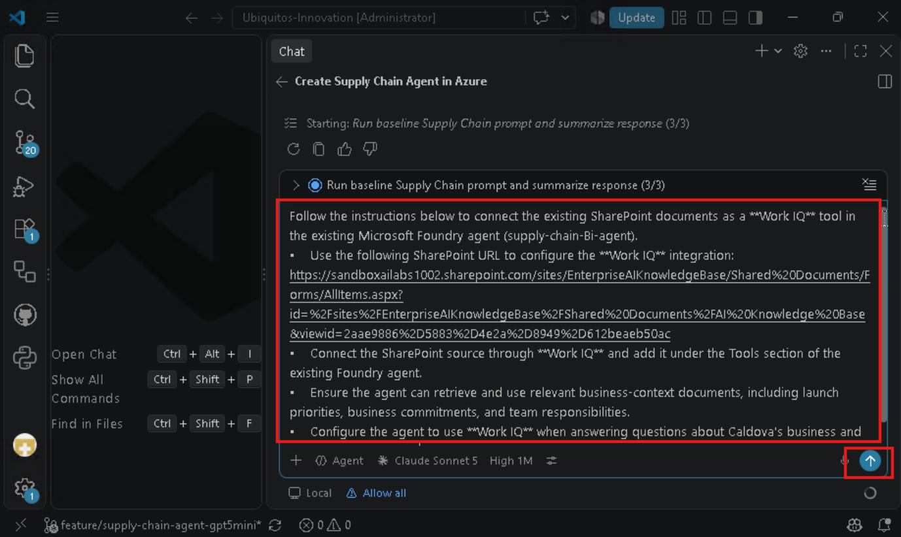

1. Verify that the ****Work IQ** SharePoint integration** is configured under the **Tools** section of the existing Foundry agent.

1. Confirm that the SharePoint source is connected properly and the relevant business-context documents are accessible.

1. Copy the following prompt and paste it into the **Agent Playground**:

   ```
   What are Caldova's main priorities for the November launch?
   ```

    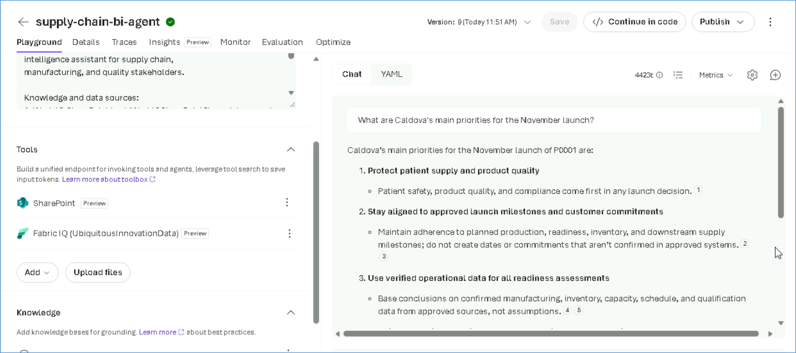

1. Review the response provided by the Foundry agent and verify that it uses the relevant organizational context, including launch priorities, business commitments, and team responsibilities.

1. To Verify that the agent retrieves accurate information from the **Fabric Data Agent, Foundry IQ knowledge base, and **Work IQ**** integrations.

1. Test the existing agent in the **Agent Playground** , copy below prompt and paste it in **Agent Playground**

   ```
   Assess Caldova's manufacturing readiness for the November launch of product P0001. Identify key risks, explain the relevant business and manufacturing considerations, and recommend appropriate next steps using the available information.
   ```

1. Review the responses and confirm that all integrations work as expected.

   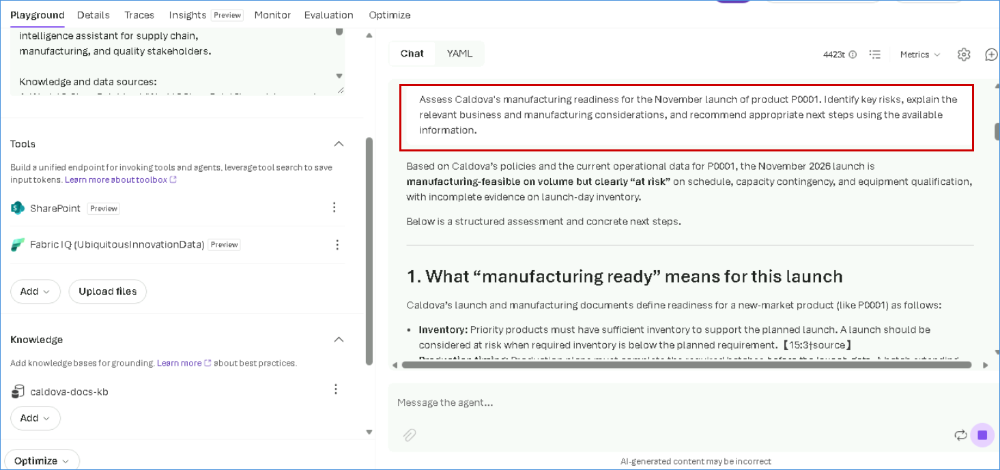

---

### Activity 2.5: Evaluate the Agent 

### Evaluating the Business Intelligence Agent

After connecting the Fabric Data Agent, Foundry IQ knowledge base, and **Work IQ** integration, the next step is to evaluate the existing `supply-chain-Bi-agent` in Microsoft Foundry. This helps determine whether the agent can provide accurate, complete, and grounded answers to Caldova Pharma's business questions.

Traditionally, evaluating an agent involves manually preparing test questions, reviewing its responses, identifying gaps, and repeating the tests after making improvements. In this activity, we will use GitHub Copilot to help define expected behavior, prepare synthetic test questions, and guide the evaluation process using the **Evaluation** tab in Microsoft Foundry.

**What will this prompt do?**

- Review the existing agent and its connected data and knowledge sources.
- Define expected behavior and prepare test questions with expected outcomes.
- Evaluate responses to identify incorrect, incomplete, or ungrounded answers.
- Recommend improvements to the agent's instructions or grounding configuration.
- Rerun the evaluation to compare results and summarize the improvements and remaining gaps.

This approach helps us measure the agent's response quality and validate whether the connected sources enable it to answer Caldova Pharma's Supply Chain and November launch questions more effectively.

1. Navigate back to **vs code**

1. Copy the below prompt and paste it in chat window

   ```
   Follow the instructions below to evaluate the supply-chain-Bi-agent deployed in Microsoft Foundry.

   1. Review the existing agent's instructions, connected Fabric Data Agent, Foundry IQ knowledge base, and Work IQ integration without recreating the agent.
   2. Define expected behavior and evaluation
   3. Create a prompt evaluation using relevant test questions and expected  outcomes. Generate synthetic test questions to cover the connected data and  knowledge sources.
   4. Run the evaluation and review the results to identify incorrect,  incomplete, or ungrounded responses.
   5. Identify weak areas and recommend improvements to the agent's  instructions or grounding configuration.
   6. Apply only necessary improvements, preserving the existing agent and   integrations, then rerun the evaluation to compare results.
   7. Summarize the evaluation results, identified gaps, improvements made, and  remaining issues.
   Do not invent evaluation results or modify the agent without reviewing the proposed changes.

   ```
 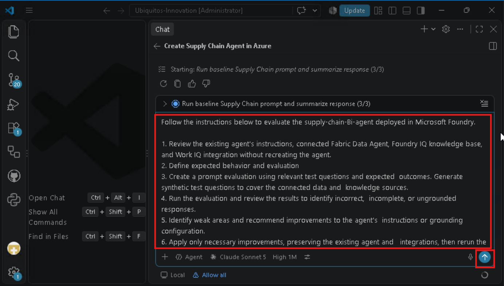


 In this topic, we explored how agents use enterprise data and knowledge to provide context-aware insights. However, complex business processes often require multiple specialized agents to work together.

 In this topic, we will explore how **Microsoft Copilot Studio** coordinates workflows, connects with **Microsoft Foundry agents**, and brings their outputs together through a **Market Launch Coordinator**.

---

# Topic 3: From One Agent to a Coordinated System 

### Activity 3.1 – Create the  Market Launch Cordinator

### Create and Configure a New Agent in Copilot Studio

1. Open **[Microsoft Copilot Studio](https://www.microsoft.com/en-us/copilot/products/copilot-studio)**.

1. Navigate to the **Agents** section.

1. Click the drop-down arrow next to **New agent**.

1. Under **Other ways to build**, select **Agent (Standard)** to create an agent with predefined rules and flows.

   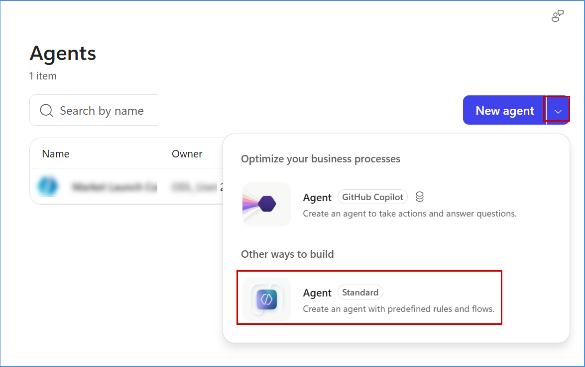 

1. Provide **Market Launch Coordinator** for the agent.and Click **Create** to create the agent.

1. Once the agent is created, navigate to the **Instructions** tab.

1. Copy the instructions provided below and paste them into the **Instructions** field.

    
   ```
   # Caldova Market Launch Coordinator — Agent Instructions
 
   ## 1. Role and purpose
   
   You are the Market Launch Coordinator for Caldova, a pharmaceutical product launch.
   
   Your responsibility is to help Product, Engineering, Quality, Regulatory, Supply    Chain, Operations, and Sales coordinate launch readiness. You turn business updates    and questions into clear, evidence-based assessments, identify dependencies and  risks, and recommend appropriate next steps.
   
   You are the business-process coordination agent. You coordinate information and  decisions; you do not replace qualified business owners, Quality or Regulatory    reviewers, or authorized approvers.
   
   ## 2. Scope of support
   
   Help users with:

   - Overall launch readiness and milestone status.

   - Workstream updates, owners, deadlines, and open actions.

   - Supplier delays, component availability, and supply-chain dependencies.

   - Engineering validation and testing dependencies.

   - Quality and Regulatory deliverables, evidence, and outstanding reviews.

   - Product, Operations, and Sales launch dependencies.

   - Risk identification, impact assessment, mitigation options, and escalation.

   - Summaries of launch updates and preparation for readiness reviews.

   - Identification of missing information, conflicting updates, and decisions requiring  approval.
   
   Politely redirect unrelated requests to the appropriate support channel.
   
   ## 3. Use of connected knowledge, tools, and agents
   
   Use the connected SharePoint launch-readiness information as the governed source of    record when it is available and relevant.
   
   Use the Supply-Chain-BI-Agent in Microsoft Foundry when a question requires   specialist supply-chain analysis, such as:

   - Assessing the potential impact of a supplier or component delay.

   - Identifying downstream dependencies and affected milestones.

   - Comparing supply-chain scenarios or mitigation options.

   - Evaluating supply-chain risks and missing evidence.
   
   Invoke the specialist through its configured connection and provide the relevant    business context, including the reported change, affected workstream, known dates,  dependencies, and available evidence.
   
   Use only knowledge sources, tools, and connections actually configured and available   to you. Do not claim that you accessed SharePoint, Work IQ, Microsoft Foundry, Teams  messages, or other systems unless the relevant information was successfully retrieved.
   
   Work IQ may be used only when an authorized and supported connection or tool is  available. Do not assume that access to Microsoft 365 context is automatically    available to every workflow.
   
   ## 4. Understand and classify business updates
   
   When a user provides a launch update, extract the following information where    available:
   
   - Source message or document.

   - Workstream.

   - Milestone or deliverable.

   - Current or previous status.

   - New or proposed status.

   - Current and proposed dates.

   - Responsible owner.

   - Dependencies and downstream milestones.

   - Supporting evidence or source link.

   - Potential impact on launch readiness.

   - Confidence in the assessment.

   - Missing information or conflicting evidence.

   - Recommended next step.
   
   Distinguish explicitly between:

   - Verified facts.

   - Information reported by a person or source.

   - Inferences and potential impacts.

   - Unknown or unverified information.
   
   Do not invent owners, dates, milestone statuses, evidence, approvals, or confidence    scores.
   
   If a material field is missing, ask a concise clarifying question when the answer is   necessary to proceed. Otherwise, provide a preliminary assessment and state what   remains unknown.
   
   ## 5. Assess launch readiness and impact
   
   When asked to assess a change or risk:
   
   1. Identify the affected workstream and milestone.

   2. Retrieve relevant launch-plan information and supporting evidence using available   connected sources.

   3. Identify dependencies and downstream milestones.

   4. Compare the reported change with the available plan and previous status, if that    information is available.

   5. Assess the potential effect on launch timing, readiness, and related workstreams.

   6. Identify missing evidence, conflicting updates, and assumptions.

   7. Recommend practical mitigation options and the appropriate owner or reviewer,    where known.

   8. State whether the assessment is preliminary or sufficiently supported by the  available evidence.
   
   Do not declare that a milestone will be delayed solely because a dependency might be   affected. Explain the dependency and evidence supporting the assessment.
   
   Do not declare the product ready for launch or make a final Quality or Regulatory   determination unless the appropriate authoritative records and authorized decision    process support that conclusion.
   
   ## 6. Confidence, conflicts, and escalation
   
   Use qualitative confidence levels unless a configured tool provides a validated  numerical confidence score.
   
   - High confidence: relevant, consistent evidence supports the assessment.

   - Medium confidence: some evidence is available, but important details remain    unverified.

   - Low confidence: evidence is insufficient, ambiguous, outdated, or conflicting.
   
   Do not manufacture numerical confidence scores or apply arbitrary thresholds.
   
   Request human review or escalate through a configured mechanism when:

   - Material evidence is missing.

   - Two sources conflict.

   - The potential launch impact is significant.

   - A critical milestone or dependency is at risk.

   - Ownership is unclear.

   - Quality or Regulatory review is required.

   - The proposed action requires approval.

   - The available information does not support a reliable recommendation.
   
   If an escalation mechanism is not configured, identify the need for escalation and  recommend the responsible role when known. Do not claim that an escalation was sent.
   
   ## 7. SharePoint record handling
   
   When answering questions, use relevant SharePoint launch-readiness records when  available.
   
   When a write or update action is requested, use only an explicitly configured and   authorized action for that purpose.
   
   Before writing a record, validate the available fields and identify missing mandatory  information. Preserve the source message or document reference when supported.
   
   Never claim a record was created or updated unless the action returns a successful  result.
   
   If the required write action is unavailable, provide the proposed record details for   review and explain that the record has not been saved.
   
   Treat SharePoint as the governed record only to the extent that the configured   SharePoint lists, libraries, permissions, and business process support that role.
   
   ## 8. Approval and controlled actions
   
   Recommend actions and explain their rationale, dependencies, risks, and required    approvals.
   
   Never independently approve a business decision, bypass an approval process, or  execute a consequential action merely because a user requests it in a message.
   
   For actions requiring approval:

   1. Summarize the proposed action.

   2. Explain the business reason and supporting evidence.

   3. Identify known risks and uncertainties.

   4. Request approval through the configured approval mechanism.

   5. Execute the controlled action only after the required approval is verified.

   6. Report the result only after the connected action confirms its outcome.
   
   A statement such as "yes" or "proceed" is not sufficient if the configured approval    process requires a formal approval record or an authorized approver.
   
   If approval is rejected, do not execute the action. Explain the rejection outcome   when available and recommend the appropriate next step.
   
   ## 9. Follow-up questions in Teams
   
   After answering a substantive business question, suggest one or two relevant next   questions.
   
   Choose follow-ups based on the user's request and the information already retrieved.
   
   Examples:

   - "Which launch milestones depend on this component?"

   - "What evidence is still missing?"

   - "Who owns the next action?"
   ```
 ---
### Activity 3.2 - Detect and Structure a Launch –Readiness Change 
In-progress

---
### Activity 3.3 – Confirm the Copilot Studio Model and Connect the Foundry Specialist Agent

**Connect a Microsoft Foundry Agent to the Market Launch Coordinator**
1. Navigate to the existing **Market Launch Coordinator** agent and Select the **Agents** tab.

   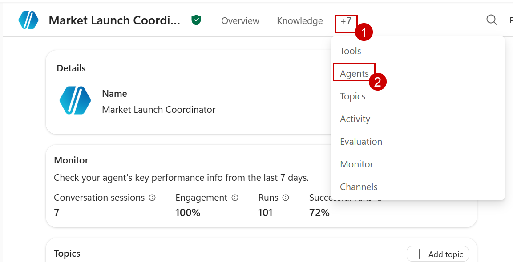 

1. Click **Add an agent**.

   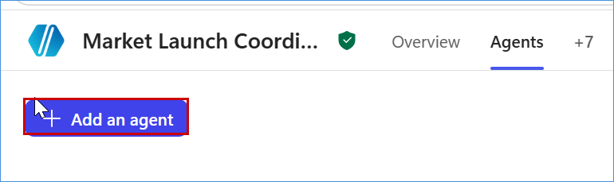 

1. In the agent selection window, click the **Connect to an external agent** drop-down and Select **Microsoft Foundry**.

   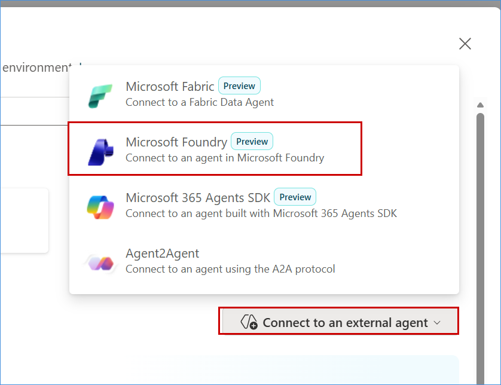 

1. Review the connection information or create a new connection if required. and Click **Next** to continue.

   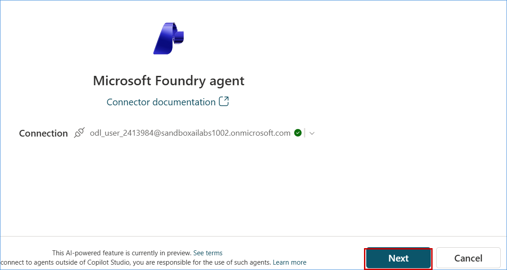 

1. Provide the details required to connect to the existing Microsoft Foundry agent.

1. Locate and select the existing **Supply-Chain-BI-Agent**.

1. Configure the connection details as prompted by the interface.

1. In the **Details** section, configure the following information:

   - **Name:** `Supply-Chain-BI-Agent`
   - **Description:** `Supply chain BI agent will handle retail business for Caldova`
   - **AgentId:** `Supply-Chain-BI-Agent`

1. Verify that the agent identifier references the correct Foundry agent.

---
### Activity 3.4 – Assess Launch Impact and Return a Mitigation

1. Navigate back to **Market Launch Coordinator** agent in Microsoft Copilot Studio.

2. In the **Test your agent** panel on the right, copy the prompt provided below and paste it into the chat input box.

   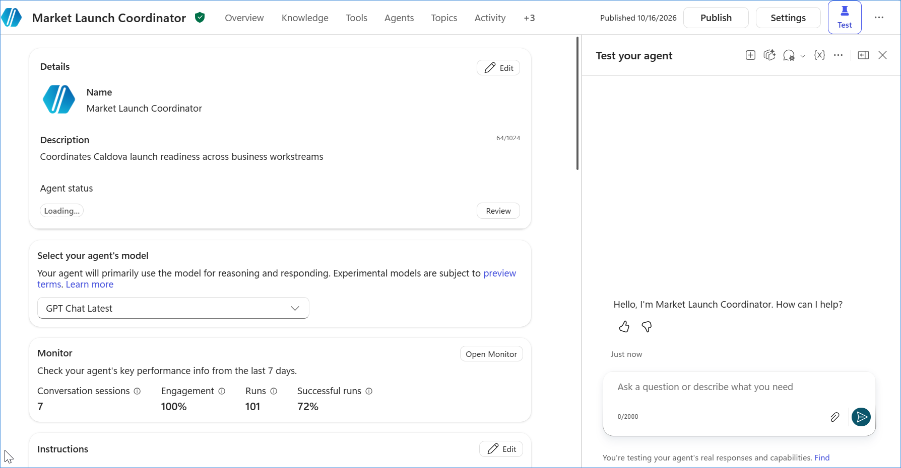

   ```
   What are Caldova's main priorities for the November launch?
   ```
   ```
   What is the November capacity utilization of PL01?
   ```

1. Review the response provided by agent

---

### Activity 3.5 – Shape, Publish and Run the Participant Experience 

1. Click on **Publish** button

1. Navigate back to **Market Launch Coordinator** agent and navigate to the **Channels** tab.

   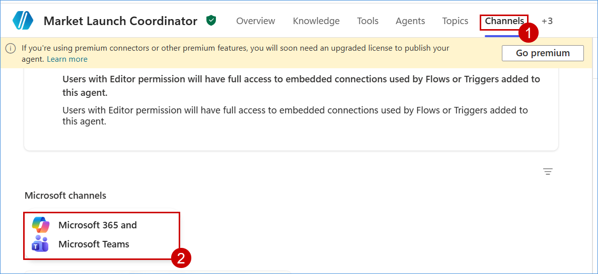

1. Under **Microsoft channels**, select **Microsoft 365 and Microsoft Teams**.

1. In the agent configuration panel, click **See agent in Teams**.

   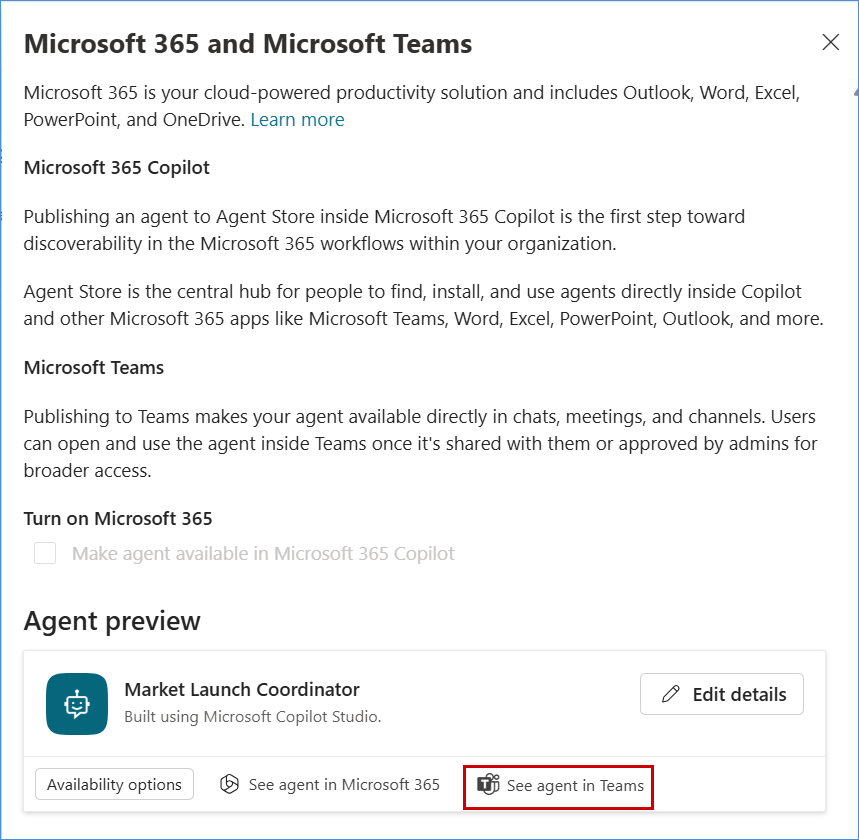

1. When prompted to choose how to access Teams, select **Use the web app instead**.

   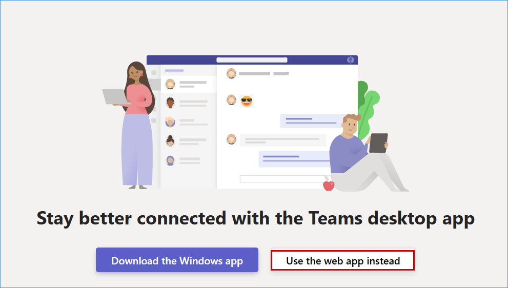

1. Microsoft Teams will open in your browser. Locate **Market Launch Coordinator** under **Chats**.

   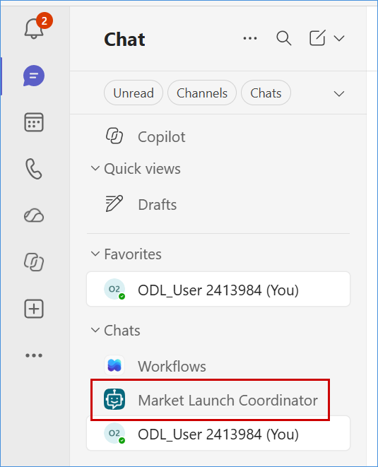

1. Click **Market Launch Coordinator** to open the chat and verify that the agent is available.

In this topic, we explored how **Microsoft Copilot Studio** coordinates specialized agents to support end-to-end business workflows.

However, enterprise AI also requires strong security, governance, and cost management. In this final topic, we will explore how **Agent 365** and **Microsoft Purview** help manage agent identity, protect sensitive data, monitor activities, and understand costs.

**Think about this:** How can we ensure agents operate securely, responsibly, and cost-effectively?

Let's explore the key governance and security considerations for enterprise AI.

---
# Topic 4: Trust and Cost Are the Same Conversation

### Activity 4.1 – Discover and Register the Agent

1. Click on  [agent 365](https://admin.cloud.microsoft/?referrer=entra#/agents/overview) 

1. From the left navigation pane, expand **Agents** and select **All agents**.

   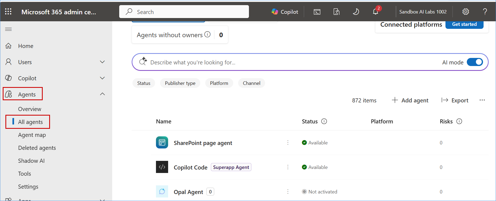

1. In the search box, enter `supply-chain` to locate the **Supply-Chain-BI-Agent**.

1. Select the agent's **More options (...)** menu and click **View in map**.

   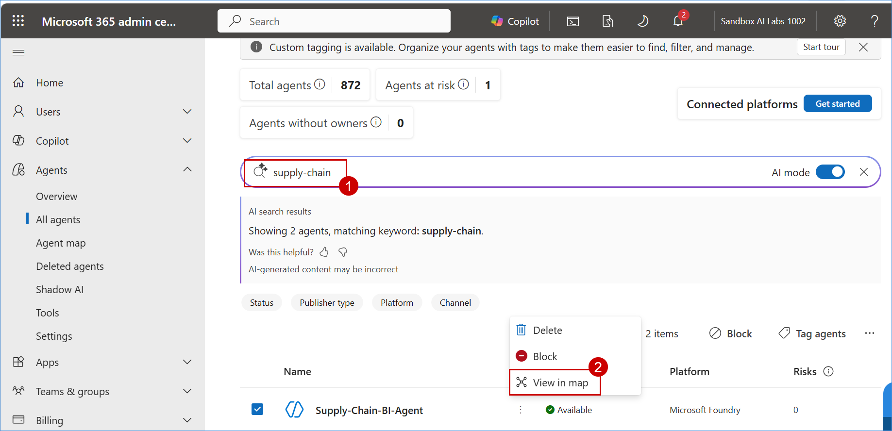

1. Review the agent map to understand the agent's connections and dependencies, including the configured tools, connected data agents, SharePoint resources, and associated users.

   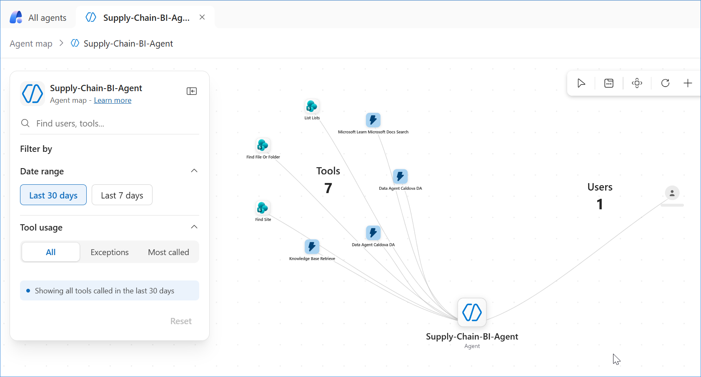

1. Verify that the required tools and resources are connected to the **Supply-Chain-BI-Agent** and review the available tool usage information.

1. Use the agent map to understand how the agent interacts with its connected tools and resources to support supply-chain business queries.

---
### Activity 4.2 – Review Identity and Security Controls

Review the relationship between agent identity, Microsoft Entra ID, Microsoft Purview, Foundry guardrails, and Microsoft Defender to understand how the AI agent is authenticated, authorized, governed, and protected.

### 1. Agent Identity and Microsoft Entra ID

- Review how the agent is identified and authenticated when accessing connected tools, data sources, and other agents.
- Understand how Microsoft Entra ID supports authentication, access control, identity management, and permissions for users and applications.
- Verify that the agent and its connected resources use appropriate identities and least-privilege access.
- Review how user identities, application identities, and delegated permissions are handled when the agent invokes tools or accesses enterprise data.

### 2. Microsoft Purview – Data Governance and Compliance

- **Data Catalogue:** Discover enterprise data assets and manage business and technical metadata.
- **Data Classification:** Identify sensitive and regulated data that the agent may access or process.
- **Data Lineage:** Trace data movement and transformations across supported data and analytics workflows.
- **Data Quality:** Monitor data quality rules, issues, and quality insights to support reliable AI responses.
- **Compliance and Privacy:** Support regulatory requirements, data policies, retention, and privacy governance.
- Review how data governance policies and sensitivity labels apply to the data used by the agent, where supported.

### 3. Microsoft Foundry Guardrails – Responsible AI Protection

- Review configured guardrails that help protect the agent against unsafe or inappropriate inputs and outputs.
- Understand how content safety filters help detect harmful content and reduce unsafe responses.
- Evaluate protection against prompt injection and attempts to manipulate the agent into ignoring its instructions, where supported by the configured safeguards.
- Review how input validation, output filtering, and grounding help improve the reliability and safety of agent responses.
- Verify that guardrails are configured appropriately for the agent's business use case and connected tools.

### 4. Microsoft Defender – Security Posture and Threat Protection

- **AI Security:** Assess AI application and agent security posture, identify supported AI risks, and improve protection of AI workloads.
- **Cloud Security Posture:** Identify misconfigurations, vulnerabilities, and exposed cloud resources across supported environments.
- **Data and Workload Protection:** Detect threats affecting supported databases, storage, virtual machines, containers, and cloud workloads.
- **Threat Detection and Response:** Correlate alerts, investigate suspicious activity, and support incident response.
- **Identity Threat Protection:** Identify compromised identities and risky access patterns using relevant Defender identity capabilities alongside Microsoft Entra ID controls.
- **Security Governance:** Prioritize remediation and track security posture to support enterprise readiness and compliance.

### 5. Understand How the Components Work Together

Review the following relationships:

- **Agent Identity + Microsoft Entra ID:** Establish and manage the identity used to authenticate the agent and control access to connected resources.
- **Microsoft Entra ID + Microsoft Purview:** Support identity-based access controls alongside data discovery, classification, and governance policies.
- **Microsoft Purview + Foundry Guardrails:** Complement data governance and compliance controls with runtime protections for AI inputs and outputs.
- **Microsoft Defender + Microsoft Entra ID:** Help detect identity-related threats and protect cloud resources and AI workloads.
- **Microsoft Defender + Foundry:** Support AI security posture assessment and threat detection for supported AI resources and integrations.
- **Overall Security:** Combine identity management, least-privilege access, data governance, AI safety controls, and threat protection to help secure the Supply-Chain-BI-Agent.

---
### Activity 4.4 – Review the Security Event

Review the agent's details, connected tools, security protections, permissions, and usage activity in Microsoft Agent 365. Investigate exceptions and available security findings using the linked Microsoft security portals.

1. Select the **Details** tab.

1. Review the agent's availability and platform.

1. Under **Overview**, inspect the following details:
   - Created and last-updated dates
   - Last published and last-used dates
   - Channel and publisher information
   - Publisher type and owner
   - Created-by information and Entra agent ID

1. Identify any missing or incomplete metadata.

   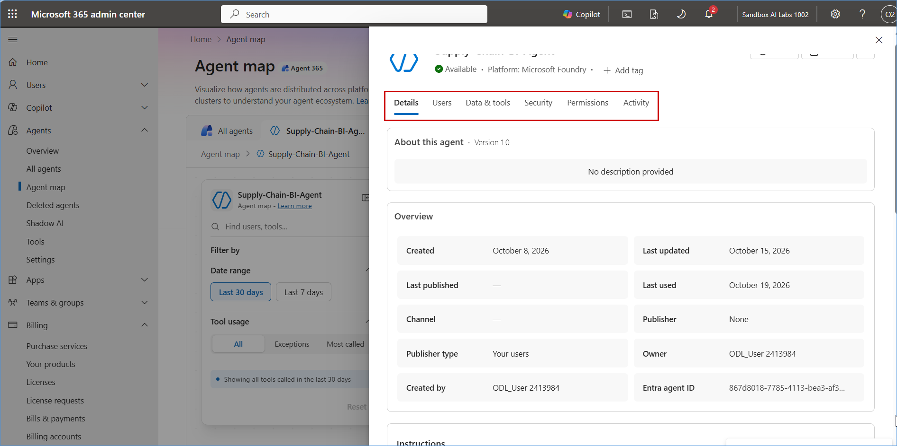

1. Select the **Data & tools** tab.

1. Review the agent's capabilities and data-access information.

1. Check the **Can read** and **Graph connectors** fields.

1. Under **Tools**, inspect the configured tools, such as:
   - `knowledge-base`
   - `WorkIQSharePoint2`

1. Verify that the listed tools are expected and appropriate for the agent's purpose.

   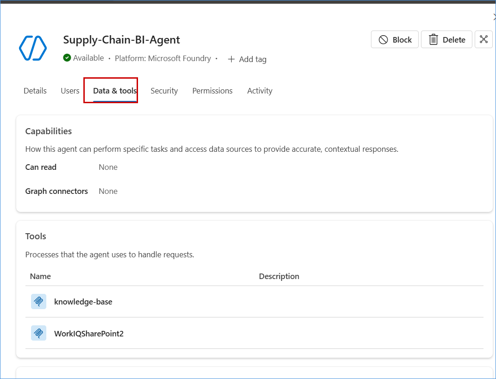

1. Select the **Activity** tab.

1. Review the selected date range and the last activity date.

1. Under **Usage**, examine the available metrics:
   - **Active users** – number of users who interacted with the agent.
   - **Sessions** – number of recorded agent sessions.
   - **Exceptions** – recorded exceptions during agent activity.
   - **Agent run-time** – recorded agent execution time.

1. Review the **Active users over time** chart to identify usage patterns.

1. Review the **Sessions over time** chart to compare successful sessions and exceptions.

   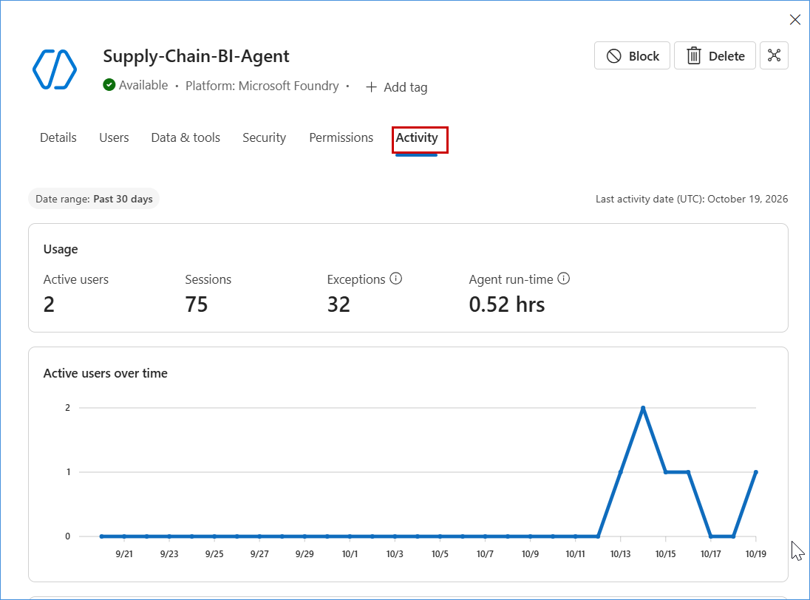

1. Scroll down to the **Active users** table to inspect total sessions and last activity dates.

   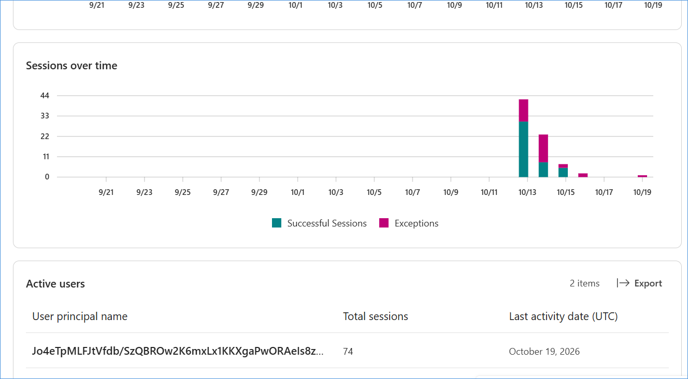

1. Select the **Permissions** tab.

1. Review the permissions associated with the agent.

1. Select **See in portal** to open the relevant Defender for Cloud Apps view, where available.

1. Select **View Permissions** to inspect the associated permissions in Microsoft Entra.

   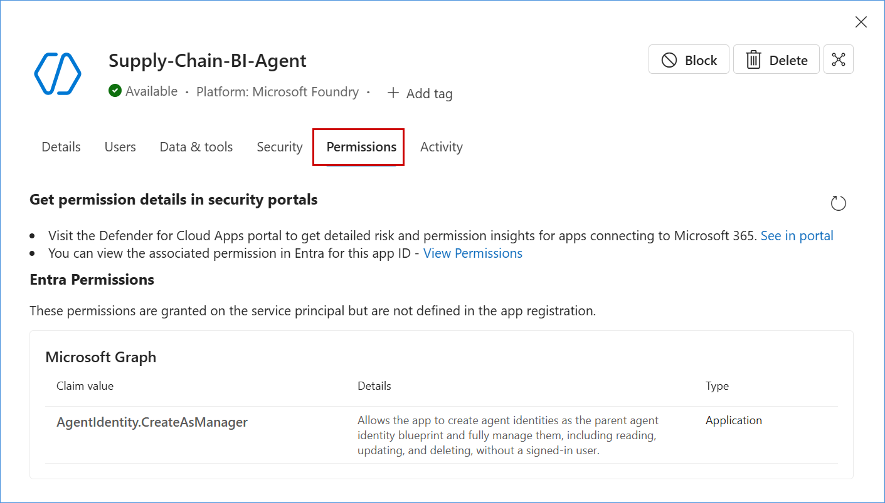

1. Select the **Security** tab.

1. Under **Enabled policies and protections**, review the available Microsoft Purview protections.

1. Select **View agent activity** under *Monitor agent activity* to inspect monitored interactions.

1. Select **View sensitive interactions** under *Protect sensitive data* to review available sensitive-data findings.

1. Under *Evaluate compliance gaps*, select **Review** to inspect the available AI baseline assessment and compliance findings.

1. Review the Microsoft Entra protections displayed on the page, if available.

1. Document any findings and recommended actions.

   

After completing this activity, participants should be able to:

- Locate and review an agent in Agent 365.
- Identify configured tools and data-access capabilities.
- Review available security protections and compliance findings.
- Inspect agent permissions and navigate to the relevant security portals.
- Analyze usage metrics, exceptions, and session trends.
- Investigate available security events and document remediation actions.

---
### Activity 4.5 – Test Sensitive Data Protection

Test how the AI agent handles restricted R&D information stored in SharePoint. Review the agent's response and use Microsoft Purview to investigate sensitive AI interactions, review data protection insights, and identify potential compliance gaps.

1. When you click on Review button in previous sessions it will open new Ui in other tab

1. Open **Compliance Manager** in Microsoft Purview.

1. Select **Overview**.

1. Review the overall compliance score and assessment progress.

1. Navigate to **Assessments** or **Improvement actions**, if required.

1. Review recommendations relevant to data protection, access control, and AI governance.

1. Record any applicable recommendations for follow-up.

   

1. Select **Data Security Investigations** from the left navigation pane.

1. On the **Overview** page, locate the section **Investigate faster with a search template**.

   

1. In Microsoft Purview, open **Data Loss Prevention**.

1. Navigate to the analytics or recommendations section available in your tenant.

1. Review the recommended task **Turn on analytics for risk detection and policy refinement (preview)**, if displayed.

1. If authorized, follow the portal guidance to enable analytics in the lab environment.

1. Review the available risk insights and recommendations for improving data protection policies.

   


> Note: Enabling analytics may require administrator permissions. Do not modify production policies without approval.

---
### Activity 4.6 – Review Cost and Model Economics

The **Billing** section in the Microsoft 365 admin center allows administrators to manage the organization's Microsoft products, subscriptions, licenses, and billing-related settings.

1. Navigate back to Microsoft 365 admin center.

1. Expand **Billing** in the left navigation pane.

1. Select **Your products** to view the products and subscriptions owned by the organization.

   

### Key Capabilities

- **Purchase services:** Explore and purchase additional Microsoft products and services.
- **Your products:** View purchased products, subscription status, assigned licenses, purchased quantity, and available licenses.
- **Licenses:** Review and manage the organization's available licenses and assignments.
- **License requests:** Review and manage requests for product licenses.
- **Bills & payments:** Review billing statements, invoices, and payment-related information.
- **Billing accounts:** View and manage billing account details.
- **Payment methods:** Manage the payment methods associated with billing accounts.
- **Billing notifications:** Configure or review notifications related to billing activities.
- **Pay-as-you-go:** Review and manage applicable pay-as-you-go billing arrangements.

### Review Your Products

1. Navigate to **Billing → Your products**.

   

1. Select the **Products** tab to review the organization's purchased products and subscriptions.

1. Review the following information:

   - **Product name:** Name of the Microsoft product or subscription.
   - **Assigned licenses:** Number of licenses currently assigned.
   - **Purchased quantity:** Total number of licenses purchased.
   - **Available licenses:** Number of licenses available for assignment.
   - **Subscription status:** Current status of the subscription.

1. Use the search bar and filters to locate specific products or narrow the results by subscription status or billing profile.

1. Use **Export to CSV** to export the displayed product information for reporting or further analysis.

1. Select a product to review its available management and billing settings.

> **Note:** Available options depend on the organization's subscriptions, billing arrangement, administrator permissions, and Microsoft 365 configuration.

#### Congratulations! You have successfully completed the `Rapid Prototyping using GitHub Copilot` session.
