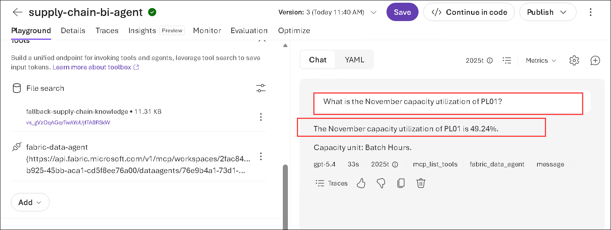
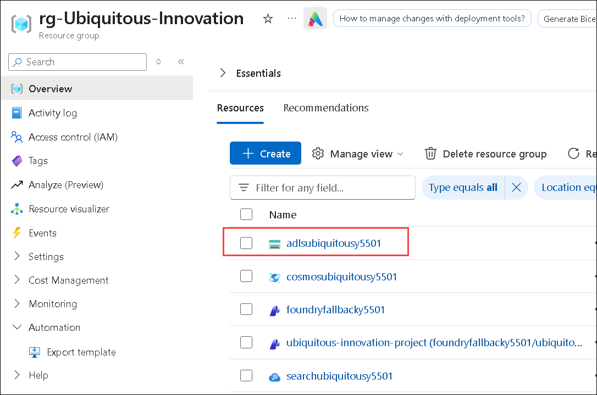
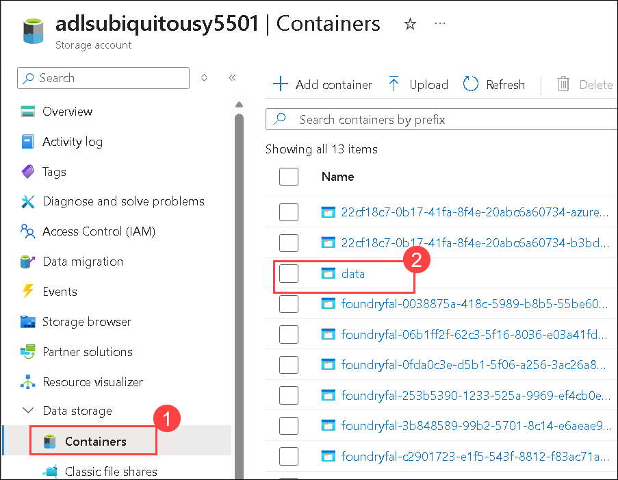
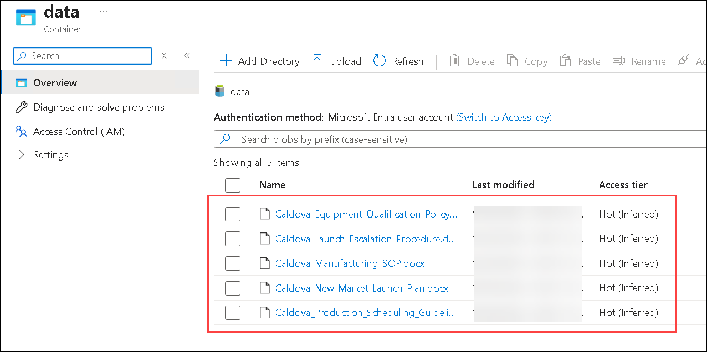
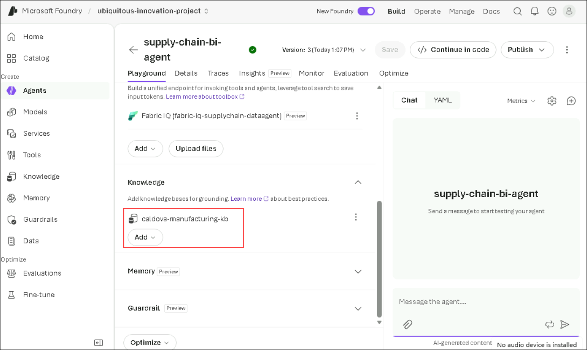
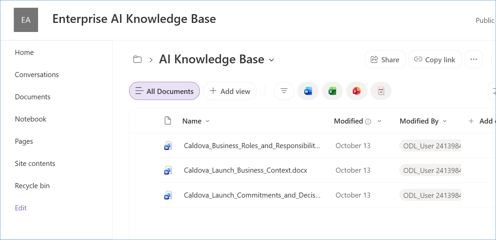

# Ubiquitous Innovation Package

Now that you have deployed the generated template with GitHub Copilot, let’s explore a similar, pre-deployed solution. 

1. Navigate to the **Azure portal**. Select **Resource group**.

   

1. Select the pre deployed **rg-Ubiquitous-Innovation** resource group.

      

1. See the deployed resources.

    


### Let's explore how `business data, Microsoft Fabric Data Agent, Foundry IQ, and Work IQ` can provide that context.

## Agents That Know Your Business 

### Activity 2.1: Connect Live Manufacturing Context

The existing Business Intelligence agent needs access to live manufacturing data to answer questions about plant capacity, production schedules, and operational readiness. In this activity, we will connect the existing Fabric Data Agent from the `Caldova_UI` workspace to the Foundry agent using tool calling.

### Verify the Existing Fabric Data Agent

Before adding the **Data Agent** to the Microsoft Foundry agent, verify that the required Data Agent is available in the provided Fabric workspace.

1. Click on the **App launcher (1)** and select **Microsoft fabric (2)** icon.

   

1. Navigate to **Workspaces (1)**, there should be workspace created with the name starting with  **Ubiquitous-Innovation (2)**. Select the workspace. 

   

1. Verify that the **Ubiquitous_Innovation_DataAgent** Data Agent is listed in the workspace, as shown in the reference screenshots.

   

   >**Note:** Confirm that the Data Agent is available before proceeding to the next activity.

1. To verify that the **Fabric Data Agent** is attached under the **Tools** section of the existing Foundry agent. Navigate to **Azure portal**.

1. Navigate to **rg-Ubiquitous- Innovation** and select the **ubiquitous-innoation-project (2)**.

   

1. Click **Go to Foundry**.

1. Navigate to **Agents (1)** and then select **supply-chain-bi-agent (2)**.

   

1. Verify that the **Fabric Data Agent** is attached under the **Tools** section.

      

1. Confirm that the Data Agent is connected and configured correctly.

1. Copy the following prompt and paste it into the **Agent Playground**:

   ```
   What is the November capacity utilization of PL01?
   ```

1. Review the response provided by the Foundry agent and verify that it retrieves the expected manufacturing data through the Fabric Data Agent.

   


### Activity 2.2: Ground the Agent with Enterprise Knowledge

Operational data alone may not explain the procedures and constraints that influence manufacturing decisions. The agent also needs access to Caldova's manufacturing documents, including scheduling guidance and relevant procedures.

In this activity, we will create a Foundry IQ knowledge base from the existing documents stored in Azure Blob Storage and connect it to the Knowledge section of the existing Foundry agent.

### Verify the SharePoint Source Documents in Azure Blob Storage

Before connecting the enterprise knowledge source, verify that the required documents are available in the provided **Azure Storage account**.

1. Navigate to the Azure portal and open **rg-Ubiquitous-Innovation** resource group.

1. Under Resources, locate and open the storage account with the name starts with **adlsubiquitous**.

   

1. Click on **Containers (1)** under **Data Storage** and open the **data (2)** container.

   

1. Verify that the following documents are available:

   

Confirm that all five documents are present before proceeding with the knowledge source configuration.

1. Navigate back to the **Agent** in **Foundry**. Verify that the **Foundry IQ knowledge base** is configured under the **Knowledge** section of the existing Foundry agent.

   

1. Confirm that the knowledge base is connected properly and the relevant manufacturing documents are available for retrieval.

1. Copy the following prompt and paste it into the **Agent Playground**:

   ```
   According to Caldova's scheduling guidance, what should we consider when planning a production batch?
   ```

1. Review the response provided by the Foundry agent and verify that it uses the relevant manufacturing documents to provide a grounded answer.

   

### Activity 2.3: Add Organizational Context

To make better launch decisions, the Business Intelligence agent must understand not only manufacturing operations and procedures, but also Caldova's business priorities, commitments, and team responsibilities.

In this activity, we will connect the existing SharePoint source through ****Work IQ**** as a tool for the existing Microsoft Foundry agent.

### Verify the SharePoint Knowledge Base Documents

Before connecting the enterprise knowledge source to the agent, verify that the required documents are available in SharePoint.

1. Open the [Enterprise AI Knowledge Base – SharePoint](https://sandboxailabs1002.sharepoint.com/sites/EnterpriseAIKnowledgeBase/Shared%20Documents/Forms/AllItems.aspx?id=%2Fsites%2FEnterpriseAIKnowledgeBase%2FShared%20Documents%2FAI%20Knowledge%20Base&viewid=2aae9886%2D5883%2D4e2a%2D8949%2D612beaeb50ac&newTargetListUrl=%2Fsites%2FEnterpriseAIKnowledgeBase%2FShared%20Documents&viewpath=%2Fsites%2FEnterpriseAIKnowledgeBase%2FShared%20Documents%2FForms%2FAllItems%2Easpx) link.

1. Verify that the following documents are available:
   - `Caldova_Business_Roles_and_Responsibilities.docx`
   - `Caldova_Launch_Business_Context.docx`
   - `Caldova_Launch_Commitments_and_Decisions.docx`

1. Confirm that all three documents are present and accessible.

   

1. Navigate back to the **Foundry Agent.**

1. Lets add the **SharePoint** under the **Tools** section of the existing Foundry agent.

1. 


