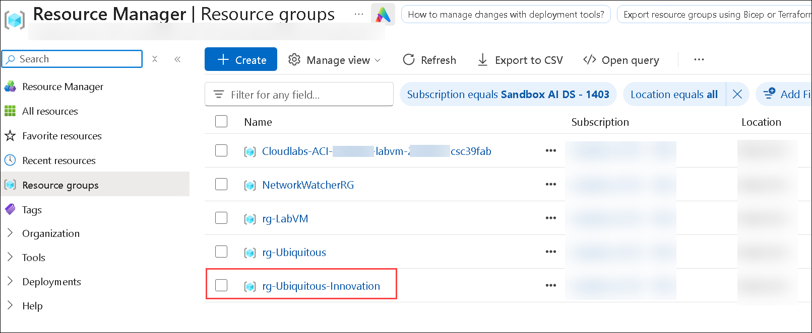
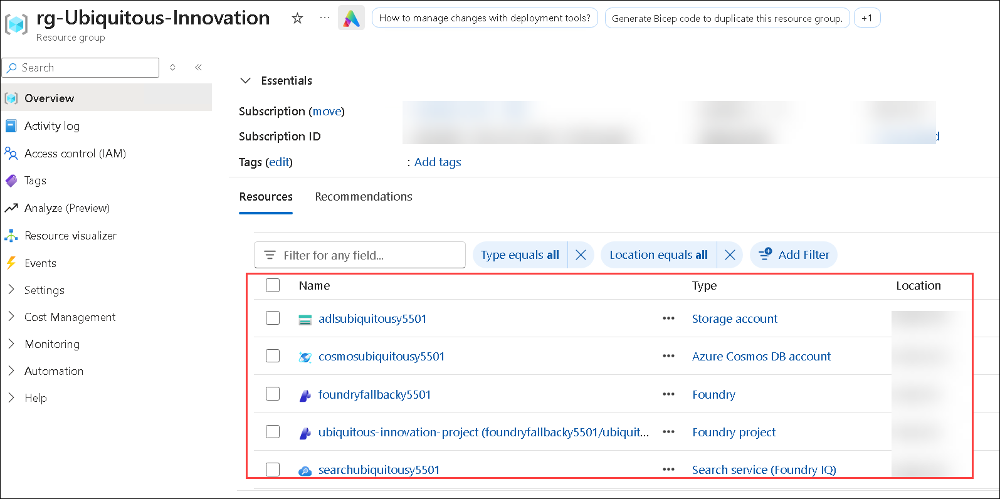
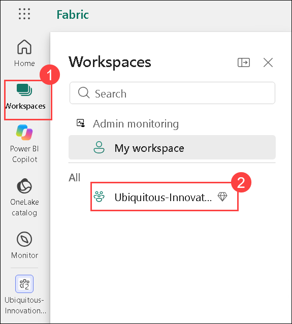
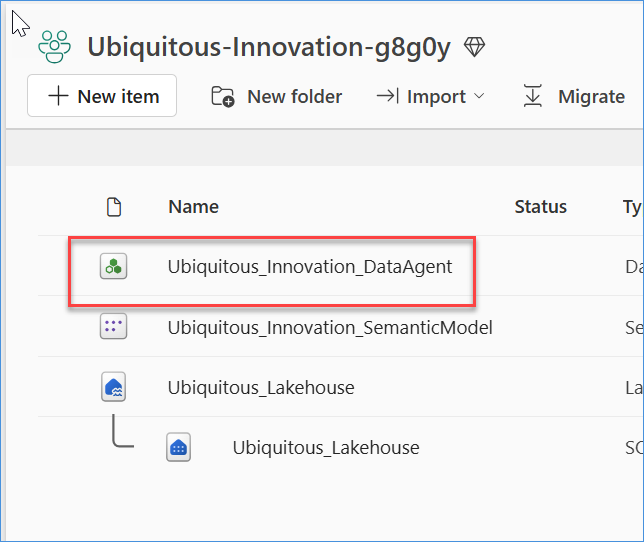
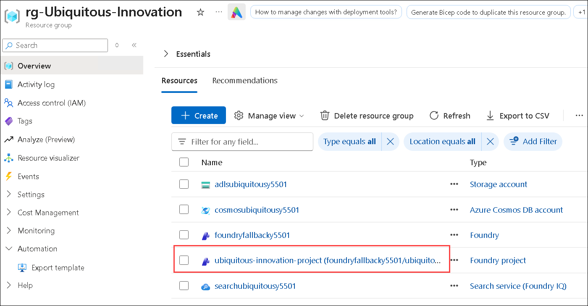
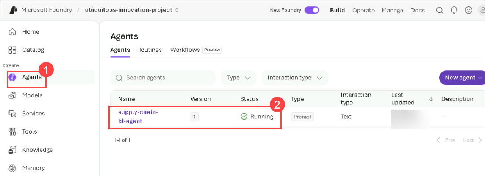
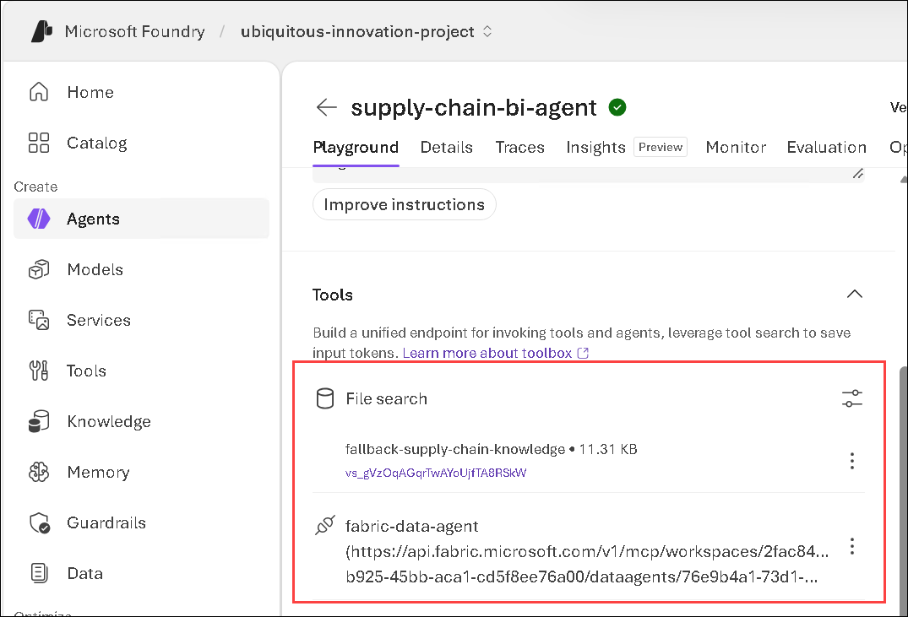

# Ubiquitous Innovation Package

Now that you have deployed the generated template with GitHub Copilot, let’s explore a similar, pre-deployed solution. 

1. Navigate to the **Azure portal**. Select **Resource group**.

   

1. Select the pre deployed **rg-Ubiquitous-Innovation** resource group.

      

1. See the deployed resources.

    

### Let's explore how `business data, Microsoft Fabric Data Agent, Foundry IQ, and Work IQ` can provide that context.

## Agents That Know Your Business 

### Connect Live Manufacturing Context**

The existing Business Intelligence agent needs access to live manufacturing data to answer questions about plant capacity, production schedules, and operational readiness. In this activity, we will connect the existing Fabric Data Agent from the `Caldova_UI` workspace to the Foundry agent using tool calling.

### Verify the Existing Fabric Data Agent

Before adding the **Data Agent** to the Microsoft Foundry agent, verify that the required Data Agent is available in the provided Fabric workspace.

1. Click on the **App launcher (1)** and select **Microsoft fabric (2)** icon.

   

1. Navigate to **Workspaces (1)**, there should be workspace created with the name starting with  **Ubiquitous-Innovation (2)**. Select the workspace. 

   

1. Verify that the **Ubiquitous_Innovation_DataAgent** Data Agent is listed in the workspace, as shown in the reference screenshots.

   

   >**Note:** Confirm that the Data Agent is available before proceeding to the next activity.

1. To verify that the **Fabric Data Agent** is attached under the **Tools** section of the existing Foundry agent. Navigate to **Azure portal**.

1. Navigate to **rg-Ubiquitous- Innovation** and select the **ubiquitous-innoation-project (2)**.

   

1. Click **Go to Foundry**.

1. Navigate to **Agents (1)** and then select **supply-chain-bi-agent (2)**.

   

1. Verify that the **Fabric Data Agent** is attached under the **Tools** section.

      